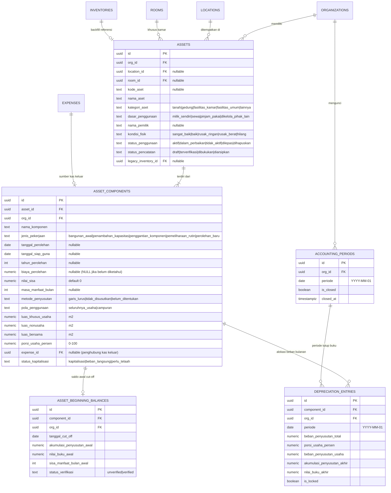
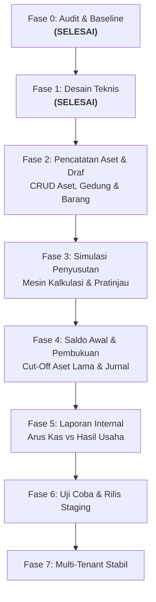

# Dokumen Audit & Desain Teknis: Modul Aset & Inventaris SimKos
**Fase 0 (Audit & Baseline) & Fase 1 (Desain Teknis)**
*Tanggal: 7 November 2026 | Branch: `feat/aset-inventaris-audit-desain` | Baseline Commit: `b563f8f`*

---

## 1. Laporan Audit & Kondisi Baseline (Fase 0)

### 1.1 Status Repositori & Environment
- **Active Branch**: `feat/aset-inventaris-audit-desain` (dibuat dari `main` commit `b563f8f`).
- **Baseline Commit**: `b563f8f847591164cb761e86a1cbd7bf078d1150` (*"feat: tambahkan fitur pagination pada semua menu yang menampilkan list data"*).
- **Remote**: `origin` -> `https://github.com/rhesal/simkos-v2.git`.
- **Working Tree**: Bersih, perubahan mode file QA dinormalkan, mockup diekstrak di `references/mockup-aset`.
- **Build Status**: `npm run build` sukses 100% (531ms), 29 precache assets PWA.
- **Test Suite Baseline**: `node --test qa/**/*.test.mjs` -> **80/80 tests passing** (0 gagal, 0 diskip).

### 1.2 Tech Stack & Pola Akses Supabase
- **Frontend**: Vue.js 3.5 (Composition API, `<script setup>`), Vite 8.1, Tailwind CSS v4, Vue Router 4, Vite PWA (Workbox).
- **Database**: PostgreSQL di Supabase dengan RLS aktif.
- **Pola Akses**: Client `@supabase/supabase-js` menggunakan Anon Key di browser. Tidak ada Service Role Key di client.
- **Multi-Tenancy & Isolasi**:
  - Organisasi merepresentasikan entitas usaha kos (`public.organizations` & `public.organization_members`).
  - Kolom `org_id` diterapkan di seluruh tabel aplikasi dengan default `public.current_org_id()`.
  - Penegakan RLS menggunakan fungsi Security Definer `public.is_org_member(org_id)` untuk operasi SELECT, INSERT, UPDATE, DELETE.
  - Role anggota: `admin`, `owner`, `staff` (Migration 500).
  - Storage: Bucket privat `ktp_images` dan `receipt_images` dengan isolasi path wajib `<org_id>/...`.

### 1.3 Audit Skema Data Eksisting
Tabel-tabel relevan yang diaudit:
1. `public.organizations` & `organization_members`: Mengunci multi-tenancy per usaha.
2. `public.locations`: Menyimpan lokasi kos fisik (`id`, `nama_lokasi`, `alamat`, `org_id`).
3. `public.rooms`: Menyimpan kamar kos (`id`, `location_id`, `nomor_kamar`, `harga_harian`, `harga_bulanan`, `status_kamar`, `org_id`).
4. `public.tenants`: Menyimpan identitas penghuni, kontak, alamat asal, dan KTP.
5. `public.rentals`: Relasi sewa aktif/non-aktif (`room_id`, `tenant_id`, `tipe_sewa`, `tanggal_masuk`, `tanggal_jatuh_tempo`, `status_aktif`, `org_id`).
6. `public.incomes`: Penerimaan kas (`rental_id`, `tanggal_bayar`, `nominal`, `kategori`, `metode_bayar`, `status_bayar`, `periode_bayar`, `org_id`).
7. `public.expenses`: Pengeluaran kas (`location_id` nullable untuk tagihan bersama, `tanggal_pengeluaran`, `kategori`, `nominal`, `keterangan`, `bukti_nota_url`, `org_id`).
8. `public.inventories`: Inventaris barang lama (`id`, `location_id`, `room_id`, `nama_barang`, `kondisi`, `catatan`, `org_id`, plus migrasi 400: `tanggal_pembelian`, `harga`, `tipe_fasilitas`, `receipt_url`).

### 1.4 Temuan Khusus: Hubungan Pembelian Inventaris vs Pengeluaran (`expenses`)
- **Status Audit**: **SAMA SEKALI BELUM TERHUBUNG**.
- **Detail**:
  - Saat pengguna mencatat barang di `src/views/InventarisView.vue`, data hanya disimpan ke tabel `inventories` (termasuk kolom `harga` dan `receipt_url`). Tidak ada pencatatan kas keluar di `expenses`.
  - Sebaliknya, di `src/views/TambahPengeluaranView.vue`, pencatatan pengeluaran (misal belanja peralatan/aset) disimpan mandiri di `expenses` tanpa foreign key atau link ke `inventories`.
- **Implikasi Arsitektural**:
  - Jika pengguna mencatat beli AC di `TambahPengeluaranView` dan mencatat barang di `InventarisView`, sistem saat ini menganggap keduanya dua entitas terpisah.
  - Jika penyusutan diterapkan tanpa rekonsiliasi, ada risiko *double counting*: uang keluar dihitung saat beli, lalu nilai barang dibebankan lagi via penyusutan.
  - Solusi Fase 1: Sediakan kolom `expense_id` (nullable) pada komponen aset untuk menghubungkan aset dengan transaksi pengeluaran kas sumbernya.

### 1.5 Verifikasi 4 Temuan Awal Aplikasi
Berdasarkan pemeriksaan langsung terhadap kode sumber:

| No | Temuan Awal | Status Aktual | Referensi Kode & Bukti | Rekomendasi / Rencana Perbaikan Terpisah |
|---|---|---|---|---|
| 1 | Insert pembayaran dan update jatuh tempo dilakukan terpisah | **MASIH TERJADI** | `src/views/TambahPemasukanView.vue` (L351-370) dan `src/views/BerandaView.vue` (L1078-1092). Keduanya memanggil `supabase.from('incomes').insert` lalu `supabase.from('rentals').update`. | Buat fungsi Database RPC atomik (`record_rent_payment`) di backlog perbaikan sewa (terpisah dari roadmap modul aset). |
| 2 | Pesan berhasil muncul meskipun update jatuh tempo gagal | **MASIH TERJADI** | `src/views/TambahPemasukanView.vue` (L372-380) dan `src/views/BerandaView.vue` (L1094-1103). Blok `if (updateRentalError)` hanya menulis `console.warn`, lalu eksekusi berlanjut menampilkan pesan sukses kepada pengguna. | Perbaiki agar jika langkah kedua gagal, pesan peringatan eksplisit ditampilkan atau seluruh aksi di-rollback via RPC atomik. |
| 3 | Pembayaran positif memajukan jatuh tempo 1 bulan tanpa perhitungkan nominal/periode | **MASIH TERJADI** di form input, namun **SUDAH DIMULAI PERBAIKAN** pada perhitungan display radar | `TambahPemasukanView.vue` (L365) memanggil `advanceOneMonth` tanpa cek sisa tagihan. Namun di radar/dashboard, baru saja dipasang `calculateEffectiveDueDate` (`src/lib/sewa.js`) yang menghitung jatuh tempo dinamis dari riwayat pembayaran. | Samakan logika form input dengan mesin perhitungan efektif `calculateEffectiveDueDate` agar konsisten secara bisnis. |
| 4 | Respons pengambilan rental dapat menimpa pilihan kamar yang lebih baru (Race Condition) | **MASIH TERJADI** | `src/views/TambahPemasukanView.vue` watcher `form.room_id` (L307-339). Tidak ada verifikasi `if (form.room_id !== newRoomId) return` setelah `await supabase`, sehingga respons lambat kamar lama bisa menimpa kamar baru. | Tambahkan guard pengecekan request id / token pembatalan pada watcher kamar. |

---

## 2. Audit Mockup Interaktif (`SimKos_Mockup_Aset_Antigravity.zip`)

Mockup diekstrak ke `references/mockup-aset/SimKos_Mockup/`.

### 2.1 Analisis Fitur & Interaksi Mockup
- **Navigasi Bawah**: Mempertahankan 5 menu (`Beranda`, `Keuangan`, `Aset`, `Riwayat`, `Penghuni`).
- **Daftar Aset**: Menampilkan kartu ringkasan biaya aset terdata, estimasi nilai buku, dan aset yang perlu dilengkapi data. Tab kategori: *Semua*, *Tanah & Gedung*, *Fasilitas Kamar*, *Fasilitas Umum*.
- **Form Gedung Bertahap (Wizard 4 Langkah)**:
  1. *Identitas*: Nama gedung, nama pemilik aset (dapat berbeda dari pengelola akun), dasar penggunaan (Milik sendiri, Sewa, Pinjam pakai, Dikelola untuk pihak lain), jenis aset (Gedung).
  2. *Penggunaan*: Pola penggunaan (Campuran, Seluruhnya usaha), luas kos ($m^2$), luas nonusaha ($m^2$), luas bersama ($m^2$).
  3. *Biaya & Riwayat*: Tahun mulai digunakan (bebas tanpa paksaan 1 Jan), biaya pembangunan awal, tanggal siap guna, pengembangan/renovasi opsional (tahun, jenis pekerjaan, biaya, tanggal siap guna), estimasi masa manfaat (tahun) dan nilai sisa.
  4. *Pratinjau*: Ringkasan beban per bulan penuh dan porsi usaha.
- **Detail Aset**: Menampilkan kondisi, pemilik, jadwal penyusutan, dan kartu sisa nilai buku.
- **Keuangan**: Tab **Arus Kas** (fokus penerimaan & kas keluar riil) vs **Hasil Usaha** (fokus pendapatan periode, beban operasional, dan penyusutan).

### 2.2 Kekurangan Mockup yang Wajib Diperbaiki pada Implementasi Nyata
1. **Formula Luas Bersama Terabaikan di Kode Mockup**:
   - Di `index.html` mockup, formula JavaScript tertulis: `k+f ? 100*k/(k+f) : 0` (hanya membagi luas kos dengan total luas kos + keluarga, mengabaikan variabel `shared`).
   - *Perbaikan Produksi*: Wajib mengimplementasikan formula lengkap alokasi area bersama:
     $$p = \frac{\text{luas\_usaha}}{\text{luas\_usaha} + \text{luas\_nonusaha}}$$
     $$\text{luas\_usaha\_efektif} = \text{luas\_usaha} + (p \times \text{luas\_bersama})$$
     $$\text{porsi\_usaha} = \frac{\text{luas\_usaha\_efektif}}{\text{total\_luas}} \times 100\%$$
2. **Tanah & Gedung Digabung di Mockup**:
   - Mockup menampilkan tab "Tanah & Gedung". Secara akuntansi dan instruksi produk, **tanah harus dicatat terpisah dari bangunan** karena tanah tidak disusutkan.
   - *Perbaikan Produksi*: Sediakan kategori terpisah untuk Tanah (tidak disusutkan) dan Gedung (disusutkan).
3. **Jadwal Penyusutan Di-hardcode**:
   - Jadwal penyusutan pada modal detail mockup menggunakan deret statis AC, lemari, pompa.
   - *Perbaikan Produksi*: Jadwal harus dihitung secara komputasi dinamis dari data aset aktual komponen bersangkutan.
4. **Penyimpanan Draf Hanya di Memori Sesi Browser**:
   - Mockup hanya menyimpan draf di variabel memori JS lokal.
   - *Perbaikan Produksi*: Status draf disimpan ke database Supabase dengan status `draft` sehingga aman saat berpindah perangkat.
5. **Form Hanya Ada untuk Gedung**:
   - Mockup hanya mendemonstrasikan form gedung bertahap.
   - *Perbaikan Produksi*: Aset sederhana (barang fasilitas kamar/umum) menggunakan form ringkas 1 layar (melanjutkan format `InventarisView` yang sudah familiar bagi user), sedangkan Gedung menggunakan wizard bertahap.

---

## 3. Desain Teknis Data Aset & Inventaris (Fase 1)

### 3.1 Pemisahan Konsep Entitas & Multi-Tenancy
Untuk mengakomodasi fleksibilitas gedung bertahap, penambahan komponen, serta inventaris barang sederhana, data dipisahkan menjadi 5 entitas inti:
1. **Identitas Aset (`assets`)**: Menyimpan identitas fisik, kategori aset (tanah, gedung, fasilitas kamar, fasilitas umum), dasar penguasaan, pemilik sah, lokasi, kamar, kondisi, dan status lifecycle aset.
   - *Pemisahan Entitas*: Akun pengguna yang mengelola aplikasi berbeda dari pemilik aset. Pemilik aset dicatat pada `nama_pemilik` bebas, sedangkan organisasi pencatat diikat oleh `org_id`.
2. **Komponen / Pengembangan Aset (`asset_components`)**: Menyimpan data finansial biaya perolehan, tanggal siap guna, penambahan/renovasi gedung bertahap, pola penggunaan (campuran vs usaha), alokasi biaya dari transaksi pengeluaran (`expense_id` dan `allocated_cost`), dan parameter penyusutan.
   - *Pemisahan Gedung Induk vs Komponen Renovasi (Leasehold Improvement)*: Jika gedung berstatus sewa/milik pihak lain, gedung induk tidak disusutkan oleh penyewa. Namun renovasi atau penambahan kamar yang dibiayai oleh organisasi kos tetap dapat dikapitalisasi dan disusutkan selama masa manfaat/sewa. Kasus yang belum jelas diklasifikasikan sebagai `perlu_telaah`.
3. **Ambang Batas Kapitalisasi Organisasi (`organizations.capitalization_threshold`)**: Nilai nominal minimum yang dapat dikonfigurasi per organisasi (nullable). Tidak ada nominal baku hardcoded.
4. **Saldo Awal Aset Lama (`asset_beginning_balances`)**: Menyimpan cut-off nilai historis aset lama sebelum dicatat di SimKos (akumulasi penyusutan masa lalu dan nilai buku awal). Tanggal cut-off boleh kosong pada Fase 2 dan wajib diverifikasi sebelum aktivasi saldo awal di Fase 4.
5. **Pencatatan Penyusutan Periodik (`depreciation_entries`)**: Jurnal / buku pembantu penyusutan bulanan yang telah dikunci atau dibukukan. Draf pada Fase 2 tidak menghasilkan pencatatan jurnal atau mutasi kas.
6. **Penguncian Periode Buku (`accounting_periods`)**: Tabel kontrol periode pembukuan untuk mencegah modifikasi data masa lalu yang sudah ditutup.

### 3.2 Diagram Entitas Hubungan (ERD)



### 3.3 Struktur Kolom Detail & Constraint Database

```sql
-- 1. Tabel Identitas Aset
create table public.assets (
  id uuid primary key default gen_random_uuid(),
  org_id uuid not null references public.organizations(id) on delete cascade,
  location_id uuid references public.locations(id) on delete set null,
  room_id uuid references public.rooms(id) on delete set null,
  kode_aset text,
  nama_aset text not null check (length(btrim(nama_aset)) > 0),
  kategori_aset text not null check (kategori_aset in ('tanah', 'gedung', 'fasilitas_kamar', 'fasilitas_umum', 'kendaraan', 'elektronik_kantor', 'lainnya')),
  dasar_penggunaan text not null default 'milik_sendiri' check (dasar_penggunaan in ('milik_sendiri', 'sewa', 'pinjam_pakai', 'dikelola_pihak_lain')),
  nama_pemilik text,
  kondisi_fisik text not null default 'baik' check (kondisi_fisik in ('sangat_baik', 'baik', 'rusak_ringan', 'rusak_berat', 'hilang')),
  status_penggunaan text not null default 'aktif' check (status_penggunaan in ('aktif', 'dalam_perbaikan', 'tidak_aktif', 'dilepas', 'dihapuskan')),
  status_pencatatan text not null default 'draft' check (status_pencatatan in ('draft', 'terverifikasi', 'dibukukan', 'diarsipkan')),
  catatan text,
  legacy_inventory_id uuid references public.inventories(id) on delete set null,
  created_by uuid references auth.users(id),
  updated_by uuid references auth.users(id),
  created_at timestamptz not null default now(),
  updated_at timestamptz not null default now()
);

-- Index performa & keunikan
create index idx_assets_org_kategori on public.assets(org_id, kategori_aset);
create index idx_assets_location on public.assets(location_id);
create index idx_assets_room on public.assets(room_id);

-- 2. Tabel Komponen & Pengembangan Aset
create table public.asset_components (
  id uuid primary key default gen_random_uuid(),
  asset_id uuid not null references public.assets(id) on delete cascade,
  org_id uuid not null references public.organizations(id) on delete cascade,
  nama_komponen text not null check (length(btrim(nama_komponen)) > 0),
  jenis_pekerjaan text not null default 'perolehan_baru' check (jenis_pekerjaan in ('bangunan_awal', 'penambahan_kapasitas', 'penggantian_komponen', 'pemeliharaan_rutin', 'perolehan_baru', 'lainnya')),
  tanggal_perolehan date,
  tanggal_siap_guna date,
  tahun_perolehan int check (tahun_perolehan between 1900 and 2100),
  biaya_perolehan numeric check (biaya_perolehan >= 0), -- NULL jika belum diketahui
  nilai_sisa numeric default 0 check (nilai_sisa >= 0 and (biaya_perolehan is null or nilai_sisa <= biaya_perolehan)),
  masa_manfaat_bulan int check (masa_manfaat_bulan > 0),
  metode_penyusutan text not null default 'garis_lurus' check (metode_penyusutan in ('garis_lurus', 'tidak_disusutkan', 'belum_ditentukan')),
  pola_penggunaan text not null default 'seluruhnya_usaha' check (pola_penggunaan in ('seluruhnya_usaha', 'campuran')),
  luas_khusus_usaha numeric default 0 check (luas_khusus_usaha >= 0),
  luas_nonusaha numeric default 0 check (luas_nonusaha >= 0),
  luas_bersama numeric default 0 check (luas_bersama >= 0),
  porsi_usaha_persen numeric not null default 100 check (porsi_usaha_persen >= 0 and porsi_usaha_persen <= 100),
  expense_id uuid references public.expenses(id) on delete set null,
  bukti_dokumen_url text,
  status_kapitalisasi text not null default 'kapitalisasi' check (status_kapitalisasi in ('kapitalisasi', 'beban_langsung', 'perlu_telaah')),
  created_at timestamptz not null default now(),
  updated_at timestamptz not null default now()
);

create index idx_asset_components_asset on public.asset_components(asset_id);
create index idx_asset_components_org on public.asset_components(org_id);
create index idx_asset_components_expense on public.asset_components(expense_id);

-- 3. Tabel Saldo Awal Aset Lama (Cut-Off SimKos)
create table public.asset_beginning_balances (
  id uuid primary key default gen_random_uuid(),
  component_id uuid not null unique references public.asset_components(id) on delete cascade,
  org_id uuid not null references public.organizations(id) on delete cascade,
  tanggal_cut_off date not null check (extract(day from tanggal_cut_off) = 1),
  akumulasi_penyusutan_awal numeric not null default 0 check (akumulasi_penyusutan_awal >= 0),
  nilai_buku_awal numeric not null check (nilai_buku_awal >= 0),
  sisa_manfaat_bulan_awal int not null check (sisa_manfaat_bulan_awal >= 0),
  status_verifikasi text not null default 'unverified' check (status_verifikasi in ('unverified', 'verified')),
  catatan_sumber text,
  created_at timestamptz not null default now()
);

-- 4. Tabel Jurnal / Buku Pembantu Penyusutan Periodik
create table public.depreciation_entries (
  id uuid primary key default gen_random_uuid(),
  component_id uuid not null references public.asset_components(id) on delete restrict,
  org_id uuid not null references public.organizations(id) on delete cascade,
  periode date not null check (extract(day from periode) = 1),
  beban_penyusutan_total numeric not null check (beban_penyusutan_total >= 0),
  porsi_usaha_persen numeric not null check (porsi_usaha_persen >= 0 and porsi_usaha_persen <= 100),
  beban_penyusutan_usaha numeric not null check (beban_penyusutan_usaha >= 0),
  akumulasi_penyusutan_akhir numeric not null check (akumulasi_penyusutan_akhir >= 0),
  nilai_buku_akhir numeric not null check (nilai_buku_akhir >= 0),
  is_locked boolean not null default false,
  posted_at timestamptz not null default now(),
  posted_by uuid references auth.users(id),
  constraint uq_component_periode unique (component_id, periode)
);

create index idx_depreciation_entries_org_periode on public.depreciation_entries(org_id, periode);

-- 5. Tabel Penguncian Periode Akuntansi
create table public.accounting_periods (
  id uuid primary key default gen_random_uuid(),
  org_id uuid not null references public.organizations(id) on delete cascade,
  periode date not null check (extract(day from periode) = 1),
  is_closed boolean not null default false,
  closed_at timestamptz,
  closed_by uuid references auth.users(id),
  constraint uq_org_accounting_period unique (org_id, periode)
);
```

### 3.4 Keamanan, Isolasi Organisasi & RLS
- Seluruh tabel di atas diaktifkan RLS (`alter table ... enable row level security;`).
- Policy `for all using (public.is_org_member(org_id)) with check (public.is_org_member(org_id))`.
- Trigger validasi path dokumen storage: Memastikan file dokumen pendukung aset di bucket `receipt_images` berawalan `<org_id>/...` sama seperti nota inventaris dan nota pengeluaran.
- Penguncian baris (`is_locked`): Trigger guard menolak `UPDATE` atau `DELETE` pada `depreciation_entries` yang periodenya sudah ditutup (`accounting_periods.is_closed = true`).

---

## 4. Spesifikasi Algoritma Penyusutan & Kasus Batas

### 4.1 Logika Inti & Rumus
1. **Dasar Penyusutan (Depreciable Base)**:
   $$B = \text{biaya\_perolehan} - \text{nilai\_sisa}$$
   *Jika biaya perolehan NULL atau metode `tidak_disusutkan`, maka penyusutan = 0.*
2. **Penyusutan Bulanan Penuh**:
   $$\text{Depr}_{\text{bulanan}} = \frac{B}{M}$$
   di mana $M = \text{masa\_manfaat\_bulan}$.
3. **Porsi Beban Usaha**:
   $$\text{Beban Usaha} = \text{Depr}_{\text{bulanan}} \times \frac{\text{Porsi Usaha (\%)}}{100}$$

### 4.2 Formula Penggunaan Campuran (Alokasi Biaya Bersama)
Untuk bangunan atau aset yang digunakan sebagian untuk kos dan sebagian untuk nonusaha (keluarga):
- $L_u$: Luas khusus usaha (kamar kos, resepsionis).
- $L_n$: Luas khusus nonusaha (ruang pribadi keluarga).
- $L_b$: Luas area bersama (dapur bersama, lorong, garasi).
- $L_{\text{total}}$: Luas total fisik = $L_u + L_n + L_b$.

**Aturan Perhitungan:**
1. Hitung rasio usaha terhadap luas khusus:
   $$p = \frac{L_u}{L_u + L_n}$$
   *Penanganan batas (Penyebut Nol):*
   Jika $L_u + L_n = 0$:
   - Sistem **TIDAK menghasilkan persentase otomatis** (tidak boleh mengasumsikan 0% atau 100%).
   - Nilai porsi dikembalikan sebagai `NULL` / status "Belum ditentukan", dan form mewajibkan pengguna mengisi luas khusus sebelum porsi dapat dihitung.
2. Alokasikan luas bersama secara proporsional:
   $$L_{\text{bersama\_usaha}} = p \times L_b$$
   $$L_{\text{bersama\_nonusaha}} = (1 - p) \times L_b$$
3. Luas fisik yang wajib ditampilkan ke pengguna:
   - **Luas Total**: $L_{\text{total}} = L_u + L_n + L_b$
   - **Luas Usaha Efektif**: $L_{\text{efektif}} = L_u + L_{\text{bersama\_usaha}}$
   - **Luas Nonusaha Efektif**: $L_{\text{nonusaha\_efektif}} = L_n + L_{\text{bersama\_nonusaha}}$
4. Porsi Penggunaan Usaha Final (%):
   $$\text{Porsi Usaha (\%)} = \frac{L_{\text{efektif}}}{L_{\text{total}}} \times 100\%$$

*Catatan Matematis*: Alokasi proporsional pada luas bersama secara matematis menghasilkan persentase usaha yang identik dengan $\frac{L_u}{L_u + L_n}$, karena:
$$\frac{L_u + p L_b}{L_u + L_n + L_b} = \frac{p(L_u + L_n) + p L_b}{L_u + L_n + L_b} = \frac{p(L_u + L_n + L_b)}{L_u + L_n + L_b} = p$$
Meskipun persentasenya sama dengan rasio luas khusus, antarmuka aplikasi **wajib menampilkan besaran meter persegi fisik** (Luas Total, Luas Usaha Efektif, dan Luas Nonusaha Efektif) agar pengguna memahami alokasi fisik ruangannya.

### 4.3 Konvensi Prorata, Akhir Masa Manfaat, dan Pembulatan
- **Awal Penyusutan**: Dimulai dari `tanggal_siap_guna` (bukan tanggal perolehan/kontrak jika berbeda).
- **Pembedaan Sisa Prorata vs Selisih Pembulatan**:
  1. *Sisa Prorata (Bulan Parsial)*:
     Jika aset mulai siap digunakan di pertengahan bulan (tanggal $d$ dalam bulan dengan $D$ hari):
     - Hari aktif bulan ke-1: $H_1 = D - d + 1$ (inklusif).
     - Fraksi bulan 1: $F_1 = H_1 / D$.
     - Beban bulan 1: $\text{Depr}_1 = \text{round}(\text{Depr}_{\text{bulanan}} \times F_1)$.
     - Sisa hak masa manfaat pada bulan ke-1 ($1 - F_1$) bukan selisih pembulatan, melainkan masa manfaat yang belum terpakai dan dialokasikan ke periode bulan ke-($M+1$).
  2. *Tanggal Akhir Masa Manfaat*:
     Dihitung secara kalender: `tanggal_siap_guna` $+ M$ bulan (dengan batas inklusif kalender dan penanganan rollover akhir bulan).
  3. *Selisih Pembulatan Desimal (Rounding Discrepancy)*:
     Akibat pembulatan integer mata uang Rupiah per bulan, selisih beberapa rupiah diselesaikan pada bulan terakhir masa manfaat:
     $$\text{Depr}_{\text{akhir}} = B - \sum_{i=1}^{\text{akhir}-1} \text{Depr}_i$$
     Hal ini menjamin 100% mutlak bahwa:
     $$\sum \text{Depr} \equiv B \quad \text{dan} \quad \text{Nilai Buku Akhir} \equiv \text{Nilai Sisa}$$

### 4.4 Verifikasi Fixture Kasus Nyata

#### Fixture 1: Barang Fasilitas Kamar (AC Kamar)
- Biaya Perolehan: **Rp 6.500.000**
- Nilai Sisa: **Rp 500.000**
- Dasar Penyusutan: $6.500.000 - 500.000 = \text{Rp } 6.000.000$
- Masa Manfaat: 60 bulan (5 tahun).
- Porsi Penggunaan Usaha: **100%**.
- **Hasil Perhitungan**:
  - Beban per bulan penuh: $\text{Rp } 6.000.000 / 60 = \mathbf{\text{Rp } 100.000 \text{ / bulan}}$.
  - Akumulasi penyusutan setelah 12 bulan penuh: $12 \times 100.000 = \text{Rp } 1.200.000$.
  - Nilai buku setelah 12 bulan penuh: $6.500.000 - 1.200.000 = \mathbf{\text{Rp } 5.300.000}$. *(Sesuai fixture instruksi)*.

#### Fixture 2: Bangunan Gedung Kos Penggunaan Campuran
- Biaya Bangunan Awal: **Rp 600.000.000** (tidak termasuk tanah).
- Nilai Sisa: **Rp 0**
- Dasar Penyusutan: **Rp 600.000.000**.
- Masa Manfaat: 240 bulan (20 tahun).
- Penyusutan Gedung Penuh: $\text{Rp } 600.000.000 / 240 = \text{Rp } 2.500.000 \text{ / bulan}$.
- Luas Area: Kos = $120\text{ m}^2$, Keluarga = $80\text{ m}^2$, Bersama = $40\text{ m}^2$.
  - $p = 120 / (120 + 80) = 0.60$ (60%).
  - Luas efektif usaha = $120 + (0.60 \times 40) = 144\text{ m}^2$.
  - Total luas = $120 + 80 + 40 = 240\text{ m}^2$.
  - Porsi Usaha = $144 / 240 = \mathbf{60.0\%}$.
- **Hasil Perhitungan**:
  - Beban usaha bulanan: $\text{Rp } 2.500.000 \times 60\% = \mathbf{\text{Rp } 1.500.000 \text{ / bulan}}$. *(Sesuai fixture instruksi)*.
  - Beban nonusaha (tidak dibukukan ke biaya kos): $\text{Rp } 1.000.000 \text{ / bulan}$.

#### Fixture 3: Tanah Kos
- Biaya Perolehan: Rp 450.000.000.
- Kategori: `tanah`.
- Metode Penyusutan: `tidak_disusutkan`.
- Nilai Buku: Tetap Rp 450.000.000 selamanya, beban penyusutan Rp 0.

#### Fixture 4: Aset Milik Pihak Lain (Gedung Sewa / Pinjam Pakai)
- Dasar Penggunaan: `sewa` atau `pinjam_pakai`.
- Nilai Pembangunan Gedung: Dicatat oleh pemilik asli.
- Perlakuan SimKos: Nilai aset dicatat untuk pelacakan fisik, namun beban penyusutan gedung **tidak diakui** sebagai penyusutan pemilik kos. Biaya sewa tempat dicatat melalui `expenses` rutin.

---

## 5. Integrasi Keuangan Internal (Arus Kas vs Hasil Usaha)

### 5.1 Perbandingan Dua Sudut Pandang Laporan

| Aspek | Laporan Arus Kas (Cash Flow) | Laporan Hasil Usaha Internal (Operating Results) |
|---|---|---|
| **Tujuan** | Memantau likuiditas riil: berapa uang tunai masuk & keluar | Mengukur kinerja ekonomi: berapa hasil bersih usaha sebenarnya |
| **Penerimaan Sewa** | Dicatat saat kas diterima (`tanggal_bayar` di `incomes`) | Dicatat sebagai pendapatan sewa kamar periode bersangkutan |
| **Pengeluaran Operasional** | Dicatat saat uang dibayarkan (`expenses`) | Dicatat sebagai beban operasional periode bersangkutan |
| **Pembelian Aset Baru** | **Tampil penuh sebagai Kas Keluar Investasi** | **Tidak tampil langsung sebagai beban** (dialokasikan bertahap) |
| **Beban Penyusutan** | **TIDAK MUNCUL** (karena transaksi non-kas) | **Tampil sebagai Beban Penyusutan Aset** |
| **Setoran / Prive Pemilik** | Tampil sebagai Arus Kas Pendanaan | Tidak memengaruhi hasil usaha operasional |

### 5.2 Strategi Anti Double-Counting & Alokasi Transaksi Campuran
1. **Prinsip Utama Kas Keluar**:
   - Pembelian aset tetap **selalu merupakan kas keluar riil** dan tetap muncul pada Laporan Arus Kas.
   - Yang dikecualikan dari beban operasional di Laporan Hasil Usaha **hanya nominal yang dikapitalisasi** (`allocated_cost`), BUKAN otomatis seluruh transaksi `expenses` sumber.
2. **Transaksi Pembelian Campuran / Multi-Aset (Split Allocation)**:
   - Suatu transaksi kas di `expenses` (misal nota renovasi atau belanja peralatan senilai Rp 15.000.000) bisa mencakup:
     - Aset 1 (AC Rp 6.500.000)
     - Aset 2 (Pompa Rp 2.400.000)
     - Biaya operasional habis pakai / jasa tukang (Rp 6.100.000)
   - Kolom `allocated_cost numeric` pada `asset_components` mencatat nominal porsi yang dikapitalisasi ke komponen tersebut.
   - **Validasi Integritas**:
     Total alokasi aset untuk satu transaksi sumber tidak boleh melebihi nilai transaksi:
     $$\sum_{\text{komponen}} \text{allocated\_cost} \le \text{expenses.nominal}$$
   - Selisih nominal yang tidak dialokasikan ke aset ($\text{nominal} - \sum \text{allocated\_cost}$) tetap diakui sebagai beban operasional langsung pada periode berjalan.
3. **Penyajian pada Laporan Hasil Usaha**:
   - Beban operasional dihitung dari `expenses.nominal` dikurangi $\sum \text{allocated\_cost}$ yang berstatus kapitalisasi.
   - Porsi yang dikapitalisasi kemudian dibebankan secara berkala melalui `beban_penyusutan_usaha`. Hal ini mencegah double counting secara presisi.

### 5.3 Basis Pembukuan & Batasan Pelaporan
- **Kondisi Data Eksisting**: Sebagian data lama hanya mencatat `tanggal_bayar` kas masuk tanpa `periode_bayar` akrual.
- **Kebijakan Pelaporan**:
  - SimKos menggunakan **Modified Cash Basis** (Basis Kas yang Dimodifikasi dengan Kapitalisasi Aset & Penyusutan).
  - Judul laporan: **"Laporan Hasil Usaha Internal"**, dengan disclaimer jelas bahwa laporan ini ditujukan untuk evaluasi internal pemilik kos, bukan Laporan Laba Rugi Fiskal (pajak) atau Neraca Resmi IFRS/SAK.

---

## 6. Pemetaan Layar Mockup ke Komponen Aplikasi SimKos

| Layar Mockup | View / Komponen SimKos | Deskripsi Alur & Interaksi |
|---|---|---|
| **Daftar Aset** (`page='assets'`) | `src/views/AsetView.vue` (menggantikan / membungkus `InventarisView.vue`) | - Card metrik atas: Total Biaya Terdata, Estimasi Nilai Buku, Data Belum Lengkap.<br>- Dropdown lokasi (`CustomLocationDropdown`) seragam.<br>- Search bar nama aset.<br>- Tabs: `Semua`, `Tanah & Gedung`, `Fasilitas Kamar`, `Fasilitas Umum`.<br>- Pagination komponen `BasePagination.vue` (10 per halaman). |
| **Form Gedung Bertahap** (`page='form'`) | `src/views/TambahGedungView.vue` (atau modal wizard bertahap) | - Step 1: Identitas (Nama, Pemilik, Dasar penggunaan, Tanah vs Bangunan).<br>- Step 2: Penggunaan (Usaha vs Nonusaha, Luas kamar, Luas keluarga, Luas bersama).<br>- Step 3: Biaya & Riwayat (Tahun perolehan bebas, Biaya awal, Tanggal siap guna, Pengembangan opsional, Masa manfaat, Nilai sisa).<br>- Step 4: Pratinjau interaktif beban per bulan & porsi usaha.<br>- Tombol *Simpan Draf* dapat diklik kapan saja. |
| **Form Barang Sederhana** (tidak ada di mockup) | `src/components/FormBarangRingkasModal.vue` | Form ringkas satu halaman (adaptasi dari `InventarisView.vue`) untuk input cepat perabot kamar/alat umum tanpa harus melalui 4 langkah gedung. |
| **Detail Aset** (`page='detail'`) | `src/views/DetailAsetView.vue` (atau `AssetDetailModal.vue`) | - Info umum: pemilik, kondisi, status pencatatan, lokasi/kamar.<br>- Komponen gedung (bangunan awal + penambahan).<br>- Tabel jadwal simulasi penyusutan (Bulan ke-n, Beban usaha, Nilai buku).<br>- Progress bar sisa nilai buku. |
| **Keuangan: Arus Kas & Hasil Usaha** (`page='finance'`) | `src/views/KeuanganView.vue` (pengembangan tab Laporan Internal) | - Tab switch: **Arus Kas** vs **Hasil Usaha**.<br>- Arus kas: Kas masuk sewa, kas keluar operasional, kas beli aset, kenaikan kas bersih.<br>- Hasil usaha: Pendapatan, beban operasional riil (tanpa double counting belanja aset), beban penyusutan aset terkapitalisasi, hasil usaha bersih internal. |

---

## 7. Rencana Migrasi, Backfill & Rollback (Fase 1)

### 7.1 Prinsip Migrasi
1. **Aditif & Non-Destruktif**: Tidak menghapus tabel `inventories` atau kolom lama.
2. **Backward Compatible**: `src/views/InventarisView.vue` tetap dapat membaca dan menulis data inventaris lama selama masa transisi.
3. **Idempoten**: Skrip migrasi dan backfill dapat dijalankan berulang kali tanpa membuat record ganda.

### 7.2 Prosedur Backfill Data Inventaris Lama ke Skema Aset
```sql
-- Contoh logika backfill idempoten (dijalankan di staging / lokal)
insert into public.assets (
  org_id,
  location_id,
  room_id,
  nama_aset,
  kategori_aset,
  dasar_penggunaan,
  kondisi_fisik,
  status_penggunaan,
  status_pencatatan,
  catatan,
  legacy_inventory_id,
  created_at
)
select
  i.org_id,
  i.location_id,
  i.room_id,
  i.nama_barang,
  case 
    when i.tipe_fasilitas = 'kamar' or i.room_id is not null then 'fasilitas_kamar'
    else 'fasilitas_umum'
  end as kategori_aset,
  'milik_sendiri' as dasar_penggunaan,
  case 
    when lower(i.kondisi) like '%rusak%' then 'rusak_ringan'
    else 'baik'
  end as kondisi_fisik,
  'aktif' as status_penggunaan,
  'draft' as status_pencatatan, -- Disimpan sebagai draft agar diverifikasi user
  i.catatan,
  i.id as legacy_inventory_id,
  i.created_at
from public.inventories i
where not exists (
  select 1 from public.assets a where a.legacy_inventory_id = i.id
);

-- Komponen biaya untuk inventaris lama yang memiliki harga
insert into public.asset_components (
  asset_id,
  org_id,
  nama_komponen,
  jenis_pekerjaan,
  tanggal_perolehan,
  tanggal_siap_guna,
  biaya_perolehan,
  nilai_sisa,
  masa_manfaat_bulan,
  metode_penyusutan,
  porsi_usaha_persen,
  bukti_dokumen_url,
  status_kapitalisasi
)
select
  a.id,
  a.org_id,
  a.nama_aset,
  'perolehan_baru',
  i.tanggal_pembelian,
  i.tanggal_pembelian as tanggal_siap_guna,
  i.harga,
  0 as nilai_sisa,
  null as masa_manfaat_bulan, -- NULL karena umur manfaat barang lama belum diinput user
  'belum_ditentukan' as metode_penyusutan,
  100 as porsi_usaha_persen,
  i.receipt_url,
  'perlu_telaah'
from public.assets a
join public.inventories i on a.legacy_inventory_id = i.id
where not exists (
  select 1 from public.asset_components ac where ac.asset_id = a.id
);
```

### 7.3 Rencana Rollback (Disaster Recovery)
Jika terjadi kendala pada rilis skema aset:
1. `supabase/rollback/rollback_700_assets_schema.sql` disiapkan untuk menghapus trigger, constraint, foreign key, dan tabel baru (`accounting_periods`, `depreciation_entries`, `asset_beginning_balances`, `asset_components`, `assets`).
2. Data di tabel `inventories` dan `expenses` sama sekali tidak tersentuh dan tetap utuh 100%.

---

## 8. Matriks Pengujian (Test Matrix & Fixtures)

| Kategori | Skenario Pengujian | Input / Kondisi | Ekspektasi Hasil |
|---|---|---|---|
| **Data Validasi** | Biaya perolehan kosong (NULL) | `biaya_perolehan = null` | Tersimpan sebagai `NULL` (bukan 0), status draf, penyusutan = 0. |
| **Data Validasi** | Masa manfaat nol atau negatif | `masa_manfaat_bulan = 0` | Ditolak oleh constraint database (`check > 0`) & validasi UI. |
| **Data Validasi** | Nilai sisa lebih besar dari biaya | `nilai_sisa > biaya_perolehan` | Ditolak oleh constraint database & validasi form UI. |
| **Perhitungan** | Fixture AC kamar (100% usaha) | Rp 6.5jt, sisa 500rb, 60 bln | Beban Rp 100.000/bln, NBV bln 12 = Rp 5.300.000. |
| **Perhitungan** | Fixture Gedung Campuran | Rp 600jt, sisa 0, 240 bln, luas usaha 60% | Beban usaha Rp 1.500.000/bln, beban nonusaha Rp 1.000.000. |
| **Perhitungan** | Prorata hari bulan pertama | Siap guna 16 Juni (15 hari aktif dari 30 hari) | Beban bulan 1 tepat 50% dari beban bulan penuh. |
| **Perhitungan** | Penutupan discrepancy periode akhir | Total jadwal disusutkan | $\sum \text{Depr} \equiv \text{Biaya} - \text{Sisa}$ tanpa selisih Rp 1 pun. |
| **Kepemilikan** | Aset milik pihak lain | `dasar_penggunaan = 'sewa'` | Metode otomatis `tidak_disusutkan`, bebas depresiasi. |
| **Multi-Tenancy** | Isolasi data antar-organisasi | User Org A query aset Org B | 0 rows returned oleh RLS Supabase. |
| **Anti Double-Count**| Beli AC dicatat di expenses & aset | Linked via `expense_id` | Di Hasil Usaha, belanja tidak masuk beban operasional langsung. |
| **Penguncian** | Edit periode terkunci | Update record di periode closed | Ditolak oleh trigger guard penguncian periode. |

---

## 9. Backlog Pengembangan Roadmap (Fase 2 – Fase 7)



| Fase | Target Modul & Fitur | Dependensi | Estimasi Bobot |
|---|---|---|---|
| **Fase 2** | Migrasi DB tabel `assets` & `asset_components`. CRUD aset barang & wizard gedung. Backfill inventaris lama ke aset draf. | Selesai Fase 1 | 3–4 hari |
| **Fase 3** | Library algoritma penyusutan garis lurus (`src/lib/depresiasi.js`). Simulator interaktif & pratinjau jadwal di UI detail aset. | Selesai Fase 2 | 2–3 hari |
| **Fase 4** | Tabel `asset_beginning_balances` & `depreciation_entries`. Prosedur posting penyusutan bulanan, cut-off saldo awal, dan penguncian periode. | Selesai Fase 3 | 3–4 hari |
| **Fase 5** | Layar Keuangan: Tab Arus Kas vs Hasil Usaha. Filter periode, pengaitan `expense_id`, dan visualisasi kesehatan aset. | Selesai Fase 4 | 3–4 hari |
| **Fase 6** | QA menyeluruh: pengujian mobile, stress test data besar, verifikasi backup & restore, staging rehearsal. | Selesai Fase 5 | 2–3 hari |
| **Fase 7** | Onboarding pemilik kos baru, dokumentasi panduan aset, hardening izin staf vs owner. | Selesai Fase 6 | 2 hari |

---

## 10. Daftar Keputusan Bisnis yang Memerlukan Jawaban Pengguna

Sebelum eksekusi implementasi coding di Fase 2 dimulai, berikut adalah daftar keputusan bisnis yang memerlukan konfirmasi dari pemilik / manajemen SimKos:

1. **Kebijakan Default Transisi Inventaris Lama**:
   - Apakah seluruh barang di `inventories` saat ini ingin otomatis dibuatkan draf aset di tabel baru, atau pengguna lebih memilih migrasi bertahap sesuai kebutuhan? *(Rekomendasi teknis: dibuatkan draf dengan status `draft` dan metode `belum_ditentukan` agar tidak memengaruhi laporan sebelum diverifikasi).*
2. **Penentuan Batas Minimum Nilai Kapitalisasi (Capitalization Threshold)**:
   - Apakah ada nilai rupiah minimum agar suatu barang disusutkan sebagai aset (misal barang di atas Rp 500.000 disusutkan, sedangkan sapu/ember Rp 50.000 langsung dibebankan habis)?
3. **Tanggal Cut-Off Saldo Awal Kos Eksisting**:
   - Untuk kos yang sudah berjalan, per tanggal berapa saldo awal aset (cut-off) ingin ditetapkan dalam SimKos (misalnya per 1 Januari 2026 atau 1 November 2026)?
4. **Alur Perbaikan 4 Bug Eksisting Sewa/Rental**:
   - Terkait 4 temuan awal (insert pembayaran terpisah, race condition kamar, dsb): apakah perbaikan bug sewa tersebut ingin dibuatkan PR terpisah di luar modul aset agar tidak mencampuradukkan cakupan perubahan?
