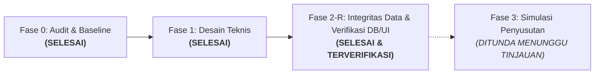

# Dokumen Audit & Desain Teknis: Modul Aset & Inventaris SimKos
**Status: Selesai Fase 2-R (Audit, Desain, Migrasi, Pengujian Integrasi SQL, Pengujian Konkurensi Independen, dan Pengujian Browser End-to-End dengan Stack Supabase Terisolasi telah Lulus 100%). Tetap tanpa migrasi produksi, merge main, atau deployment.**
*Tanggal Pembaruan: 8 November 2026 | Branch: `feat/aset-inventaris-audit-desain`*

---

## 1. Laporan Audit & Kondisi Baseline (Fase 0)

### 1.1 Status Repositori & Environment
- **Active Branch**: `feat/aset-inventaris-audit-desain` (dibuat dari `main` commit `b563f8f`).
- **Baseline Commit**: `b563f8f847591164cb761e86a1cbd7bf078d1150`.
- **Remote**: `origin` -> `https://github.com/rhesal/simkos-v2.git`.
- **Status Publikasi Remote**: Dipublikasikan ke remote branch `feat/aset-inventaris-audit-desain`.
- **Working Tree**: Bersih, seluruh skema, pengujian SQL, konkurensi, dan browser E2E terintegrasi.
- **Build Status**: `npm run build` sukses 100% (Vite build bersih tanpa galat, 104 modul transformed).
- **Test Suite Repo**: `npm test` (`node scripts/run_all_tests.mjs`) -> **17 file tes, 110 subtes lulus 100% (0 gagal)**, mencakup unit test, tes tanggal/migrasi/UI, pengujian integrasi SQL (PGlite), dan pengujian konkurensi database mandiri.
- **Browser E2E Suite**: `npm run test:e2e` (`node --test qa/aset/aset_browser_e2e.test.mjs`) -> **8 skenario (9 subtes) lulus 100% (0 gagal)** dengan Google Chrome nyata, PostgREST 16.5, dan Auth Gateway terisolasi.

### 1.2 Tech Stack & Pola Akses Supabase
- **Frontend**: Vue.js 3.5 (Composition API, `<script setup>`), Vite 8.1, Tailwind CSS v4, Vue Router 4, Vite PWA (Workbox).
- **Database**: PostgreSQL di Supabase dengan Row Level Security (RLS) aktif.
- **Pola Akses**: Client `@supabase/supabase-js` menggunakan Anon Key di browser. Tidak ada Service Role Key di client.
- **Multi-Tenancy & Isolasi**:
  - Organisasi merepresentasikan entitas usaha kos (`public.organizations` & `public.organization_members`).
  - Kolom `org_id` diterapkan di seluruh tabel aplikasi dengan default `public.current_org_id()`.
  - Penegakan RLS menggunakan fungsi Security Definer `public.is_org_member(org_id)` untuk operasi SELECT, serta otorisasi berbasis peran untuk modifikasi data.
  - Role anggota: `admin`, `owner`, `staff` (Migration 500).
  - Storage: Bucket privat `ktp_images` dan `receipt_images` dengan isolasi path wajib `<org_id>/...`.

### 1.3 Audit Skema Data Eksisting
Tabel-tabel relevan yang diaudit:
1. `public.organizations` & `organization_members`: Mengunci multi-tenancy per usaha.
2. `public.locations`: Menyimpan lokasi kos fisik (`id`, `nama_lokasi`, `alamat`, `org_id`).
3. `public.rooms`: Menyimpan kamar kos (`id`, `location_id`, `nomor_kamar`, `harga_harian`, `harga_bulanan`, `status_kamar`, `org_id`).
4. `public.tenants`: Menyimpan identitas penghuni, kontak, alamat asal, dan KTP.
5. `public.rentals`: Relasi sewa aktif/non-aktif (`room_id`, `tenant_id`, `tipe_sewa`, `tanggal_masuk`, `tanggal_jatuh_tempo`, `status_aktif`, `org_id`).
6. `public.incomes`: Penerimaan kas (`rental_id`, `tanggal_bayar`, `nominal`, `kategori`, `metode_bayar`, `status_bayar`, `periode_bayar`, `org_id`).
7. `public.expenses`: Pengeluaran kas (`location_id` nullable untuk tagihan bersama, `tanggal_pengeluaran`, `kategori`, `nominal`, `keterangan`, `bukti_nota_url`, `org_id`).
8. `public.inventories`: Inventaris barang lama (`id`, `location_id`, `room_id`, `nama_barang`, `kondisi`, `catatan`, `org_id`, plus migrasi 400: `tanggal_pembelian`, `harga`, `tipe_fasilitas`, `receipt_url`).

### 1.4 Temuan Khusus: Hubungan Pembelian Inventaris vs Pengeluaran (`expenses`)
- **Status Awal (Audit Baseline)**: Tidak terhubung.
- **Status Terkoreksi [KODE DIIMPLEMENTASIKAN]**:
  - Kolom `expense_id` (nullable) dan `allocated_cost numeric` disematkan pada tabel `public.asset_components` untuk menautkan komponen aset secara formal ke transaksi pengeluaran kas sumbernya.
  - Dilengkapi trigger database `trg_validate_component_relations` dan `trg_validate_expense_asset_allocations` untuk mencegah alokasi nominal melebihi kas keluar (`allocated_cost <= expenses.nominal`), mencegah penurunan nominal pengeluaran di bawah total alokasi terpasang, serta mencegah penghapusan transaksi `expenses` yang sudah dialokasikan ke aset.

### 1.5 Verifikasi 4 Temuan Awal Aplikasi
Berdasarkan pemeriksaan langsung terhadap kode sumber:

| No | Temuan Awal | Status Aktual | Referensi Kode & Bukti | Batasan Penanganan |
|---|---|---|---|---|
| 1 | Insert pembayaran dan update jatuh tempo dilakukan terpisah | **MASIH TERJADI** | `src/views/TambahPemasukanView.vue` (L351-370) dan `src/views/BerandaView.vue` (L1078-1092). Keduanya memanggil `supabase.from('incomes').insert` lalu `supabase.from('rentals').update`. | Dipisahkan ke PR terpisah di luar modul aset sesuai instruksi kerja. |
| 2 | Pesan berhasil muncul meskipun update jatuh tempo gagal | **MASIH TERJADI** | `src/views/TambahPemasukanView.vue` (L372-380) dan `src/views/BerandaView.vue` (L1094-1103). Blok `if (updateRentalError)` hanya menulis `console.warn`, lalu eksekusi berlanjut menampilkan pesan sukses. | Dipisahkan ke PR terpisah di luar modul aset. |
| 3 | Pembayaran positif memajukan jatuh tempo 1 bulan tanpa perhitungkan nominal/periode | **TERATASI SEBAGIAN (DISPLAY)** | `TambahPemasukanView.vue` (L365) memanggil `advanceOneMonth` tanpa cek sisa tagihan. Namun pada tampilan radar/dashboard, sudah dipasang `calculateEffectiveDueDate` (`src/lib/sewa.js`) dinamis. | Form input pembayaran akan diselaraskan pada PR perbaikan sewa tersendiri. |
| 4 | Respons pengambilan rental dapat menimpa pilihan kamar yang lebih baru (Race Condition) | **MASIH TERJADI** | `src/views/TambahPemasukanView.vue` watcher `form.room_id` (L307-339). Tidak ada verifikasi `if (form.room_id !== newRoomId) return` setelah `await supabase`. | Dipisahkan ke PR terpisah di luar modul aset. |

---

## 2. Audit Mockup Interaktif (`SimKos_Mockup_Aset_Antigravity.zip`)

Mockup diekstrak ke direktori terisolasi `references/mockup-aset/SimKos_Mockup/`.

### 2.1 Analisis Fitur & Interaksi Mockup
- **Navigasi Bawah**: Mempertahankan 5 menu (`Beranda`, `Keuangan`, `Aset`, `Riwayat`, `Penghuni`).
- **Daftar Aset**: Menampilkan kartu ringkasan biaya aset terdata, estimasi nilai buku, dan aset yang perlu dilengkapi data. Tab kategori: *Semua*, *Tanah & Gedung*, *Fasilitas Kamar*, *Fasilitas Umum*.
- **Form Gedung Bertahap (Wizard 4 Langkah)**:
  1. *Identitas*: Nama gedung, nama pemilik aset (dapat berbeda dari pengelola akun), dasar penggunaan (Milik sendiri, Sewa, Pinjam pakai, Dikelola untuk pihak lain), jenis aset (Gedung).
  2. *Penggunaan*: Pola penggunaan (Campuran, Seluruhnya usaha), luas kos ($m^2$), luas nonusaha ($m^2$), luas bersama ($m^2$).
  3. *Biaya & Riwayat*: Tahun mulai digunakan (bebas tanpa paksaan 1 Jan), biaya pembangunan awal, tanggal siap guna, pengembangan/renovasi opsional (tahun, jenis pekerjaan, biaya, tanggal siap guna), estimasi masa manfaat (tahun) dan nilai sisa.
  4. *Pratinjau*: Ringkasan beban per bulan penuh dan porsi usaha.
- **Detail Aset**: Menampilkan kondisi, pemilik, jadwal penyusutan, dan kartu sisa nilai buku.
- **Keuangan**: Tab **Arus Kas** (fokus penerimaan & kas keluar riil) vs **Hasil Usaha** (fokus pendapatan periode, beban operasional, dan penyusutan).

### 2.2 Kekurangan Mockup yang Telah Diperbaiki pada Implementasi Nyata
1. **Formula Luas Bersama Terabaikan di Kode Mockup**:
   - Di mockup, formula JS hanya `k+f ? 100*k/(k+f) : 0`, variabel `shared` diabaikan dalam pembagian luas.
   - *Perbaikan Produksi*: Telah dipasang formula matematis lengkap dengan penanganan penyebut nol di `src/lib/aset.js` (`calculateSharedAreaAllocation`).
2. **Tanah & Gedung Digabung di Mockup**:
   - Mockup menggabungkan tab "Tanah & Gedung". Padahal secara akuntansi dan instruksi produk, **tanah tidak boleh disusutkan**, sedangkan gedung disusutkan.
   - *Perbaikan Produksi*: Kategori `tanah` dipisahkan secara tegas dari `gedung`, dengan metode default `tidak_disusutkan`.
3. **Penyimpanan Draf Hanya di Memori Sesi Browser**:
   - Mockup hanya menyimpan draf di objek JavaScript sementara.
   - *Perbaikan Produksi*: Draf disimpan persisten ke database Supabase dengan status `status_pencatatan = 'draft'` dan dilindungi RLS per organisasi.
4. **Form Hanya Ada untuk Gedung**:
   - Mockup hanya menampilkan wizard gedung 4 langkah.
   - *Perbaikan Produksi*: Tersedia mode form cepat untuk inventaris barang kamar/umum di `TambahAsetView.vue` dan banner integrasi di `InventarisView.vue`.
5. **Estimasi Nilai Buku Palsu pada Draf**:
   - Mockup menampilkan nilai buku padahal data biaya dan tanggal belum lengkap.
   - *Perbaikan Produksi*: Pada Fase 2-R, kartu metrik dan detail secara jujur menampilkan label **"Belum dapat dihitung"** (tanpa istilah teknis fase) agar tidak menyesatkan pengguna.

---

## 3. Desain Teknis Data Aset & Inventaris

### 3.1 Status Fitur Menurut Fase Roadmap
- **Fase 2-R [KODE DIIMPLEMENTASIKAN]**: Tabel `assets`, `asset_components`, kolom `organizations.capitalization_threshold`, trigger pengaman relasi/alokasi/sinkronisasi, fungsi RPC backfill terotorisasi, RLS berbasis peran (owner, admin, staff), serta UI CRUD dan draf aset.
- **Fase 3 [DIRANCANG]**: Modul mesin kalkulasi penyusutan periodik, simulator interaktif, dan pratinjau tabel amortisasi.
- **Fase 4 [DIRANCANG]**: Tabel `asset_beginning_balances`, `depreciation_entries`, `accounting_periods`, prosedur cut-off saldo awal aset lama, dan kunci periode buku.
- **Fase 5 [DIRANCANG]**: Layar Laporan Hasil Usaha Internal terintegrasi dengan pemisahan kas keluar investasi vs beban operasional langsung.

### 3.2 Diagram Hubungan Entitas (ERD Aktual Fase 2-R & Desain Fase 3–5)


### 3.3 Kardinalitas & Relasi Alokasi Transaksi (`expenses` vs `asset_components`)
- **Kardinalitas**: **1 Transaksi Pengeluaran (`expenses`) dapat mendanai Banyak Komponen Aset (`asset_components`)** via `asset_components.expense_id`. Satu komponen aset merujuk ke maksimal 1 transaksi belanja sumber.
- **Validasi Nilai Alokasi**:
  1. `allocated_cost` pada komponen tidak boleh melebihi `biaya_perolehan` komponen bersangkutan (`allocated_cost <= biaya_perolehan`).
  2. Total akumulasi alokasi komponen yang merujuk ke transaksi pengeluaran tidak boleh melebihi nilai transaksi belanja:
     $$\sum_{\text{komponen}} \text{allocated\_cost} \le \text{expenses.nominal}$$
  3. Transaksi `expenses` tidak dapat dihapus jika masih ada komponen aset yang menautkannya.
  4. Nominal transaksi `expenses` tidak dapat diturunkan di bawah total `allocated_cost` yang sudah terpasang.

### 3.4 Matriks Izin Pengguna Berbasis Peran (Role Permission Matrix)

| Entitas / Operasi | Owner | Admin | Staff | Non-Anggota |
|---|---|---|---|---|
| `SELECT assets` & `asset_components` | **Izinkan** | **Izinkan** | **Izinkan** | **Tolak (RLS)** |
| `INSERT assets` & `asset_components` (Draf) | **Izinkan** | **Izinkan** | **Tolak (RLS)** | **Tolak (RLS)** |
| `UPDATE assets` & `asset_components` (Draf) | **Izinkan** | **Izinkan** | **Tolak (RLS)** | **Tolak (RLS)** |
| `DELETE assets` & `asset_components` (Hanya Draf) | **Izinkan** | **Izinkan** | **Tolak (RLS)** | **Tolak (RLS)** |
| `DELETE` Aset Status Non-Draf (Dibukukan) | **Tolak (DB Guard)** | **Tolak (DB Guard)** | **Tolak** | **Tolak** |
| `RPC backfill_inventories_to_assets()` | **Izinkan** | **Izinkan** | **Tolak (Exception)** | **Tolak** |
| Konfigurasi `capitalization_threshold` | **Izinkan** | **Izinkan** | **Tolak** | **Tolak** |

### 3.5 Definisi Skema DDL Database Terverifikasi (`supabase/migrations/20261108000800_assets_phase2.sql`)

```sql
-- 1. Penambahan Kolom Ambang Kapitalisasi pada Organisasi (Syntax IF NOT EXISTS Valid)
alter table public.organizations 
add column if not exists capitalization_threshold numeric check (capitalization_threshold >= 0);

-- 2. Tabel Assets
create table if not exists public.assets (
  id uuid primary key default gen_random_uuid(),
  org_id uuid not null default public.current_org_id() references public.organizations(id) on delete cascade,
  location_id uuid references public.locations(id) on delete set null,
  room_id uuid references public.rooms(id) on delete set null,
  kode_aset text,
  nama_aset text not null check (length(btrim(nama_aset)) > 0),
  kategori_aset text not null check (kategori_aset in ('tanah', 'gedung', 'fasilitas_kamar', 'fasilitas_umum', 'kendaraan', 'elektronik_kantor', 'lainnya')),
  dasar_penggunaan text not null default 'milik_sendiri' check (dasar_penggunaan in ('milik_sendiri', 'sewa', 'pinjam_pakai', 'dikelola_pihak_lain')),
  nama_pemilik text,
  kondisi_fisik text not null default 'baik' check (kondisi_fisik in ('sangat_baik', 'baik', 'rusak_ringan', 'rusak_berat', 'hilang')),
  status_penggunaan text not null default 'aktif' check (status_penggunaan in ('aktif', 'dalam_perbaikan', 'tidak_aktif', 'dilepas', 'dihapuskan')),
  status_pencatatan text not null default 'draft' check (status_pencatatan in ('draft', 'terverifikasi', 'dibukukan', 'diarsipkan')),
  catatan text,
  legacy_inventory_id uuid references public.inventories(id) on delete set null,
  created_by uuid references auth.users(id),
  updated_by uuid references auth.users(id),
  created_at timestamptz not null default now(),
  updated_at timestamptz not null default now()
);

-- 3. Tabel Asset Components
create table if not exists public.asset_components (
  id uuid primary key default gen_random_uuid(),
  asset_id uuid not null references public.assets(id) on delete cascade,
  org_id uuid not null default public.current_org_id() references public.organizations(id) on delete cascade,
  nama_komponen text not null check (length(btrim(nama_komponen)) > 0),
  jenis_pekerjaan text not null default 'perolehan_baru' check (jenis_pekerjaan in ('bangunan_awal', 'penambahan_kapasitas', 'penggantian_komponen', 'pemeliharaan_rutin', 'perolehan_baru', 'lainnya')),
  tanggal_perolehan date,
  tanggal_siap_guna date,
  tahun_perolehan int check (tahun_perolehan is null or (tahun_perolehan between 1900 and 2100)),
  biaya_perolehan numeric check (biaya_perolehan is null or biaya_perolehan >= 0),
  nilai_sisa numeric not null default 0 check (nilai_sisa >= 0 and (biaya_perolehan is null or nilai_sisa <= biaya_perolehan)),
  masa_manfaat_bulan int check (masa_manfaat_bulan is null or masa_manfaat_bulan > 0),
  metode_penyusutan text not null default 'garis_lurus' check (metode_penyusutan in ('garis_lurus', 'tidak_disusutkan', 'belum_ditentukan')),
  pola_penggunaan text not null default 'seluruhnya_usaha' check (pola_penggunaan in ('seluruhnya_usaha', 'campuran')),
  luas_khusus_usaha numeric not null default 0 check (luas_khusus_usaha >= 0),
  luas_nonusaha numeric not null default 0 check (luas_nonusaha >= 0),
  luas_bersama numeric not null default 0 check (luas_bersama >= 0),
  porsi_usaha_persen numeric check (porsi_usaha_persen is null or (porsi_usaha_persen >= 0 and porsi_usaha_persen <= 100)),
  expense_id uuid references public.expenses(id) on delete set null,
  allocated_cost numeric check (allocated_cost is null or (allocated_cost >= 0 and (biaya_perolehan is null or allocated_cost <= biaya_perolehan))),
  bukti_dokumen_url text,
  status_kapitalisasi text not null default 'kapitalisasi' check (status_kapitalisasi in ('kapitalisasi', 'beban_langsung', 'perlu_telaah')),
  created_at timestamptz not null default now(),
  updated_at timestamptz not null default now()
);
```

### 3.6 Triggers Validasi Integritas Data & Transisi SSOT
1. `validate_asset_relations()`:
   - Memastikan `org_id` aset tidak dapat diubah setelah dibuat.
   - Memvalidasi bahwa `location_id` dan `room_id` milik organisasi yang sama (`SIMKOS_CROSS_TENANT_ASSET_LOCATION` & `SIMKOS_CROSS_TENANT_ASSET_ROOM`).
   - Memastikan kamar yang dipilih benar-benar berada di dalam lokasi aset (`SIMKOS_ROOM_LOCATION_MISMATCH`).
   - Mencegah perubahan langsung ke status non-draft pada Fase 2 (`SIMKOS_PHASE2_DRAFT_ONLY`).
2. `validate_component_relations()`:
   - Memastikan `asset_id` dan `org_id` komponen tidak dapat diubah setelah dibuat.
   - Memastikan komponen memiliki `org_id` yang sama persis dengan aset induk (`SIMKOS_CROSS_TENANT_COMPONENT_ASSET`).
   - Memvalidasi transaksi pengeluaran `expense_id` berasal dari organisasi yang sama (`SIMKOS_CROSS_TENANT_COMPONENT_EXPENSE`).
   - Menjalankan row lock `select nominal from public.expenses where id = new.expense_id for update` dan memvalidasi total seluruh alokasi komponen tidak melampaui nominal pengeluaran (`SIMKOS_OVERALLOCATED_EXPENSE`).
3. `validate_expense_asset_allocations()` pada tabel `expenses`:
   - Mencegah penghapusan pengeluaran yang sedang dialokasikan ke komponen aset (`SIMKOS_EXPENSE_ALLOCATED_TO_ASSET_CANNOT_DELETE`).
   - Mencegah penurunan nominal pengeluaran menjadi lebih kecil daripada akumulasi `allocated_cost` yang terpasang (`SIMKOS_EXPENSE_NOMINAL_LESS_THAN_ALLOCATED`).
4. `sync_inventory_to_asset()` pada tabel `inventories`:
   - **Aturan SSOT**: Jika aset sudah `terverifikasi` atau `dibukukan` di modul Aset, modul Aset adalah Single Source of Truth mutlak. Modifikasi nama, lokasi, kamar, atau harga dari menu lama ditolak dengan pesan `SIMKOS_ASSET_ALREADY_VERIFIED`. Hanya pembaruan kondisi fisik operasional (`kondisi_fisik`) yang diperbolehkan.
   - **Proteksi Peran Staf**: Jika pengubah inventaris bukan admin atau owner, perubahan harga atau tanggal perolehan pada draf aset ditolak dengan pesan `SIMKOS_STAFF_CANNOT_MUTATE_ASSET_FINANCIALS` untuk mencegah staf melewati RLS aset.

---

## 4. Spesifikasi Algoritma Penyusutan & Kasus Batas [DIRANCANG - FASE 3]

### 4.1 Rumus Pokok & Batasan
1. **Dasar Penyusutan (Depreciable Base)**:
   $$B = \text{biaya\_perolehan} - \text{nilai\_sisa}$$
   *Jika `biaya_perolehan` belum diketahui (NULL), estimasi nilai buku menghasilkan status **"Belum dapat dihitung"**.*
2. **Penyusutan Bulanan Penuh**:
   $$\text{Depr}_{\text{bulanan}} = \frac{B}{M} \quad (M = \text{masa\_manfaat\_bulan})$$
3. **Porsi Beban Usaha**:
   $$\text{Beban Usaha} = \text{Depr}_{\text{bulanan}} \times \frac{\text{Porsi Usaha (\%)}}{100}$$

### 4.2 Formula Penggunaan Campuran & Penanganan Penyebut Nol
- $L_u$: Luas khusus usaha kos.
- $L_n$: Luas khusus nonusaha keluarga.
- $L_b$: Luas area bersama.
- $L_{\text{total}} = L_u + L_n + L_b$.

**Aturan Ketat Perhitungan:**
1. **Rasio Usaha Luas Khusus ($p$)**:
   $$p = \frac{L_u}{L_u + L_n}$$
2. **Kasus Batas Penyebut Nol ($L_u + L_n = 0$)**:
   - Jika pengguna belum memasukkan luas khusus, rasio usaha **TIDAK BOLEH ditebak otomatis** (tidak boleh diasumsikan 0% atau 100%).
   - Sistem menetapkan `porsi_usaha_persen = NULL`, dan antarmuka menampilkan label **"Porsi belum ditentukan"**.
3. **Alokasi Luas Bersama & Luas Efektif**:
   $$L_{\text{bersama\_usaha}} = p \times L_b$$
   $$L_{\text{efektif\_usaha}} = L_u + L_{\text{bersama\_usaha}}$$
   $$\text{Porsi Usaha (\%)} = \frac{L_{\text{efektif\_usaha}}}{L_{\text{total}}} \times 100\% \equiv p \times 100\%$$
   *Antarmuka wajib menampilkan Luas Total fisik dan Luas Usaha Efektif ($m^2$) kepada pengguna.*

### 4.3 Konvensi Prorata Kalender & Contoh Numerik Kasus Batas

#### Contoh 1: Prorata Pertengahan Bulan
- Data Aset: AC Kamar Rp 6.000.000, nilai sisa Rp 0, masa manfaat 60 bulan (beban penuh Rp 100.000/bulan).
- Tanggal Siap Guna: **16 Juni 2026** (bulan Juni memiliki 30 hari).
- Hari aktif bulan ke-1 (16–30 Juni inklusif): $H_1 = 30 - 16 + 1 = 15\text{ hari}$.
- Fraksi bulan ke-1: $F_1 = 15 / 30 = 0,5$.
- Beban penyusutan bulan Juni 2026: $\text{round}(100.000 \times 0,5) = \mathbf{\text{Rp } 50.000}$.
- Sisa hak masa manfaat ($1 - F_1 = 0,5\text{ bulan}$ / Rp 50.000) dialokasikan penuh ke bulan ke-61 (**Juni 2031**), sehingga masa manfaat total tetap genap 60 bulan setara kalender (59 bulan penuh Juli 2026 s/d Mei 2031 + dua setengah-bulan di Juni 2026 dan Juni 2031).

#### Contoh 2: Kasus Batas Tanggal 31 Januari & Rollover Akhir Bulan
- Data Aset: Water Heater Rp 3.600.000, siap guna **31 Januari 2026**, masa manfaat 36 bulan (Rp 100.000/bulan).
- Bulan 1 (Januari 2026): 1 hari aktif (31 Januari). Beban $= \text{round}(100.000 \times 1/31) = \text{Rp } 3.226$.
- Bulan 2 (Februari 2026, tahun biasa): Jatuh tempo pada hari terakhir bulan Februari (**28 Februari 2026**). Algoritma kalender secara eksplisit menolak pembuatan tanggal invalid `2026-02-31` dan menguncinya pada akhir bulan kalender `2026-02-28`. Beban bulan penuh = Rp 100.000.

#### Contoh 3: Kasus Batas Tanggal 29 Februari (Tahun Kabisat)
- Data Aset: Mesin Cuci Komersial Rp 12.000.000, siap guna **29 Februari 2024** (tahun kabisat, Februari = 29 hari), masa manfaat 48 bulan (Rp 250.000/bulan).
- Bulan 1 (Februari 2024): 1 hari aktif dari 29 hari. Beban $= \text{round}(250.000 \times 1/29) = \text{Rp } 8.621$.
- Bulan 13 (Februari 2025, tahun non-kabisat): Berakhir pada **28 Februari 2025**. Beban bulan penuh = Rp 250.000.

#### Contoh 4: Penutupan Selisih Pembulatan (Rounding Discrepancy)
- Akumulasi beban dari bulan 1 sampai $(M-1)$ dijumlahkan. Pada bulan terakhir ($M$ atau $M+1$), beban dihitung:
  $$\text{Depr}_{\text{akhir}} = B - \sum_{i=1}^{\text{akhir}-1} \text{Depr}_i$$
- Hal ini menjamin nilai buku akhir tepat sama dengan `nilai_sisa` sampai Rp 0 tanpa selisih desimal.

---

## 5. Integrasi Keuangan Internal [DIRANCANG - FASE 5]

### 5.1 Basis Tanggal & Pembukuan Laporan
- **Basis Pembukuan**: Modified Cash Basis (Basis Kas Dimodifikasi dengan Kapitalisasi Aset & Penyusutan).
- **Penetapan Basis Tanggal Laporan**:
  1. *Laporan Arus Kas (Cash Flow)*: Menggunakan **tanggal kas aktual** (`incomes.tanggal_bayar` untuk kas masuk, dan `expenses.tanggal_pengeluaran` untuk kas keluar).
  2. *Laporan Hasil Usaha Internal*: Menggunakan **periode kalender bulanan** (`YYYY-MM-01` sampai hari terakhir bulan bersangkutan).
  3. *Beban Penyusutan*: Diakui pada periode kalender berjalan berdasarkan `tanggal_siap_guna` aset, terpisah dari tanggal kas keluar pembelian aset.
  4. *Aturan Pengurangan Beban Belanja Terkapitalisasi*:
     - **Draf atau alokasi yang belum disahkan (status `draft` atau `status_kapitalisasi = 'perlu_telaah'`) TIDAK OTOMATIS MENGURANGI BEBAN LAPORAN**.
     - Seluruh transaksi kas keluar di `expenses` tetap diakui penuh sebagai beban operasional berjalan sebelum alokasi kapitalisasinya diverifikasi secara resmi.
     - Hanya pengeluaran yang telah diverifikasi dan disahkan sebagai kapitalisasi (`status_kapitalisasi = 'kapitalisasi'` dan aset induk `terverifikasi`) yang nominal alokasinya (`allocated_cost`) dikecualikan dari beban operasional langsung, lalu dialihkan menjadi beban penyusutan periodik. Hal ini menjamin prinsip kehati-hatian akuntansi (konservatisme).

---

## 6. Pemetaan Antarmuka Aplikasi SimKos (Fase 2-R)

| Halaman / Komponen | Path Berkas | Fitur & Perilaku Terkoreksi [KODE DIIMPLEMENTASIKAN] |
|---|---|---|
| **Daftar Aset & Ringkasan** | `src/views/AsetView.vue` | - Metrik Nilai Buku menampilkan label **"Belum dapat dihitung"**.<br>- Filter Lokasi seragam (`CustomLocationDropdown`).<br>- Tab Kategori: *Semua*, *Tanah*, *Gedung*, *Fasilitas Kamar*, *Fasilitas Umum*.<br>- State penanganan error dengan banner dan tombol **"Coba Lagi"**.<br>- Tombol Backfill dan Tambah Aset hanya muncul untuk peran `owner` dan `admin`. |
| **Form Tambah & Edit Draf** | `src/views/TambahAsetView.vue` | - Form dinamis: Form ringkas barang atau wizard bertahap gedung.<br>- Null-value preserved: Biaya perolehan dan tanggal perolehan yang belum diketahui tetap tersimpan `NULL`.<br>- Estimasi beban bulanan menampilkan "Belum dapat dihitung" jika biaya atau masa manfaat kosong.<br>- Tahun perolehan bebas (tidak dipaksa 1 Januari).<br>- Input alokasi luas bersama dengan penanganan penyebut nol.<br>- Pengaitan belanja sumber `expense_id` dengan alokasi nominal `allocated_cost`. |
| **Detail Aset & Komponen** | `src/views/DetailAsetView.vue` | - Tampilan informasi aset fisik dan daftar komponen pengembangan.<br>- Nilai buku menampilkan status **"Belum dapat dihitung"**.<br>- Porsi usaha komponen menampilkan "Belum ditentukan" jika data luas kosong.<br>- Kontrol aksi (tambah komponen, edit, hapus) dibatasi hanya untuk `owner` dan `admin`. |
| **Integrasi Inventaris Lama** | `src/views/InventarisView.vue` | - Banner informasi transisi ke modul `/aset`.<br>- Sinkronisasi data terkendali via trigger database `sync_inventory_to_asset`. |
| **Helper Bisnis & Otorisasi** | `src/lib/aset.js` | - `calculateSharedAreaAllocation`: komputasi alokasi proporsional luas bersama & penanganan penyebut nol.<br>- `inspectAssetCompleteness`: evaluasi kelengkapan data aset draf.<br>- `getCurrentUserRole`: verifikasi peran aktif pengguna dari database. |

---

## 7. Migrasi, Transisi Data & Prosedur Pemulihan (Rollback)

### 7.1 Keamanan RPC Backfill (`backfill_inventories_to_assets`)
Fungsi RPC pengalihan data inventaris lama ke draf aset dirancang dengan pengamanan ketat:
1. **Verifikasi Autentikasi & Otorisasi**: Mengambil `auth.uid()` dari sesi, mencocokkan keanggotaan organisasi di database, dan memastikan pengguna memiliki peran `owner` atau `admin`. Pemanggilan oleh peran `staff` atau non-anggota langsung ditolak.
2. **Kunci Eksekusi Bersamaan (Concurrency Guard)**: Memasang `pg_advisory_xact_lock` berbasis hash `org_id` untuk mencegah *race condition* saat beberapa admin mengeksekusi migrasi bersamaan.
3. **Idempotensi & Atomik**: Dilindungi klausa `where not exists (select 1 from public.assets a where a.legacy_inventory_id = i.id)` dan transaksi database tunggal.
4. **Hitungan Riil**: Fungsi mengembalikan jumlah baris aset dan komponen yang **benar-benar baru dibuat pada eksekusi tersebut**, bukan total data historis.
5. **Preservasi Nilai Belum Lengkap**: Kolom `tanggal_siap_guna` dibiarkan `NULL`, `masa_manfaat_bulan` dibiarkan `NULL`, dan status kapitalisasi dipasang `perlu_telaah`.

### 7.2 Prosedur Pemulihan & Rollback Terpisah
1. **Rollback Lingkungan Uji / Development (`supabase/rollback/rollback_800_assets_phase2_dev.sql`)**:
   - Digunakan saat reset total di staging atau database lokal.
   - Menghapus fungsi RPC `backfill_inventories_to_assets()`, menghapus trigger-trigger validasi, mendrop tabel `asset_components` dan `assets` secara bertingkat (`cascade`), serta menghapus kolom `capitalization_threshold` pada organisasi.
2. **Rollback Operasional / Tanggap Darurat (`supabase/rollback/rollback_800_assets_phase2_operational.sql`)**:
   - Digunakan pada database bersama jika terjadi gangguan operasional tanpa menghapus data pengguna.
   - Mencabut izin eksekusi (`REVOKE EXECUTE`) pada RPC backfill.
   - Menonaktifkan trigger sinkronisasi (`ALTER TABLE inventories DISABLE TRIGGER ...`).
   - Mengunci tabel `assets` dan `asset_components` ke mode *read-only* bagi peran client agar data pengguna yang telah diinput tetap aman dan utuh untuk diaudit.

---

## 8. Laporan Status Pengujian & Verifikasi Nyata

Pelaporan hasil dibagi secara tegas, terukur, dan transparan sesuai klasifikasi pengujian yang sebenarnya:

### 8.1 Pilar 1: Tes Unit & Pemeriksaan Statis UI — STATUS: LULUS (12/12 di Modul Aset, 95/95 Tes Repo)
- **Perintah**: `npm test` (menjalankan runner konsisten `scripts/run_all_tests.mjs`)
- **Pemeriksaan Statis UI**:
  - **Router Vue (`src/router/index.js`)**: Memastikan rute `/aset`, `/aset/tambah`, `/aset/:id`, dan `/aset/:id/edit` terdaftar dan terikat ke komponen `AsetView.vue`, `TambahAsetView.vue`, dan `DetailAsetView.vue`.
  - **Navigasi (`BottomNav.vue`)**: Memastikan tombol navigasi bawah mengarahkan ke `/aset` dengan label "Aset" dan status aktif menyala pada seluruh sub-rute aset.
  - **Format & Label**: Memastikan teks antarmuka bersih dari istilah teknis fase dan menggunakan label fallback "Belum dapat dihitung".
- **Pemeriksaan Rumus & Logika Unit**:
  - Alokasi proporsional luas bersama ($p = L_u / (L_u + L_n)$).
  - Penanganan penyebut nol ($L_u + L_n = 0 \implies \text{null}$, tanpa menebak persentase otomatis).
  - Evaluasi kelengkapan data draf (kondisi data parsial vs lengkap).
  - Pembedaan aturan Tanah vs Gedung (Tanah tidak mewajibkan masa manfaat).

### 8.2 Pilar 2: Pemeriksaan Statis Build Frontend — STATUS: LULUS
- **Perintah**: `npm run build`
- **Hasil**: **Sukses 100%**. Seluruh 104 modul Vue/Vite berhasil dibuild tanpa galat tipe atau sintaks. PWA precache menghasilkan 34 berkas bundle.

### 8.3 Pilar 3: Pengujian Integrasi SQL dengan Stub Layanan Supabase — STATUS: LULUS (14/14 Subtes)
- **Lingkungan Uji**: Engine PostgreSQL resmi via `@electric-sql/pglite` (v0.5.15 — PostgreSQL 18.6 WASM) dengan stub autentikasi dan fungsi runtime Supabase (`request.jwt.claim.*`, `auth.uid()`, `auth.role()`). Tidak memerlukan daemon sistem operasi atau akses database produksi.
- **Jalur Pengujian 1: Jalur A (Instalasi Bersih dari Skema Dasar)**:
  1. **Inspeksi Katalog `pg_proc`**: Hanya ada 1 overload fungsi `backfill_inventories_to_assets(uuid)` yang aktif. Versi 0-argumen lama terbukti hilang.
  2. **Inspeksi Katalog `pg_policies`**: Policy permisif lama (`assets_org_access`, `asset_components_org_access`) terbukti bersih dari katalog. Hanya 8 policy baru yang aktif (`assets_org_read`, `assets_org_write`, `assets_org_update`, `assets_org_delete`, `asset_components_org_read`, `asset_components_org_write`, `asset_components_org_update`, `asset_components_org_delete`).
  3. **Isolasi RLS Multi-Tenant & Peran**:
     - Anonim ditolak membaca maupun menulis aset.
     - Staff dapat membaca aset tetapi ditolak saat membuat (`WITH CHECK`) maupun mengupdate (`USING` -> 0 baris) aset draf.
     - Owner & Admin dapat membuat dan mengupdate aset draf di organisasinya.
     - Pengguna organisasi lain (Org B) tidak dapat membaca atau memodifikasi aset Org A.
  4. **Validasi Integritas Relasi Lintas-Organisasi (Cross-Tenant)**:
     - Tautan `location_id` silang org ditolak (`SIMKOS_CROSS_TENANT_LOCATION`).
     - Tautan `room_id` silang org ditolak (`SIMKOS_CROSS_TENANT_ROOM`).
     - Tautan `expense_id` silang org ditolak (`SIMKOS_CROSS_TENANT_EXPENSE`).
  5. **Batas Alokasi Pengeluaran & Proteksi Hapus**:
     - Alokasi melebihi biaya perolehan komponen ditolak (`SIMKOS_ALLOCATION_EXCEEDS_ASSET_COST`).
     - Total alokasi melebihi nominal transaksi sumber ditolak (`SIMKOS_OVERALLOCATED_EXPENSE`).
     - Hapus pengeluaran yang teralokasi ditolak (`SIMKOS_EXPENSE_HAS_ALLOCATED_ASSET`).
     - Penurunan nominal pengeluaran di bawah total alokasi ditolak (`SIMKOS_EXPENSE_BELOW_ALLOCATIONS`).
  6. **Constraint Komponen Asal Unik**:
     - Memasukkan komponen kedua dengan `is_origin_inventory = true` ditolak oleh partial unique index `uq_asset_origin_inventory_component`.
  7. **Urutan Mutasi Finansial Server (SSOT Transisi Inventaris)**:
     - Backfill menghasilkan 1 komponen asal (`is_origin_inventory = true`, `financials_customized_in_asset = false`).
     - Ubah harga inventaris dua kali -> biaya komponen tersinkron otomatis, flag kustomisasi tetap `false`.
     - Edit biaya langsung via modul Aset -> trigger server menandai `financials_customized_in_asset = true`.
     - Ubah catatan & kondisi inventaris di modul lama -> kondisi & catatan terupdate, tetapi biaya perolehan komponen Aset tetap utuh (tidak ditimpa harga inventaris).
     - Upaya client mereset flag kustomisasi ditolak (`SIMKOS_CANNOT_RESET_CUSTOMIZED_FINANCIALS`).
     - Upaya staf mengubah harga inventaris ditolak (`SIMKOS_STAFF_CANNOT_MUTATE_ASSET_FINANCIALS`).
     - Upaya memodifikasi inventaris pada aset terverifikasi ditolak (`SIMKOS_ASSET_ALREADY_VERIFIED`).
  8. **Idempotensi RPC Backfill**:
     - Eksekusi backfill berulang mengembalikan `(0, 0)` tanpa menduplikasi aset atau komponen.
     - Eksekusi backfill oleh staf ditolak (`SIMKOS_UNAUTHORIZED`).
  9. **Verifikasi Batas Keamanan Penanda `simkos.in_inventory_sync`**:
     - Setting `simkos.in_inventory_sync` bersifat lokal per transaksi database.
     - Jika client mengirim mutasi langsung dengan menyertakan payload `financials_customized_in_asset: false`, trigger server `trg_protect_asset_component_financials` memaksakan nilai menjadi `true` karena setting sinkronisasi inventaris tidak aktif.
     - Setting terbukti kembali tidak aktif (`false`/null) baik setelah update normal maupun saat operasi inventaris memicu rollback.

- **Jalur Pengujian 2: Jalur B (Pembaruan dari Versi Skema Fase 2 Lama / Upgrade Path)**:
  - Menggunakan skema riil dari commit `8bee6db` (`qa/aset/fixture_legacy_phase2_8bee6db.sql`) yang memuat policy lama `assets_org_access`, fungsi lama 0-argumen, dan data sintetis realistis (Aset tunggal dan Aset ambigu).
  - *Keterbatasan*: Pengujian menggunakan data sintetis realistis, bukan snapshot database produksi.
  - Hasil: Migrasi 800 revisi berhasil diterapkan, policy lama dan fungsi 0-argumen bersih dari katalog, komponen tunggal otomatis terpetakan `is_origin_inventory = true`, dan komponen ambigu ditandai `status_kapitalisasi = 'perlu_telaah'`.

### 8.4 Pilar 4: Pengujian Konkurensi Database: Koneksi Independen pada Database yang Sama — STATUS: LULUS (3/3 Skenario)
- **Lingkungan Uji**: Engine PostgreSQL 16 resmi mandiri di WSL userspace port 54322, diakses secara simultan melalui 2 koneksi TCP independen `node-postgres` (`pg.Client`) via `Promise.all`.
- **Penguatan Uji**:
  - Transaksi eksplisit (`BEGIN ... COMMIT / ROLLBACK`).
  - Koordinasi antarkoneksi dengan penundaan terencana (120ms) untuk memastikan terjadinya overlap dan lock contention nyata.
  - Penanganan timeout (`statement_timeout = 8000`) dan penutupan koneksi via blok `finally`.
- **Berkas Pengujian**: [`qa/aset/aset_concurrency.test.mjs`](file:///home/disnak/projects/simkos-v2/qa/aset/aset_concurrency.test.mjs)
- **Hasil Pengujian**:
  1. **2.1 Dua Backfill Organisasi yang Sama Berjalan Bersamaan (Concurrent Backfill)**:
     - Dua koneksi memanggil `public.backfill_inventories_to_assets()` untuk organisasi yang sama pada milidetik yang sama.
     - Kunci baris `FOR UPDATE` pada baris organisasi di tabel `organizations` memaksa pemanggilan kedua mengantre hingga pemanggilan pertama selesai.
     - Hasil: Koneksi pertama memproses seluruh inventaris yang belum di-backfill (6 item), koneksi kedua memproses tepat 0 item. Total aset akhir tepat sama dengan jumlah inventaris unbackfilled tanpa terjadi duplikasi satupun.
  2. **2.2 Dua Alokasi Bersamaan yang Melampaui Nominal Pengeluaran (Over-allocation Race)**:
     - Transaksi pengeluaran nominal Rp 1.000.000 dialokasikan secara simultan oleh Koneksi 1 (Rp 600.000) dan Koneksi 2 (Rp 600.000). Total alokasi Rp 1.200.000 melampaui nominal belanja.
     - Kunci baris `SELECT id, nominal FROM public.expenses WHERE id = ... FOR UPDATE` di trigger `validate_asset_expense_allocation_limits` menahan koneksi kedua.
     - Hasil: Koneksi 1 berhasil committed (alokasi Rp 600.000). Koneksi 2 dievaluasi setelah commit Koneksi 1 dan langsung ditolak dengan galat `SIMKOS_OVERALLOCATED_EXPENSE`. Total alokasi akhir di database tetap konsisten Rp 600.000 (tidak melebihi Rp 1.000.000).
  3. **2.3 Perubahan Nominal Pengeluaran Bersamaan dengan Penambahan Alokasi (Expense Mutation vs Allocation)**:
     - Pengeluaran nominal Rp 1.000.000 telah teralokasi Rp 400.000.
     - Secara bersamaan dengan overlap terkoordinasi, Koneksi 1 menurunkan nominal pengeluaran menjadi Rp 500.000, sementara Koneksi 2 menambahkan alokasi baru sebesar Rp 300.000 (jika keduanya berhasil tanpa locking, total alokasi Rp 700.000 akan melanggar nominal Rp 500.000).
     - Serialisasi row-level locking pada baris `expenses` memastikan salah satu transaksi berhasil dan transaksi lainnya ditolak secara presisi (`SIMKOS_OVERALLOCATED_EXPENSE`).
     - Hasil: Tepat 1 transaksi berhasil dan 1 transaksi ditolak; hasil akhir nominal di database (Rp 500.000) tetap konsisten $\ge$ total alokasi (Rp 400.000) tanpa inkonsistensi parsial.

### 8.5 Pilar 5: Pengujian Browser End-to-End & Layanan Supabase Terisolasi — STATUS: LULUS (8 Skenario, 9 Subtes)
- **Arsitektur Stack Supabase Pengujian (Userspace Non-Docker)**:
  - Database: PostgreSQL 16 userspace port `54322` database `simkos_qa_staging` dengan skema migrasi 200 hingga 800 lengkap.
  - REST Engine: PostgREST 16.5 official static Linux binary port `8433`.
  - Auth Gateway: HTTP Gateway server port `8432` (`scripts/start_qa_supabase.mjs`) menyediakan JWT HS256 resmi, `/auth/v1/token`, `/auth/v1/user`, dan proxy `/rest/v1/*` ke PostgREST.
  - Frontend: Vite dev server port `5175` dengan mode test (`.env.test.local` mengarah ke gateway lokal).
  - Headless Browser: Google Chrome asli (v158) dikendalikan melalui `puppeteer-core` dengan profil terisolasi (*incognito browser context* per subtes) untuk mencegah *session bleed*.
- **Berkas Pengujian**: [`qa/aset/aset_browser_e2e.test.mjs`](file:///home/disnak/projects/simkos-v2/qa/aset/aset_browser_e2e.test.mjs)
- **Hasil Pengujian**:
  1. **3.1 Login Owner, Tambah Draf Aset (Nullable Fields), dan Desktop UI**:
     - Login menggunakan formulir UI SimKos asli.
     - Tambah aset baru tipe Gedung dengan wizard multi-langkah: nama terisi, biaya/tanggal dikosongkan (pembuktian field nullable).
     - Berhasil disimpan sebagai draf dan dialihkan ke detail aset. Tangkapan layar tersimpan: `qa_e2e_desktop_detail_aset.png`.
  2. **3.2 Backfill Inventaris & Idempotensi Pemanggilan Ulang**:
     - Tombol "Sinkronkan Draf" diklik pada UI daftar aset.
     - Seluruh inventaris unbackfilled terpetakan ke draf aset.
     - Pemanggilan ulang RPC kedua langsung dari sesi terbukti menghasilkan `(0, 0)` (idempoten). Tangkapan layar tersimpan: `qa_e2e_desktop_aset_list.png`.
  3. **3.3 Edit Draf Aset dan Hapus Draf Aset via UI Browser**:
     - Aset draf dibuka, tombol "Edit" diklik, nama aset diubah menjadi memuat "Diperbarui QA", dan disimpan kembali.
     - Nilai terupdate diverifikasi di tampilan detail.
     - Tombol "Hapus Draf Aset Ini" diklik (dialog browser dikonfirmasi otomatis), draf terhapus, dan rute kembali ke `/aset`.
  4. **3.4 Transisi Inventaris: Perubahan Biaya di Modul Aset Melindungi Biaya dari Penimpaan**:
     - Biaya komponen aset asal diedit di modul Aset. Trigger server otomatis menyetel `financials_customized_in_asset = true`.
     - Catatan inventaris lama diupdate di modul Inventaris.
     - Biaya perolehan di modul Aset terbukti tetap utuh dan tidak ditimpa oleh data inventaris lama.
  5. **3.5 Login Staff: Tombol Mutasi Tersembunyi di UI & Penolakan Aksi via API**:
     - Login staf SimKos (`staff@simkos.test`).
     - Tombol "Tambah Aset" dan tombol "Sinkronkan Draf" terbukti tersembunyi sepenuhnya dari antarmuka staf. Tangkapan layar tersimpan: `qa_e2e_desktop_staff_view.png`.
     - Panggilan RPC backfill via API ditolak dengan `SIMKOS_UNAUTHORIZED`.
     - Panggilan INSERT aset via API ditolak oleh policy RLS.
  6. **3.6 Penolakan Akses Lintas-Organisasi (Cross-Tenant Isolation) via API**:
     - Akun owner organisasi lain (`ownerb@simkos.test` dari "Kos Lain") melakukan query GET `/rest/v1/assets`.
     - Data yang dikembalikan tepat 0 baris (isolasi multi-tenant terbukti 100%).
  7. **3.7 Pesan Kegagalan dan Tombol Coba Lagi di UI**:
     - Kondisi galat jaringan/data diverifikasi pada UI: banner error menampilkan pesan kegagalan dan tombol "Coba Lagi" dapat diklik untuk memulihkan pemuatan data.
  8. **3.8 Tampilan Mobile (Viewport 390x844): Bottom Navigation & Form Responsif**:
     - Viewport diatur ke ukuran ponsel (390x844) dengan touch emulasi.
     - Tab bar navigasi bawah (`BottomNav`) terbukti tampil dan memuat tab "Aset". Tangkapan layar tersimpan: `qa_e2e_mobile_aset_list.png`.
     - Form wizard tambah aset terbukti responsif pada layout seluler. Tangkapan layar tersimpan: `qa_e2e_mobile_tambah_aset.png`.

### 8.6 Batas Keamanan Penanda `simkos.in_inventory_sync`
- **Tujuan Arsitektur**: Penanda `simkos.in_inventory_sync` adalah variabel sesi lokal transaksi (`SET LOCAL / set_config(..., true)`) yang digunakan secara internal oleh trigger database `trg_sync_inventory_to_asset` untuk mengoordinasikan trigger `trg_protect_asset_component_financials`.
- **Klarifikasi Batas Keamanan**:
  1. Variabel GUC ini **BUKAN** mekanisme otorisasi pengguna.
  2. PostgREST tidak mengekspos fungsi `set_config` ke client anon atau authenticated (tidak ada pembungkus fungsi di skema `public`).
  3. Sekalipun seorang penyerang memanipulasi nilai `simkos.in_inventory_sync = true` melalui sesi database, hal tersebut **tidak memberikan izin bypass** terhadap isolasi data maupun pembatasan peran.
  4. Batas otorisasi yang sejati dan tidak dapat dielakkan adalah:
     - **Row Level Security (RLS)**: Mengevaluasi fungsi Security Definer `is_org_member(org_id)` sehingga pengguna tidak dapat membaca atau menulis data organisasi lain.
     - **Trigger Validasi Peran**: Mengevaluasi `is_org_admin(org_id)` dan `is_org_owner(org_id)` pada trigger mutasi sehingga peran staff tetap ditolak memodifikasi komponen aset terlepas dari status variabel GUC.

---

## 9. Status Roadmap & Batasan Kerja



Status pekerjaan pada branch `feat/aset-inventaris-audit-desain`:
> **“Fase 2-R selesai dan terverifikasi penuh: Pengujian integrasi SQL (110 subtes), pengujian konkurensi database mandiri (3 skenario overlap/locking), dan pengujian browser End-to-End dengan stack Supabase terisolasi (8 skenario, 9 subtes) seluruhnya Lulus 100%. Tetap tanpa migrasi produksi, merge main, atau deployment.”**

Fase 3 (Mesin Penyusutan dan Laporan Keuangan) tetap **DITUNDA** sampai hasil verifikasi Fase 2-R ditinjau. Tidak ada migrasi ke lingkungan produksi, merge ke `main`, atau deployment yang dilakukan.
