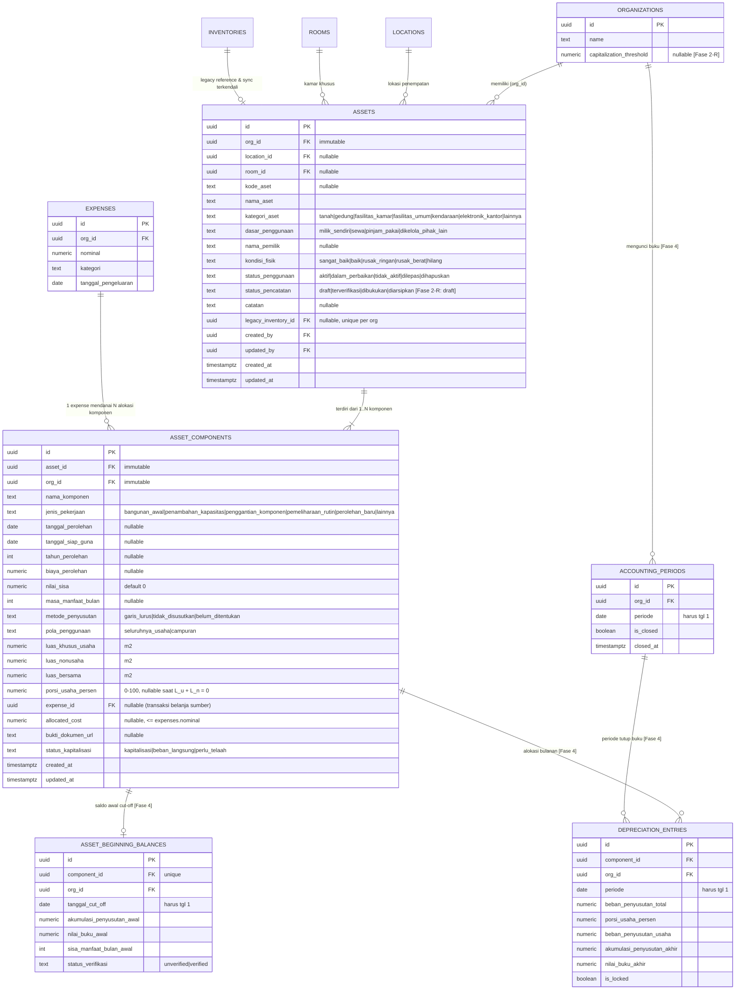
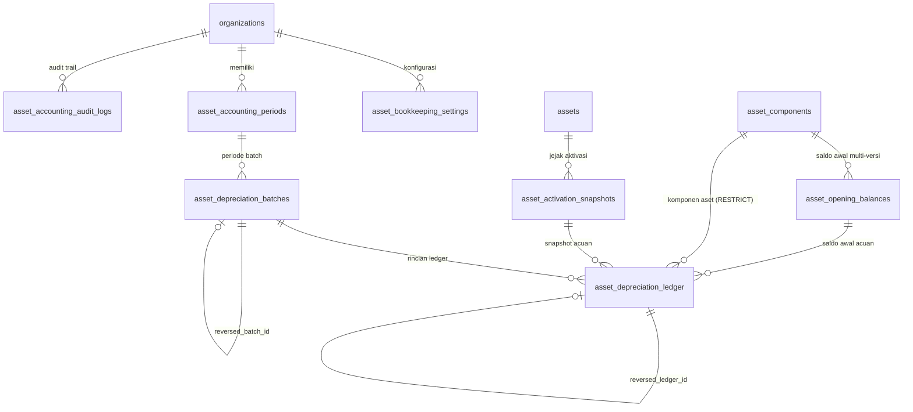

# Dokumen Audit & Desain Teknis: Modul Aset & Inventaris SimKos
**Status: Selesai Fase 4B-2R (Antarmuka Pembukuan Aset, Penanganan Eksplisit `SIMKOS_STALE_PREVIEW`, Saldo Awal Catatan Terdahulu, Pengiriman Ulang Idempoten Sebenarnya, Lulus 12/12 Subtest Browser E2E & 160/160 Tes Non-Browser pada Commit `79940a3`) | Aktif Fase 5A (Desain Integrasi Laporan Arus Kas & Hasil Usaha Internal). Tetap tanpa migrasi produksi, merge main, atau deployment.**
*Tanggal Pembaruan: 11 November 2026 | Branch: `feat/aset-inventaris-audit-desain`*

---

## 1. Laporan Audit & Kondisi Baseline (Fase 0)

### 1.1 Status Repositori & Environment
- **Active Branch**: `feat/aset-inventaris-audit-desain` (dibuat dari `main` commit `b563f8f`).
- **Baseline Commit**: `b563f8f847591164cb761e86a1cbd7bf078d1150`.
- **Remote**: `origin` -> `https://github.com/rhesal/simkos-v2.git`.
- **Status Publikasi Remote**: Dipublikasikan ke remote branch `feat/aset-inventaris-audit-desain`.
- **Working Tree**: Bersih, seluruh skema, pengujian SQL, konkurensi, dan browser E2E terintegrasi.
- **Build Status**: `npm run build` sukses 100% (Vite build bersih tanpa galat, 104 modul transformed).
- **Test Suite Repo**: `npm test` (`node scripts/run_all_tests.mjs`) -> **17 file tes, 110 subtes lulus 100% (0 gagal)**, mencakup unit test, tes tanggal/migrasi/UI, pengujian integrasi SQL (PGlite), dan pengujian konkurensi database mandiri.
- **Browser E2E Suite**: `npm run test:e2e` (`node --test qa/aset/aset_browser_e2e.test.mjs`) -> **8 skenario (9 subtes) lulus 100% (0 gagal)** dengan Google Chrome nyata, PostgREST 16.5, dan Auth Gateway terisolasi.

### 1.2 Tech Stack & Pola Akses Supabase
- **Frontend**: Vue.js 3.5 (Composition API, `<script setup>`), Vite 8.1, Tailwind CSS v4, Vue Router 4, Vite PWA (Workbox).
- **Database**: PostgreSQL di Supabase dengan Row Level Security (RLS) aktif.
- **Pola Akses**: Client `@supabase/supabase-js` menggunakan Anon Key di browser. Tidak ada Service Role Key di client.
- **Multi-Tenancy & Isolasi**:
  - Organisasi merepresentasikan entitas usaha kos (`public.organizations` & `public.organization_members`).
  - Kolom `org_id` diterapkan di seluruh tabel aplikasi dengan default `public.current_org_id()`.
  - Penegakan RLS menggunakan fungsi Security Definer `public.is_org_member(org_id)` untuk operasi SELECT, serta otorisasi berbasis peran untuk modifikasi data.
  - Role anggota: `admin`, `owner`, `staff` (Migration 500).
  - Storage: Bucket privat `ktp_images` dan `receipt_images` dengan isolasi path wajib `<org_id>/...`.

### 1.3 Audit Skema Data Eksisting
Tabel-tabel relevan yang diaudit:
1. `public.organizations` & `organization_members`: Mengunci multi-tenancy per usaha.
2. `public.locations`: Menyimpan lokasi kos fisik (`id`, `nama_lokasi`, `alamat`, `org_id`).
3. `public.rooms`: Menyimpan kamar kos (`id`, `location_id`, `nomor_kamar`, `harga_harian`, `harga_bulanan`, `status_kamar`, `org_id`).
4. `public.tenants`: Menyimpan identitas penghuni, kontak, alamat asal, dan KTP.
5. `public.rentals`: Relasi sewa aktif/non-aktif (`room_id`, `tenant_id`, `tipe_sewa`, `tanggal_masuk`, `tanggal_jatuh_tempo`, `status_aktif`, `org_id`).
6. `public.incomes`: Penerimaan kas (`rental_id`, `tanggal_bayar`, `nominal`, `kategori`, `metode_bayar`, `status_bayar`, `periode_bayar`, `org_id`).
7. `public.expenses`: Pengeluaran kas (`location_id` nullable untuk tagihan bersama, `tanggal_pengeluaran`, `kategori`, `nominal`, `keterangan`, `bukti_nota_url`, `org_id`).
8. `public.inventories`: Inventaris barang lama (`id`, `location_id`, `room_id`, `nama_barang`, `kondisi`, `catatan`, `org_id`, plus migrasi 400: `tanggal_pembelian`, `harga`, `tipe_fasilitas`, `receipt_url`).

### 1.4 Temuan Khusus: Hubungan Pembelian Inventaris vs Pengeluaran (`expenses`)
- **Status Awal (Audit Baseline)**: Tidak terhubung.
- **Status Terkoreksi [KODE DIIMPLEMENTASIKAN]**:
  - Kolom `expense_id` (nullable) dan `allocated_cost numeric` disematkan pada tabel `public.asset_components` untuk menautkan komponen aset secara formal ke transaksi pengeluaran kas sumbernya.
  - Dilengkapi trigger database `trg_validate_component_relations` dan `trg_validate_expense_asset_allocations` untuk mencegah alokasi nominal melebihi kas keluar (`allocated_cost <= expenses.nominal`), mencegah penurunan nominal pengeluaran di bawah total alokasi terpasang, serta mencegah penghapusan transaksi `expenses` yang sudah dialokasikan ke aset.

### 1.5 Verifikasi 4 Temuan Awal Aplikasi
Berdasarkan pemeriksaan langsung terhadap kode sumber:

| No | Temuan Awal | Status Aktual | Referensi Kode & Bukti | Batasan Penanganan |
|---|---|---|---|---|
| 1 | Insert pembayaran dan update jatuh tempo dilakukan terpisah | **MASIH TERJADI** | `src/views/TambahPemasukanView.vue` (L351-370) dan `src/views/BerandaView.vue` (L1078-1092). Keduanya memanggil `supabase.from('incomes').insert` lalu `supabase.from('rentals').update`. | Dipisahkan ke PR terpisah di luar modul aset sesuai instruksi kerja. |
| 2 | Pesan berhasil muncul meskipun update jatuh tempo gagal | **MASIH TERJADI** | `src/views/TambahPemasukanView.vue` (L372-380) dan `src/views/BerandaView.vue` (L1094-1103). Blok `if (updateRentalError)` hanya menulis `console.warn`, lalu eksekusi berlanjut menampilkan pesan sukses. | Dipisahkan ke PR terpisah di luar modul aset. |
| 3 | Pembayaran positif memajukan jatuh tempo 1 bulan tanpa perhitungkan nominal/periode | **TERATASI SEBAGIAN (DISPLAY)** | `TambahPemasukanView.vue` (L365) memanggil `advanceOneMonth` tanpa cek sisa tagihan. Namun pada tampilan radar/dashboard, sudah dipasang `calculateEffectiveDueDate` (`src/lib/sewa.js`) dinamis. | Form input pembayaran akan diselaraskan pada PR perbaikan sewa tersendiri. |
| 4 | Respons pengambilan rental dapat menimpa pilihan kamar yang lebih baru (Race Condition) | **MASIH TERJADI** | `src/views/TambahPemasukanView.vue` watcher `form.room_id` (L307-339). Tidak ada verifikasi `if (form.room_id !== newRoomId) return` setelah `await supabase`. | Dipisahkan ke PR terpisah di luar modul aset. |

---

## 2. Audit Mockup Interaktif (`SimKos_Mockup_Aset_Antigravity.zip`)

Mockup diekstrak ke direktori terisolasi `references/mockup-aset/SimKos_Mockup/`.

### 2.1 Analisis Fitur & Interaksi Mockup
- **Navigasi Bawah**: Mempertahankan 5 menu (`Beranda`, `Keuangan`, `Aset`, `Riwayat`, `Penghuni`).
- **Daftar Aset**: Menampilkan kartu ringkasan biaya aset terdata, estimasi nilai buku, dan aset yang perlu dilengkapi data. Tab kategori: *Semua*, *Tanah & Gedung*, *Fasilitas Kamar*, *Fasilitas Umum*.
- **Form Gedung Bertahap (Wizard 4 Langkah)**:
  1. *Identitas*: Nama gedung, nama pemilik aset (dapat berbeda dari pengelola akun), dasar penggunaan (Milik sendiri, Sewa, Pinjam pakai, Dikelola untuk pihak lain), jenis aset (Gedung).
  2. *Penggunaan*: Pola penggunaan (Campuran, Seluruhnya usaha), luas kos ($m^2$), luas nonusaha ($m^2$), luas bersama ($m^2$).
  3. *Biaya & Riwayat*: Tahun mulai digunakan (bebas tanpa paksaan 1 Jan), biaya pembangunan awal, tanggal siap guna, pengembangan/renovasi opsional (tahun, jenis pekerjaan, biaya, tanggal siap guna), estimasi masa manfaat (tahun) dan nilai sisa.
  4. *Pratinjau*: Ringkasan beban per bulan penuh dan porsi usaha.
- **Detail Aset**: Menampilkan kondisi, pemilik, jadwal penyusutan, dan kartu sisa nilai buku.
- **Keuangan**: Tab **Arus Kas** (fokus penerimaan & kas keluar riil) vs **Hasil Usaha** (fokus pendapatan periode, beban operasional, dan penyusutan).

### 2.2 Kekurangan Mockup yang Telah Diperbaiki pada Implementasi Nyata
1. **Formula Luas Bersama Terabaikan di Kode Mockup**:
   - Di mockup, formula JS hanya `k+f ? 100*k/(k+f) : 0`, variabel `shared` diabaikan dalam pembagian luas.
   - *Perbaikan Produksi*: Telah dipasang formula matematis lengkap dengan penanganan penyebut nol di `src/lib/aset.js` (`calculateSharedAreaAllocation`).
2. **Tanah & Gedung Digabung di Mockup**:
   - Mockup menggabungkan tab "Tanah & Gedung". Padahal secara akuntansi dan instruksi produk, **tanah tidak boleh disusutkan**, sedangkan gedung disusutkan.
   - *Perbaikan Produksi*: Kategori `tanah` dipisahkan secara tegas dari `gedung`, dengan metode default `tidak_disusutkan`.
3. **Penyimpanan Draf Hanya di Memori Sesi Browser**:
   - Mockup hanya menyimpan draf di objek JavaScript sementara.
   - *Perbaikan Produksi*: Draf disimpan persisten ke database Supabase dengan status `status_pencatatan = 'draft'` dan dilindungi RLS per organisasi.
4. **Form Hanya Ada untuk Gedung**:
   - Mockup hanya menampilkan wizard gedung 4 langkah.
   - *Perbaikan Produksi*: Tersedia mode form cepat untuk inventaris barang kamar/umum di `TambahAsetView.vue` dan banner integrasi di `InventarisView.vue`.
5. **Estimasi Nilai Buku Palsu pada Draf**:
   - Mockup menampilkan nilai buku padahal data biaya dan tanggal belum lengkap.
   - *Perbaikan Produksi*: Pada Fase 2-R, kartu metrik dan detail secara jujur menampilkan label **"Belum dapat dihitung"** (tanpa istilah teknis fase) agar tidak menyesatkan pengguna.

---

## 3. Desain Teknis Data Aset & Inventaris

### 3.1 Status Fitur Menurut Fase Roadmap
- **Fase 2-R [KODE DIIMPLEMENTASIKAN & TERVERIFIKASI]**: Tabel `assets`, `asset_components`, kolom `organizations.capitalization_threshold`, trigger pengaman relasi/alokasi/sinkronisasi, fungsi RPC backfill terotorisasi, RLS berbasis peran (owner, admin, staff), serta UI CRUD dan draf aset.
- **Fase 3-R [KODE DIIMPLEMENTASIKAN & TERVERIFIKASI]**: Modul mesin kalkulasi penyusutan garis lurus prorata dengan distribusi pembulatan kumulatif Bresenham, simulator interaktif di Detail Aset, dan pratinjau tabel amortisasi.
- **Fase 4B-1R & 4B-2R [KODE DIIMPLEMENTASIKAN & TERVERIFIKASI]**: Tabel `asset_bookkeeping_settings`, `asset_activation_snapshots`, `asset_opening_balances`, `asset_accounting_periods`, `asset_depreciation_batches`, `asset_depreciation_ledger`, `asset_accounting_audit_logs`, 9 RPC pembukuan atomik ber-lock advisory, serta antarmuka Buku Pembantu Penyusutan (`/aset/buku-pembantu`) dan alur pengesahan di Detail Aset (`/aset/:id`).
- **Fase 5A [DIRANCANG — AKTIF]**: Desain integrasi Laporan Arus Kas vs Laporan Hasil Usaha Internal, perlakuan pembelian aset dan nota campuran agar tidak dihitung ganda sebagai beban operasional, aturan tunggal pembacaan batch `posted`, indikator periode `"Belum lengkap"`, contoh rekonsiliasi konkret, dan matriks pengujian (tanpa menjadikan pajak atau tabel jurnal umum sebagai kewajiban fase ini).

### 3.2 Diagram Hubungan Entitas (ERD Aktual Fase 2-R & Desain Fase 3–5)



### 3.3 Kardinalitas & Relasi Alokasi Transaksi (`expenses` vs `asset_components`)
- **Kardinalitas**: **1 Transaksi Pengeluaran (`expenses`) dapat mendanai Banyak Komponen Aset (`asset_components`)** via `asset_components.expense_id`. Satu komponen aset merujuk ke maksimal 1 transaksi belanja sumber.
- **Validasi Nilai Alokasi**:
  1. `allocated_cost` pada komponen tidak boleh melebihi `biaya_perolehan` komponen bersangkutan (`allocated_cost <= biaya_perolehan`).
  2. Total akumulasi alokasi komponen yang merujuk ke transaksi pengeluaran tidak boleh melebihi nilai transaksi belanja:
     $$\sum_{\text{komponen}} \text{allocated\_cost} \le \text{expenses.nominal}$$
  3. Transaksi `expenses` tidak dapat dihapus jika masih ada komponen aset yang menautkannya.
  4. Nominal transaksi `expenses` tidak dapat diturunkan di bawah total `allocated_cost` yang sudah terpasang.

### 3.4 Matriks Izin Pengguna Berbasis Peran (Role Permission Matrix)

| Entitas / Operasi | Owner | Admin | Staff | Non-Anggota |
|---|---|---|---|---|
| `SELECT assets` & `asset_components` | **Izinkan** | **Izinkan** | **Izinkan** | **Tolak (RLS)** |
| `INSERT assets` & `asset_components` (Draf) | **Izinkan** | **Izinkan** | **Tolak (RLS)** | **Tolak (RLS)** |
| `UPDATE assets` & `asset_components` (Draf) | **Izinkan** | **Izinkan** | **Tolak (RLS)** | **Tolak (RLS)** |
| `DELETE assets` & `asset_components` (Hanya Draf) | **Izinkan** | **Izinkan** | **Tolak (RLS)** | **Tolak (RLS)** |
| `DELETE` Aset Status Non-Draf (Dibukukan) | **Tolak (DB Guard)** | **Tolak (DB Guard)** | **Tolak** | **Tolak** |
| `RPC backfill_inventories_to_assets()` | **Izinkan** | **Izinkan** | **Tolak (Exception)** | **Tolak** |
| Konfigurasi `capitalization_threshold` | **Izinkan** | **Izinkan** | **Tolak** | **Tolak** |

### 3.5 Definisi Skema DDL Database Terverifikasi (`supabase/migrations/20261108000800_assets_phase2.sql`)

```sql
-- 1. Penambahan Kolom Ambang Kapitalisasi pada Organisasi (Syntax IF NOT EXISTS Valid)
alter table public.organizations 
add column if not exists capitalization_threshold numeric check (capitalization_threshold >= 0);

-- 2. Tabel Assets
create table if not exists public.assets (
  id uuid primary key default gen_random_uuid(),
  org_id uuid not null default public.current_org_id() references public.organizations(id) on delete cascade,
  location_id uuid references public.locations(id) on delete set null,
  room_id uuid references public.rooms(id) on delete set null,
  kode_aset text,
  nama_aset text not null check (length(btrim(nama_aset)) > 0),
  kategori_aset text not null check (kategori_aset in ('tanah', 'gedung', 'fasilitas_kamar', 'fasilitas_umum', 'kendaraan', 'elektronik_kantor', 'lainnya')),
  dasar_penggunaan text not null default 'milik_sendiri' check (dasar_penggunaan in ('milik_sendiri', 'sewa', 'pinjam_pakai', 'dikelola_pihak_lain')),
  nama_pemilik text,
  kondisi_fisik text not null default 'baik' check (kondisi_fisik in ('sangat_baik', 'baik', 'rusak_ringan', 'rusak_berat', 'hilang')),
  status_penggunaan text not null default 'aktif' check (status_penggunaan in ('aktif', 'dalam_perbaikan', 'tidak_aktif', 'dilepas', 'dihapuskan')),
  status_pencatatan text not null default 'draft' check (status_pencatatan in ('draft', 'terverifikasi', 'dibukukan', 'diarsipkan')),
  catatan text,
  legacy_inventory_id uuid references public.inventories(id) on delete set null,
  created_by uuid references auth.users(id),
  updated_by uuid references auth.users(id),
  created_at timestamptz not null default now(),
  updated_at timestamptz not null default now()
);

-- 3. Tabel Asset Components
create table if not exists public.asset_components (
  id uuid primary key default gen_random_uuid(),
  asset_id uuid not null references public.assets(id) on delete cascade,
  org_id uuid not null default public.current_org_id() references public.organizations(id) on delete cascade,
  nama_komponen text not null check (length(btrim(nama_komponen)) > 0),
  jenis_pekerjaan text not null default 'perolehan_baru' check (jenis_pekerjaan in ('bangunan_awal', 'penambahan_kapasitas', 'penggantian_komponen', 'pemeliharaan_rutin', 'perolehan_baru', 'lainnya')),
  tanggal_perolehan date,
  tanggal_siap_guna date,
  tahun_perolehan int check (tahun_perolehan is null or (tahun_perolehan between 1900 and 2100)),
  biaya_perolehan numeric check (biaya_perolehan is null or biaya_perolehan >= 0),
  nilai_sisa numeric not null default 0 check (nilai_sisa >= 0 and (biaya_perolehan is null or nilai_sisa <= biaya_perolehan)),
  masa_manfaat_bulan int check (masa_manfaat_bulan is null or masa_manfaat_bulan > 0),
  metode_penyusutan text not null default 'garis_lurus' check (metode_penyusutan in ('garis_lurus', 'tidak_disusutkan', 'belum_ditentukan')),
  pola_penggunaan text not null default 'seluruhnya_usaha' check (pola_penggunaan in ('seluruhnya_usaha', 'campuran')),
  luas_khusus_usaha numeric not null default 0 check (luas_khusus_usaha >= 0),
  luas_nonusaha numeric not null default 0 check (luas_nonusaha >= 0),
  luas_bersama numeric not null default 0 check (luas_bersama >= 0),
  porsi_usaha_persen numeric check (porsi_usaha_persen is null or (porsi_usaha_persen >= 0 and porsi_usaha_persen <= 100)),
  expense_id uuid references public.expenses(id) on delete set null,
  allocated_cost numeric check (allocated_cost is null or (allocated_cost >= 0 and (biaya_perolehan is null or allocated_cost <= biaya_perolehan))),
  bukti_dokumen_url text,
  status_kapitalisasi text not null default 'kapitalisasi' check (status_kapitalisasi in ('kapitalisasi', 'beban_langsung', 'perlu_telaah')),
  created_at timestamptz not null default now(),
  updated_at timestamptz not null default now()
);
```

### 3.6 Triggers Validasi Integritas Data & Transisi SSOT
1. `validate_asset_relations()`:
   - Memastikan `org_id` aset tidak dapat diubah setelah dibuat.
   - Memvalidasi bahwa `location_id` dan `room_id` milik organisasi yang sama (`SIMKOS_CROSS_TENANT_ASSET_LOCATION` & `SIMKOS_CROSS_TENANT_ASSET_ROOM`).
   - Memastikan kamar yang dipilih benar-benar berada di dalam lokasi aset (`SIMKOS_ROOM_LOCATION_MISMATCH`).
   - Mencegah perubahan langsung ke status non-draft pada Fase 2 (`SIMKOS_PHASE2_DRAFT_ONLY`).
2. `validate_component_relations()`:
   - Memastikan `asset_id` dan `org_id` komponen tidak dapat diubah setelah dibuat.
   - Memastikan komponen memiliki `org_id` yang sama persis dengan aset induk (`SIMKOS_CROSS_TENANT_COMPONENT_ASSET`).
   - Memvalidasi transaksi pengeluaran `expense_id` berasal dari organisasi yang sama (`SIMKOS_CROSS_TENANT_COMPONENT_EXPENSE`).
   - Menjalankan row lock `select nominal from public.expenses where id = new.expense_id for update` dan memvalidasi total seluruh alokasi komponen tidak melampaui nominal pengeluaran (`SIMKOS_OVERALLOCATED_EXPENSE`).
3. `validate_expense_asset_allocations()` pada tabel `expenses`:
   - Mencegah penghapusan pengeluaran yang sedang dialokasikan ke komponen aset (`SIMKOS_EXPENSE_ALLOCATED_TO_ASSET_CANNOT_DELETE`).
   - Mencegah penurunan nominal pengeluaran menjadi lebih kecil daripada akumulasi `allocated_cost` yang terpasang (`SIMKOS_EXPENSE_NOMINAL_LESS_THAN_ALLOCATED`).
4. `sync_inventory_to_asset()` pada tabel `inventories`:
   - **Aturan SSOT**: Jika aset sudah `terverifikasi` atau `dibukukan` di modul Aset, modul Aset adalah Single Source of Truth mutlak. Modifikasi nama, lokasi, kamar, atau harga dari menu lama ditolak dengan pesan `SIMKOS_ASSET_ALREADY_VERIFIED`. Hanya pembaruan kondisi fisik operasional (`kondisi_fisik`) yang diperbolehkan.
   - **Proteksi Peran Staf**: Jika pengubah inventaris bukan admin atau owner, perubahan harga atau tanggal perolehan pada draf aset ditolak dengan pesan `SIMKOS_STAFF_CANNOT_MUTATE_ASSET_FINANCIALS` untuk mencegah staf melewati RLS aset.

---

## 4. Spesifikasi Algoritma Penyusutan & Kasus Batas [DIRANCANG - FASE 3]

### 4.1 Rumus Pokok & Batasan
1. **Dasar Penyusutan (Depreciable Base)**:
   $$B = \text{biaya\_perolehan} - \text{nilai\_sisa}$$
   *Jika `biaya_perolehan` belum diketahui (NULL), estimasi nilai buku menghasilkan status **"Belum dapat dihitung"**.*
2. **Penyusutan Bulanan Penuh**:
   $$\text{Depr}_{\text{bulanan}} = \frac{B}{M} \quad (M = \text{masa\_manfaat\_bulan})$$
3. **Porsi Beban Usaha**:
   $$\text{Beban Usaha} = \text{Depr}_{\text{bulanan}} \times \frac{\text{Porsi Usaha (\%)}}{100}$$

### 4.2 Formula Penggunaan Campuran & Penanganan Penyebut Nol
- $L_u$: Luas khusus usaha kos.
- $L_n$: Luas khusus nonusaha keluarga.
- $L_b$: Luas area bersama.
- $L_{\text{total}} = L_u + L_n + L_b$.

**Aturan Ketat Perhitungan:**
1. **Rasio Usaha Luas Khusus ($p$)**:
   $$p = \frac{L_u}{L_u + L_n}$$
2. **Kasus Batas Penyebut Nol ($L_u + L_n = 0$)**:
   - Jika pengguna belum memasukkan luas khusus, rasio usaha **TIDAK BOLEH ditebak otomatis** (tidak boleh diasumsikan 0% atau 100%).
   - Sistem menetapkan `porsi_usaha_persen = NULL`, dan antarmuka menampilkan label **"Porsi belum ditentukan"**.
3. **Alokasi Luas Bersama & Luas Efektif**:
   $$L_{\text{bersama\_usaha}} = p \times L_b$$
   $$L_{\text{efektif\_usaha}} = L_u + L_{\text{bersama\_usaha}}$$
   $$\text{Porsi Usaha (\%)} = \frac{L_{\text{efektif\_usaha}}}{L_{\text{total}}} \times 100\% \equiv p \times 100\%$$
   *Antarmuka wajib menampilkan Luas Total fisik dan Luas Usaha Efektif ($m^2$) kepada pengguna.*

### 4.3 Konvensi Prorata Kalender & Contoh Numerik Kasus Batas

#### Contoh 1: Prorata Pertengahan Bulan
- Data Aset: AC Kamar Rp 6.000.000, nilai sisa Rp 0, masa manfaat 60 bulan (beban penuh Rp 100.000/bulan).
- Tanggal Siap Guna: **16 Juni 2026** (bulan Juni memiliki 30 hari).
- Hari aktif bulan ke-1 (16–30 Juni inklusif): $H_1 = 30 - 16 + 1 = 15\text{ hari}$.
- Fraksi bulan ke-1: $F_1 = 15 / 30 = 0,5$.
- Beban penyusutan bulan Juni 2026: $\text{round}(100.000 \times 0,5) = \mathbf{\text{Rp } 50.000}$.
- Sisa hak masa manfaat ($1 - F_1 = 0,5\text{ bulan}$ / Rp 50.000) dialokasikan penuh ke bulan ke-61 (**Juni 2031**), sehingga masa manfaat total tetap genap 60 bulan setara kalender (59 bulan penuh Juli 2026 s/d Mei 2031 + dua setengah-bulan di Juni 2026 dan Juni 2031).

#### Contoh 2: Kasus Batas Tanggal 31 Januari & Rollover Akhir Bulan
- Data Aset: Water Heater Rp 3.600.000, siap guna **31 Januari 2026**, masa manfaat 36 bulan (Rp 100.000/bulan).
- Bulan 1 (Januari 2026): 1 hari aktif (31 Januari). Beban $= \text{round}(100.000 \times 1/31) = \text{Rp } 3.226$.
- Bulan 2 (Februari 2026, tahun biasa): Jatuh tempo pada hari terakhir bulan Februari (**28 Februari 2026**). Algoritma kalender secara eksplisit menolak pembuatan tanggal invalid `2026-02-31` dan menguncinya pada akhir bulan kalender `2026-02-28`. Beban bulan penuh = Rp 100.000.

#### Contoh 3: Kasus Batas Tanggal 29 Februari (Tahun Kabisat)
- Data Aset: Mesin Cuci Komersial Rp 12.000.000, siap guna **29 Februari 2024** (tahun kabisat, Februari = 29 hari), masa manfaat 48 bulan (Rp 250.000/bulan).
- Bulan 1 (Februari 2024): 1 hari aktif dari 29 hari. Beban $= \text{round}(250.000 \times 1/29) = \text{Rp } 8.621$.
- Bulan 13 (Februari 2025, tahun non-kabisat): Berakhir pada **28 Februari 2025**. Beban bulan penuh = Rp 250.000.

#### Contoh 4: Penutupan Selisih Pembulatan (Rounding Discrepancy)
- Akumulasi beban dari bulan 1 sampai $(M-1)$ dijumlahkan. Pada bulan terakhir ($M$ atau $M+1$), beban dihitung:
  $$\text{Depr}_{\text{akhir}} = B - \sum_{i=1}^{\text{akhir}-1} \text{Depr}_i$$
- Hal ini menjamin nilai buku akhir tepat sama dengan `nilai_sisa` sampai Rp 0 tanpa selisih desimal.

---

## 5. Integrasi Keuangan Internal [DIRANCANG - FASE 5A REVISI]

### 5.1 Basis Tanggal & Pembukuan Laporan
- **Basis Pembukuan**: **Laporan Internal Berbasis Penerimaan dan Pengeluaran Kas dengan Penyesuaian Kapitalisasi Aset dan Penyusutan Resmi** (bukan laporan laba-rugi akrual penuh).
- **Penetapan Basis Tanggal, Satuan Bulan Penuh, & Sumber Data Aktual**:
  1. *Satuan Periode*: Laporan Hasil Usaha Internal dibatasi hanya pada **periode bulan kalender penuh (`YYYY-MM`)** sesuai siklus pembukuan penyusutan.
  2. *Penerimaan Kas Usaha*: Mengambil `public.incomes.nominal` berdasarkan kolom tanggal aktual **`incomes.tanggal_bayar`** (`to_char(incomes.tanggal_bayar, 'YYYY-MM') = period_key`).
  3. *Pengeluaran Kas, Alokasi Referensi Snapshot, & Masalah Klasifikasi Tertunda*: Mengambil `public.expenses.nominal` berdasarkan **`expenses.tanggal_pengeluaran`** (`to_char(expenses.tanggal_pengeluaran, 'YYYY-MM') = period_key`), dengan mempertahankan nilai alokasi dari **versi snapshot terakhir yang disahkan (`asset_activation_snapshots.snapshot_params`)** selama proses pengesahan ulang (`perlu_pengesahan_ulang`), serta memisahkan nilai referensi dari usulan revisi (`pending_allocations`) agar tidak pernah dihitung ganda. Kelengkapan klasifikasi (`classification_complete`) ditentukan oleh `pending_classification_issue_count = 0` (mencakup komponen draf, `perlu_telaah`, `perlu_pengesahan_ulang`, `allocated_cost IS NULL`, serta evaluasi periode transaksi lama maupun baru apabila `expense_id` dipindahkan).
  4. *Beban Penyusutan Usaha & Lokasi Snapshot*: Pemeriksaan keberadaan batch (`batch_status = 'posted'`) dilakukan secara terpisah di tingkat organisasi dari agregasi nominal dan filter lokasi. Seluruh kueri penyusutan dan biaya bersama menggunakan **lokasi snapshot (`s.location_id`) yang dirujuk oleh `asset_depreciation_ledger.snapshot_id`**. Penyusutan aset bersama (`s.location_id IS NULL`) dan tagihan bersama (`expenses.location_id IS NULL`) disertakan dalam objek `shared_costs` beserta label bahwa hasil per lokasi belum mencakup alokasi biaya bersama.
  5. *Batas Penguncian Periode*: Penguncian periode (`asset_accounting_periods.status = 'locked'`) dibatasi pada pembukuan penyusutan aset tanpa memperluas penguncian ke seluruh transaksi kas umum (`incomes`/`expenses`). Rincian lengkap formula, kueri SQL, kontrak JSON, contoh rekonsiliasi numerik konkret, dan matriks pengujian dijabarkan pada **Bagian 12**.

---

## 6. Pemetaan Antarmuka Aplikasi SimKos (Fase 2-R)

| Halaman / Komponen | Path Berkas | Fitur & Perilaku Terkoreksi [KODE DIIMPLEMENTASIKAN] |
|---|---|---|
| **Daftar Aset & Ringkasan** | `src/views/AsetView.vue` | - Metrik Nilai Buku menampilkan label **"Belum dapat dihitung"**.<br>- Filter Lokasi seragam (`CustomLocationDropdown`).<br>- Tab Kategori: *Semua*, *Tanah*, *Gedung*, *Fasilitas Kamar*, *Fasilitas Umum*.<br>- State penanganan error dengan banner dan tombol **"Coba Lagi"**.<br>- Tombol Backfill dan Tambah Aset hanya muncul untuk peran `owner` dan `admin`. |
| **Form Tambah & Edit Draf** | `src/views/TambahAsetView.vue` | - Form dinamis: Form ringkas barang atau wizard bertahap gedung.<br>- Null-value preserved: Biaya perolehan dan tanggal perolehan yang belum diketahui tetap tersimpan `NULL`.<br>- Estimasi beban bulanan menampilkan "Belum dapat dihitung" jika biaya atau masa manfaat kosong.<br>- Tahun perolehan bebas (tidak dipaksa 1 Januari).<br>- Input alokasi luas bersama dengan penanganan penyebut nol.<br>- Pengaitan belanja sumber `expense_id` dengan alokasi nominal `allocated_cost`. |
| **Detail Aset & Komponen** | `src/views/DetailAsetView.vue` | - Tampilan informasi aset fisik dan daftar komponen pengembangan.<br>- Nilai buku menampilkan status **"Belum dapat dihitung"**.<br>- Porsi usaha komponen menampilkan "Belum ditentukan" jika data luas kosong.<br>- Kontrol aksi (tambah komponen, edit, hapus) dibatasi hanya untuk `owner` dan `admin`. |
| **Integrasi Inventaris Lama** | `src/views/InventarisView.vue` | - Banner informasi transisi ke modul `/aset`.<br>- Sinkronisasi data terkendali via trigger database `sync_inventory_to_asset`. |
| **Helper Bisnis & Otorisasi** | `src/lib/aset.js` | - `calculateSharedAreaAllocation`: komputasi alokasi proporsional luas bersama & penanganan penyebut nol.<br>- `inspectAssetCompleteness`: evaluasi kelengkapan data aset draf.<br>- `getCurrentUserRole`: verifikasi peran aktif pengguna dari database. |

---

## 7. Migrasi, Transisi Data & Prosedur Pemulihan (Rollback)

### 7.1 Keamanan RPC Backfill (`backfill_inventories_to_assets`)
Fungsi RPC pengalihan data inventaris lama ke draf aset dirancang dengan pengamanan ketat:
1. **Verifikasi Autentikasi & Otorisasi**: Mengambil `auth.uid()` dari sesi, mencocokkan keanggotaan organisasi di database, dan memastikan pengguna memiliki peran `owner` atau `admin`. Pemanggilan oleh peran `staff` atau non-anggota langsung ditolak.
2. **Kunci Eksekusi Bersamaan (Concurrency Guard)**: Memasang `pg_advisory_xact_lock` berbasis hash `org_id` untuk mencegah *race condition* saat beberapa admin mengeksekusi migrasi bersamaan.
3. **Idempotensi & Atomik**: Dilindungi klausa `where not exists (select 1 from public.assets a where a.legacy_inventory_id = i.id)` dan transaksi database tunggal.
4. **Hitungan Riil**: Fungsi mengembalikan jumlah baris aset dan komponen yang **benar-benar baru dibuat pada eksekusi tersebut**, bukan total data historis.
5. **Preservasi Nilai Belum Lengkap**: Kolom `tanggal_siap_guna` dibiarkan `NULL`, `masa_manfaat_bulan` dibiarkan `NULL`, dan status kapitalisasi dipasang `perlu_telaah`.

### 7.2 Prosedur Pemulihan & Rollback Terpisah
1. **Rollback Lingkungan Uji / Development (`supabase/rollback/rollback_800_assets_phase2_dev.sql`)**:
   - Digunakan saat reset total di staging atau database lokal.
   - Menghapus fungsi RPC `backfill_inventories_to_assets()`, menghapus trigger-trigger validasi, mendrop tabel `asset_components` dan `assets` secara bertingkat (`cascade`), serta menghapus kolom `capitalization_threshold` pada organisasi.
2. **Rollback Operasional / Tanggap Darurat (`supabase/rollback/rollback_800_assets_phase2_operational.sql`)**:
   - Digunakan pada database bersama jika terjadi gangguan operasional tanpa menghapus data pengguna.
   - Mencabut izin eksekusi (`REVOKE EXECUTE`) pada RPC backfill.
   - Menonaktifkan trigger sinkronisasi (`ALTER TABLE inventories DISABLE TRIGGER ...`).
   - Mengunci tabel `assets` dan `asset_components` ke mode *read-only* bagi peran client agar data pengguna yang telah diinput tetap aman dan utuh untuk diaudit.

---

## 8. Laporan Status Pengujian & Verifikasi Nyata

Pelaporan hasil dibagi secara tegas, terukur, dan transparan sesuai klasifikasi pengujian yang sebenarnya:

### 8.1 Pilar 1: Tes Unit & Pemeriksaan Statis UI — STATUS: LULUS (12/12 di Modul Aset, 95/95 Tes Repo)
- **Perintah**: `npm test` (menjalankan runner konsisten `scripts/run_all_tests.mjs`)
- **Pemeriksaan Statis UI**:
  - **Router Vue (`src/router/index.js`)**: Memastikan rute `/aset`, `/aset/tambah`, `/aset/:id`, dan `/aset/:id/edit` terdaftar dan terikat ke komponen `AsetView.vue`, `TambahAsetView.vue`, dan `DetailAsetView.vue`.
  - **Navigasi (`BottomNav.vue`)**: Memastikan tombol navigasi bawah mengarahkan ke `/aset` dengan label "Aset" dan status aktif menyala pada seluruh sub-rute aset.
  - **Format & Label**: Memastikan teks antarmuka bersih dari istilah teknis fase dan menggunakan label fallback "Belum dapat dihitung".
- **Pemeriksaan Rumus & Logika Unit**:
  - Alokasi proporsional luas bersama ($p = L_u / (L_u + L_n)$).
  - Penanganan penyebut nol ($L_u + L_n = 0 \implies \text{null}$, tanpa menebak persentase otomatis).
  - Evaluasi kelengkapan data draf (kondisi data parsial vs lengkap).
  - Pembedaan aturan Tanah vs Gedung (Tanah tidak mewajibkan masa manfaat).

### 8.2 Pilar 2: Pemeriksaan Statis Build Frontend — STATUS: LULUS
- **Perintah**: `npm run build`
- **Hasil**: **Sukses 100%**. Seluruh 104 modul Vue/Vite berhasil dibuild tanpa galat tipe atau sintaks. PWA precache menghasilkan 34 berkas bundle.

### 8.3 Pilar 3: Pengujian Integrasi SQL dengan Stub Layanan Supabase — STATUS: LULUS (14/14 Subtes)
- **Lingkungan Uji**: Engine PostgreSQL resmi via `@electric-sql/pglite` (v0.5.15 — PostgreSQL 18.6 WASM) dengan stub autentikasi dan fungsi runtime Supabase (`request.jwt.claim.*`, `auth.uid()`, `auth.role()`). Tidak memerlukan daemon sistem operasi atau akses database produksi.
- **Jalur Pengujian 1: Jalur A (Instalasi Bersih dari Skema Dasar)**:
  1. **Inspeksi Katalog `pg_proc`**: Hanya ada 1 overload fungsi `backfill_inventories_to_assets(uuid)` yang aktif. Versi 0-argumen lama terbukti hilang.
  2. **Inspeksi Katalog `pg_policies`**: Policy permisif lama (`assets_org_access`, `asset_components_org_access`) terbukti bersih dari katalog. Hanya 8 policy baru yang aktif (`assets_org_read`, `assets_org_write`, `assets_org_update`, `assets_org_delete`, `asset_components_org_read`, `asset_components_org_write`, `asset_components_org_update`, `asset_components_org_delete`).
  3. **Isolasi RLS Multi-Tenant & Peran**:
     - Anonim ditolak membaca maupun menulis aset.
     - Staff dapat membaca aset tetapi ditolak saat membuat (`WITH CHECK`) maupun mengupdate (`USING` -> 0 baris) aset draf.
     - Owner & Admin dapat membuat dan mengupdate aset draf di organisasinya.
     - Pengguna organisasi lain (Org B) tidak dapat membaca atau memodifikasi aset Org A.
  4. **Validasi Integritas Relasi Lintas-Organisasi (Cross-Tenant)**:
     - Tautan `location_id` silang org ditolak (`SIMKOS_CROSS_TENANT_LOCATION`).
     - Tautan `room_id` silang org ditolak (`SIMKOS_CROSS_TENANT_ROOM`).
     - Tautan `expense_id` silang org ditolak (`SIMKOS_CROSS_TENANT_EXPENSE`).
  5. **Batas Alokasi Pengeluaran & Proteksi Hapus**:
     - Alokasi melebihi biaya perolehan komponen ditolak (`SIMKOS_ALLOCATION_EXCEEDS_ASSET_COST`).
     - Total alokasi melebihi nominal transaksi sumber ditolak (`SIMKOS_OVERALLOCATED_EXPENSE`).
     - Hapus pengeluaran yang teralokasi ditolak (`SIMKOS_EXPENSE_HAS_ALLOCATED_ASSET`).
     - Penurunan nominal pengeluaran di bawah total alokasi ditolak (`SIMKOS_EXPENSE_BELOW_ALLOCATIONS`).
  6. **Constraint Komponen Asal Unik**:
     - Memasukkan komponen kedua dengan `is_origin_inventory = true` ditolak oleh partial unique index `uq_asset_origin_inventory_component`.
  7. **Urutan Mutasi Finansial Server (SSOT Transisi Inventaris)**:
     - Backfill menghasilkan 1 komponen asal (`is_origin_inventory = true`, `financials_customized_in_asset = false`).
     - Ubah harga inventaris dua kali -> biaya komponen tersinkron otomatis, flag kustomisasi tetap `false`.
     - Edit biaya langsung via modul Aset -> trigger server menandai `financials_customized_in_asset = true`.
     - Ubah catatan & kondisi inventaris di modul lama -> kondisi & catatan terupdate, tetapi biaya perolehan komponen Aset tetap utuh (tidak ditimpa harga inventaris).
     - Upaya client mereset flag kustomisasi ditolak (`SIMKOS_CANNOT_RESET_CUSTOMIZED_FINANCIALS`).
     - Upaya staf mengubah harga inventaris ditolak (`SIMKOS_STAFF_CANNOT_MUTATE_ASSET_FINANCIALS`).
     - Upaya memodifikasi inventaris pada aset terverifikasi ditolak (`SIMKOS_ASSET_ALREADY_VERIFIED`).
  8. **Idempotensi RPC Backfill**:
     - Eksekusi backfill berulang mengembalikan `(0, 0)` tanpa menduplikasi aset atau komponen.
     - Eksekusi backfill oleh staf ditolak (`SIMKOS_UNAUTHORIZED`).
  9. **Verifikasi Batas Keamanan Penanda `simkos.in_inventory_sync`**:
     - Setting `simkos.in_inventory_sync` bersifat lokal per transaksi database.
     - Jika client mengirim mutasi langsung dengan menyertakan payload `financials_customized_in_asset: false`, trigger server `trg_protect_asset_component_financials` memaksakan nilai menjadi `true` karena setting sinkronisasi inventaris tidak aktif.
     - Setting terbukti kembali tidak aktif (`false`/null) baik setelah update normal maupun saat operasi inventaris memicu rollback.

- **Jalur Pengujian 2: Jalur B (Pembaruan dari Versi Skema Fase 2 Lama / Upgrade Path)**:
  - Menggunakan skema riil dari commit `8bee6db` (`qa/aset/fixture_legacy_phase2_8bee6db.sql`) yang memuat policy lama `assets_org_access`, fungsi lama 0-argumen, dan data sintetis realistis (Aset tunggal dan Aset ambigu).
  - *Keterbatasan*: Pengujian menggunakan data sintetis realistis, bukan snapshot database produksi.
  - Hasil: Migrasi 800 revisi berhasil diterapkan, policy lama dan fungsi 0-argumen bersih dari katalog, komponen tunggal otomatis terpetakan `is_origin_inventory = true`, dan komponen ambigu ditandai `status_kapitalisasi = 'perlu_telaah'`.

### 8.4 Pilar 4: Pengujian Konkurensi Database: Koneksi Independen pada Database yang Sama — STATUS: LULUS (3/3 Skenario)
- **Lingkungan Uji**: Engine PostgreSQL 16 resmi mandiri di WSL userspace port 54322, diakses secara simultan melalui 2 koneksi TCP independen `node-postgres` (`pg.Client`) via `Promise.all`.
- **Penguatan Uji**:
  - Transaksi eksplisit (`BEGIN ... COMMIT / ROLLBACK`).
  - Koordinasi antarkoneksi dengan penundaan terencana (120ms) untuk memastikan terjadinya overlap dan lock contention nyata.
  - Penanganan timeout (`statement_timeout = 8000`) dan penutupan koneksi via blok `finally`.
- **Berkas Pengujian**: [`qa/aset/aset_concurrency.test.mjs`](file:///home/disnak/projects/simkos-v2/qa/aset/aset_concurrency.test.mjs)
- **Hasil Pengujian**:
  1. **2.1 Dua Backfill Organisasi yang Sama Berjalan Bersamaan (Concurrent Backfill)**:
     - Dua koneksi memanggil `public.backfill_inventories_to_assets()` untuk organisasi yang sama pada milidetik yang sama.
     - Kunci baris `FOR UPDATE` pada baris organisasi di tabel `organizations` memaksa pemanggilan kedua mengantre hingga pemanggilan pertama selesai.
     - Hasil: Koneksi pertama memproses seluruh inventaris yang belum di-backfill (6 item), koneksi kedua memproses tepat 0 item. Total aset akhir tepat sama dengan jumlah inventaris unbackfilled tanpa terjadi duplikasi satupun.
  2. **2.2 Dua Alokasi Bersamaan yang Melampaui Nominal Pengeluaran (Over-allocation Race)**:
     - Transaksi pengeluaran nominal Rp 1.000.000 dialokasikan secara simultan oleh Koneksi 1 (Rp 600.000) dan Koneksi 2 (Rp 600.000). Total alokasi Rp 1.200.000 melampaui nominal belanja.
     - Kunci baris `SELECT id, nominal FROM public.expenses WHERE id = ... FOR UPDATE` di trigger `validate_asset_expense_allocation_limits` menahan koneksi kedua.
     - Hasil: Koneksi 1 berhasil committed (alokasi Rp 600.000). Koneksi 2 dievaluasi setelah commit Koneksi 1 dan langsung ditolak dengan galat `SIMKOS_OVERALLOCATED_EXPENSE`. Total alokasi akhir di database tetap konsisten Rp 600.000 (tidak melebihi Rp 1.000.000).
  3. **2.3 Perubahan Nominal Pengeluaran Bersamaan dengan Penambahan Alokasi (Expense Mutation vs Allocation)**:
     - Pengeluaran nominal Rp 1.000.000 telah teralokasi Rp 400.000.
     - Secara bersamaan dengan overlap terkoordinasi, Koneksi 1 menurunkan nominal pengeluaran menjadi Rp 500.000, sementara Koneksi 2 menambahkan alokasi baru sebesar Rp 300.000 (jika keduanya berhasil tanpa locking, total alokasi Rp 700.000 akan melanggar nominal Rp 500.000).
     - Serialisasi row-level locking pada baris `expenses` memastikan salah satu transaksi berhasil dan transaksi lainnya ditolak secara presisi (`SIMKOS_OVERALLOCATED_EXPENSE`).
     - Hasil: Tepat 1 transaksi berhasil dan 1 transaksi ditolak; hasil akhir nominal di database (Rp 500.000) tetap konsisten $\ge$ total alokasi (Rp 400.000) tanpa inkonsistensi parsial.

### 8.5 Pilar 5: Pengujian Browser End-to-End & Layanan Supabase Terisolasi — STATUS: LULUS (8 Skenario, 9 Subtes)
- **Arsitektur Stack Supabase Pengujian (Userspace Non-Docker)**:
  - Database: PostgreSQL 16 userspace port `54322` database `simkos_qa_staging` dengan skema migrasi 200 hingga 800 lengkap.
  - REST Engine: PostgREST 16.5 official static Linux binary port `8433`.
  - Auth Gateway: HTTP Gateway server port `8432` (`scripts/start_qa_supabase.mjs`) menyediakan JWT HS256 resmi, `/auth/v1/token`, `/auth/v1/user`, dan proxy `/rest/v1/*` ke PostgREST.
  - Frontend: Vite dev server port `5175` dengan mode test (`.env.test.local` mengarah ke gateway lokal).
  - Headless Browser: Google Chrome asli (v158) dikendalikan melalui `puppeteer-core` dengan profil terisolasi (*incognito browser context* per subtes) untuk mencegah *session bleed*.
- **Berkas Pengujian**: [`qa/aset/aset_browser_e2e.test.mjs`](file:///home/disnak/projects/simkos-v2/qa/aset/aset_browser_e2e.test.mjs)
- **Hasil Pengujian**:
  1. **3.1 Login Owner, Tambah Draf Aset (Nullable Fields), dan Desktop UI**:
     - Login menggunakan formulir UI SimKos asli.
     - Tambah aset baru tipe Gedung dengan wizard multi-langkah: nama terisi, biaya/tanggal dikosongkan (pembuktian field nullable).
     - Berhasil disimpan sebagai draf dan dialihkan ke detail aset. Tangkapan layar tersimpan: `qa_e2e_desktop_detail_aset.png`.
  2. **3.2 Backfill Inventaris & Idempotensi Pemanggilan Ulang**:
     - Tombol "Sinkronkan Draf" diklik pada UI daftar aset.
     - Seluruh inventaris unbackfilled terpetakan ke draf aset.
     - Pemanggilan ulang RPC kedua langsung dari sesi terbukti menghasilkan `(0, 0)` (idempoten). Tangkapan layar tersimpan: `qa_e2e_desktop_aset_list.png`.
  3. **3.3 Edit Draf Aset dan Hapus Draf Aset via UI Browser**:
     - Aset draf dibuka, tombol "Edit" diklik, nama aset diubah menjadi memuat "Diperbarui QA", dan disimpan kembali.
     - Nilai terupdate diverifikasi di tampilan detail.
     - Tombol "Hapus Draf Aset Ini" diklik (dialog browser dikonfirmasi otomatis), draf terhapus, dan rute kembali ke `/aset`.
  4. **3.4 Transisi Inventaris: Perubahan Biaya di Modul Aset Melindungi Biaya dari Penimpaan**:
     - Biaya komponen aset asal diedit di modul Aset. Trigger server otomatis menyetel `financials_customized_in_asset = true`.
     - Catatan inventaris lama diupdate di modul Inventaris.
     - Biaya perolehan di modul Aset terbukti tetap utuh dan tidak ditimpa oleh data inventaris lama.
  5. **3.5 Login Staff: Tombol Mutasi Tersembunyi di UI & Penolakan Aksi via API**:
     - Login staf SimKos (`staff@simkos.test`).
     - Tombol "Tambah Aset" dan tombol "Sinkronkan Draf" terbukti tersembunyi sepenuhnya dari antarmuka staf. Tangkapan layar tersimpan: `qa_e2e_desktop_staff_view.png`.
     - Panggilan RPC backfill via API ditolak dengan `SIMKOS_UNAUTHORIZED`.
     - Panggilan INSERT aset via API ditolak oleh policy RLS.
  6. **3.6 Penolakan Akses Lintas-Organisasi (Cross-Tenant Isolation) via API**:
     - Akun owner organisasi lain (`ownerb@simkos.test` dari "Kos Lain") melakukan query GET `/rest/v1/assets`.
     - Data yang dikembalikan tepat 0 baris (isolasi multi-tenant terbukti 100%).
  7. **3.7 Pesan Kegagalan dan Tombol Coba Lagi di UI**:
     - Kondisi galat jaringan/data diverifikasi pada UI: banner error menampilkan pesan kegagalan dan tombol "Coba Lagi" dapat diklik untuk memulihkan pemuatan data.
  8. **3.8 Tampilan Mobile (Viewport 390x844): Bottom Navigation & Form Responsif**:
     - Viewport diatur ke ukuran ponsel (390x844) dengan touch emulasi.
     - Tab bar navigasi bawah (`BottomNav`) terbukti tampil dan memuat tab "Aset". Tangkapan layar tersimpan: `qa_e2e_mobile_aset_list.png`.
     - Form wizard tambah aset terbukti responsif pada layout seluler. Tangkapan layar tersimpan: `qa_e2e_mobile_tambah_aset.png`.

### 8.6 Batas Keamanan Penanda `simkos.in_inventory_sync`
- **Tujuan Arsitektur**: Penanda `simkos.in_inventory_sync` adalah variabel sesi lokal transaksi (`SET LOCAL / set_config(..., true)`) yang digunakan secara internal oleh trigger database `trg_sync_inventory_to_asset` untuk mengoordinasikan trigger `trg_protect_asset_component_financials`.
- **Klarifikasi Batas Keamanan**:
  1. Variabel GUC ini **BUKAN** mekanisme otorisasi pengguna.
  2. PostgREST tidak mengekspos fungsi `set_config` ke client anon atau authenticated (tidak ada pembungkus fungsi di skema `public`).
  3. Sekalipun seorang penyerang memanipulasi nilai `simkos.in_inventory_sync = true` melalui sesi database, hal tersebut **tidak memberikan izin bypass** terhadap isolasi data maupun pembatasan peran.
  4. Batas otorisasi yang sejati dan tidak dapat dielakkan adalah:
     - **Row Level Security (RLS)**: Mengevaluasi fungsi Security Definer `is_org_member(org_id)` sehingga pengguna tidak dapat membaca atau menulis data organisasi lain.
     - **Trigger Validasi Peran**: Mengevaluasi `is_org_admin(org_id)` dan `is_org_owner(org_id)` pada trigger mutasi sehingga peran staff tetap ditolak memodifikasi komponen aset terlepas dari status variabel GUC.

---

## 9. Status Roadmap & Batasan Kerja

```mermaid
flowchart LR
    F0["Fase 0: Audit & Baseline<br><b>(SELESAI)</b>"] --> F1["Fase 1: Desain Teknis<br><b>(SELESAI)</b>"]
    F1 --> F2R["Fase 2-R: Integritas Data & Verifikasi DB/UI<br><b>(SELESAI & TERVERIFIKASI)</b>"]
    F2R --> F3R["Fase 3-R: Mesin Penyusutan & Pratinjau UI<br><b>(SELESAI & TERVERIFIKASI)</b>"]
    F3R --> F4A["Fase 4A: Desain Kontrak Pembukuan<br><b>(SELESAI)</b>"]
    F4A --> F4B1R["Fase 4B-1R: Database & Kontrak Pembukuan<br><b>(SELESAI & TERVERIFIKASI)</b>"]
    F4B1R --> F4B2R["Fase 4B-2R: UI Pembukuan & Browser E2E<br><b>(SELESAI & TERVERIFIKASI)</b>"]
    F4B2R --> F5A["Fase 5A: Desain Integrasi Laporan<br><b>(AKTIF)</b>"]
    F5A -.-> F5B["Fase 5B: Implementasi Laporan & E2E<br><i>(MENUNGGU TINJAUAN 5A)</i>"]
```



Status pekerjaan pada branch `feat/aset-inventaris-audit-desain`:
> **“Fase 4B-2R selesai dan terverifikasi penuh pada commit 79940a3: Antarmuka pembukuan aset, penanganan eksplisit kode server `SIMKOS_STALE_PREVIEW`, alur saldo awal catatan terdahulu (`catatan_terdahulu`), pengujian retry idempoten sebenarnya vs klik ganda, 12/12 subtest browser E2E, dan 160/160 tes non-browser lulus 100%. Saat ini berada pada Fase 5A (Desain Integrasi Laporan Arus Kas & Hasil Usaha Internal). Tidak menambahkan pajak atau jurnal umum sebagai kewajiban fase ini. Tetap tanpa migrasi produksi, merge main, atau deployment.”**

---

## 10. Spesifikasi Mesin Penyusutan (Hasil Final Fase 3-R)

### 10.1 Formula Pembulatan Kumulatif Presisi (*Bresenham Cumulative Target Distribution*)
Untuk menjamin agar:
1. Tidak ada beban bulanan atau beban usaha bernilai negatif ($\text{beban}_i \ge 0$).
2. Akumulasi penyusutan tidak pernah melampaui dasar penyusutan.
3. Total jadwal tepat sama dengan dasar penyusutan ($\sum \text{beban}_i \equiv \text{Dasar}$ tanpa selisih 1 rupiah pun).
4. Total beban usaha tepat sama dengan target porsi usahanya ($\sum \text{bebanUsaha}_i \equiv \text{TargetUsaha}$).
5. Tidak ada penambalan ad-hoc seperti `Math.max()` pada nilai buku akhir.

Diterapkan formula pembagian berbasis bobot waktu kumulatif integer:
```javascript
// Target akumulasi teoritis periode ke-i
const targetAkumulasi = dasarPenyusutan === 0 ? 0 : Math.round(dasarPenyusutan * (W(i) / M));
const bebanPeriode = targetAkumulasi - prevAkumulasi;
prevAkumulasi = targetAkumulasi;

// Target akumulasi porsi usaha teoritis periode ke-i
const targetAkumulasiUsaha = Math.round(totalBebanUsahaTarget * (targetAkumulasi / dasarPenyusutan));
const bebanUsahaPeriode = targetAkumulasiUsaha - prevAkumulasiUsaha;
prevAkumulasiUsaha = targetAkumulasiUsaha;
```

### 10.2 Konvensi Periode Prorata Kalender
- Komponen siap guna 16 Juni 2026 selama 60 bulan:
  * Memiliki tepat **61 periode kalender bulanan**.
  * Periode pertama: Juni 2026 (aktif 15 hari dari 30 hari = fraksi 0.5 bulan).
  * Periode terakhir: **Juni 2031** (menyelesaikan fraksi sisa 0.5 bulan).
  * Konvensi menyatakan periode akhir adalah **Juni 2031** sebagai periode bulanan akuntansi, tanpa menyimpulkan tanggal harian selesai sebagai aturan umum kalender. Sisa fraksi bulan pertama tidak selalu sama dengan proporsi hari kalender bulan terakhir.

### 10.3 Pelestarian Ketidakpastian Input
- Komponen dengan `porsi_usaha_persen = null` dipertahankan tetap `null`. Kartu metrik dan tabel menampilkan **"Belum ditentukan"** dan tidak memaksa asumsi 100% atau 0%.
- Komponen dengan `metode_penyusutan = 'belum_ditentukan'` atau kosong menghasilkan status `BELUM_DAPAT_DIHITUNG` (tidak otomatis diasumsikan garis lurus).
- Biaya perolehan dan nilai sisa wajib berupa bilangan bulat rupiah utuh tanpa pecahan desimal. Angka non-finite, `NaN`, negatif, dan melampaui `MAX_SAFE_INTEGER` ditolak.

### 10.4 Penanganan Komponen Berdasar Nol & Kapitalisasi Berbasis Waktu
- Komponen dengan `biaya_perolehan === nilai_sisa` (`dasarPenyusutan = 0`) tetap memiliki `startPeriodKey` dan `endPeriodKey` yang valid dan jadwal bulanan sepanjang masa manfaatnya (beban Rp0, akumulasi Rp0, nilai buku = nilai sisa).
- Kalender gabungan aset multi-komponen mencakup seluruh periode dari seluruh komponen aktif, termasuk komponen berdasar nol yang aktif bertahap.
- Nilai buku gabungan aditif linear berbasis waktu: biaya komponen pengembangan baru masuk ke nilai buku gabungan pada bulan tanggal siap gunanya masing-masing.

---

## 11. Desain Teknis & Kontrak Pembukuan Penyusutan (Revisi Terbatas Fase 4A)

### 11.1 Prinsip Desain dan Batasan Integritas
1. **Fokus Tunggal: Buku Pembantu Penyusutan (*Sub-Ledger*)**:
   - Fase 4 memusatkan pencatatan pada **Buku Pembantu Penyusutan Aset (`public.asset_depreciation_ledger`)** dan **Batch Posting (`public.asset_depreciation_batches`)**.
   - Setiap baris ledger mencatat tiga komponen nominal secara terpisah dan eksplisit:
     * `depreciation_amount numeric not null`: total beban penyusutan komponen periode tersebut.
     * `business_portion_amount numeric not null`: beban penyusutan bagian usaha kos, dihitung secara strictly kumulatif: $\text{TargetAkumulasiUsaha}(i) - \text{TargetAkumulasiUsaha}(i-1)$ (bukan perkalian langsung beban periode).
     * `non_business_portion_amount numeric not null`: beban penyusutan bagian non-usaha / pribadi, dihitung sebagai selisih: $\text{depreciation\_amount} - \text{business\_portion\_amount}$.
     * Pada komponen dengan dasar nol, seluruh komponen nominal bernilai 0 tanpa pembagian nol.
   - **Tanpa Kewajiban Jurnal Umum & Pajak:** Tabel jurnal umum (`journal_entries`, `journal_lines`), pemetaan akun buku besar ganda, dan perhitungan pajak tidak menjadi kewajiban Fase 4 maupun Fase 5. Integrasi laporan pada Fase 5 dibangun langsung di atas sub-ledger penyusutan resmi dan alokasi pengeluaran yang sudah tersedia.
2. **Pemisahan Tegas Simulasi vs Pembukuan Resmi**:
   - Simulasi di antarmuka hanyalah kalkulasi *in-memory* dan usulan nilai, tidak pernah otomatis menjadi catatan pembukuan resmi.
   - Pembukuan resmi mewajibkan konfigurasi tanggal mulai pembukuan, aktivasi aset eksplisit, pengesahan saldo awal, dan posting bulanan via RPC PostgreSQL berizin khusus (`owner`/`admin`).
3. **Integritas Kas Terjaga 100%**:
   - Pembukuan penyusutan dan pengesahan saldo awal **TIDAK membuat mutasi pengeluaran kas (`public.expenses`)**.
4. **Immutability & Jejak Audit Append-Only**:
   - Baris ledger dan batch yang telah diposting dilarang di-UPDATE atau di-DELETE secara langsung.
   - Relasi foreign key ke data master aset/komponen menggunakan `ON DELETE RESTRICT` untuk mencegah penghapusan aset/komponen aktif yang telah dibukukan.
   - Disediakan tabel audit log terpisah (`public.asset_accounting_audit_logs`) yang mencatat setiap peristiwa mutasi.
5. **Urutan Posting Kronologis & Pembatalan Bertahap**:
   - Posting bulanan harus berurutan secara kronologis tanpa celah bulan (*no gaps*).
   - Periode tanpa komponen yang perlu disusutkan tetap menghasilkan batch posting resmi nol (`total_depreciation = 0`, `component_count = 0`) agar aturan kontinuitas tidak terhenti.
   - Pembatalan (*reversal/storno*) dibatasi hanya pada **batch posting aktif terakhir** (`batch_status = 'posted'`). Koreksi periode yang lebih lama mewajibkan pembatalan beruntun dari periode terbaru mundur ke periode yang dituju.
6. **Perbaikan Multi-Versi Pembatalan Batch**:
   - Menggunakan partial unique index `WHERE batch_status = 'posted'` untuk menjamin keunikan hanya pada batch yang sedang aktif. Banyak versi historis yang dibatalkan (`batch_status = 'reversed'`) diizinkan untuk periode yang sama.
   - Mencatat relasi `reversed_batch_id` pada batch pembalik dan `replaces_batch_id` pada batch pengganti.
7. **Perlindungan Terhadap Pratinjau Kedaluwarsa (*Stale Preview Guard*) & Idempotensi**:
   - Identitas idempoten diikat per organisasi `(org_id, idempotency_key)`. Percobaan ulang dengan kunci sama dan payload sama mengembalikan batch yang ada; jika payload berbeda ditolak dengan `SIMKOS_IDEMPOTENCY_PAYLOAD_MISMATCH`. Jika batch berstatus `reversed`, pengulangan mengembalikan rekaman pembatalan lama (pengganti wajib kunci baru).
   - Penggunaan token pratinjau (`preview_token`) kriptografis yang divalidasi ulang di dalam transaksi ber-lock advisory untuk mencegah eksekusi posting jika parameter berubah di antara waktu pratinjau dibuat dan konfirmasi dikirim.
8. **Pilihan Dasar Penggunaan Tetap Lengkap**:
   - Mengakomodasi seluruh 4 pilihan dasar penggunaan eksisting:
     * `milik_sendiri`
     * `sewa`
     * `pinjam_pakai`
     * `dikelola_pihak_lain`

---

### 11.2 Skema Tabel & Relasi Buku Pembantu Penyusutan



#### 1. Tabel `public.asset_bookkeeping_settings`
Menyimpan patokan tanggal mulai pembukuan aset per organisasi (dilindungi dari penghapusan organisasi yang tidak disengaja).
```sql
create table if not exists public.asset_bookkeeping_settings (
  id uuid primary key default gen_random_uuid(),
  org_id uuid not null unique references public.organizations(id) on delete restrict,
  tanggal_mulai_pembukuan date not null check (extract(day from tanggal_mulai_pembukuan) = 1),
  is_locked boolean not null default false,
  locked_reason text,
  created_by uuid references auth.users(id),
  updated_by uuid references auth.users(id),
  created_at timestamptz not null default now(),
  updated_at timestamptz not null default now()
);
```

#### 2. Tabel `public.asset_activation_snapshots`
Merekam parameter lengkap komponen aset saat beralih dari draf ke aktif (relasi `ON DELETE RESTRICT` pada aset dan organisasi).
```sql
create table if not exists public.asset_activation_snapshots (
  id uuid primary key default gen_random_uuid(),
  asset_id uuid not null references public.assets(id) on delete restrict,
  org_id uuid not null references public.organizations(id) on delete restrict,
  version int not null default 1,
  algorithm_version text not null default 'v3.1-bresenham',
  snapshot_params jsonb not null,
  activated_by uuid references auth.users(id),
  activation_notes text,
  created_at timestamptz not null default now(),
  constraint uq_asset_activation_version unique (asset_id, version)
);
```

#### 3. Tabel `public.asset_opening_balances`
Menyimpan saldo awal resmi per komponen aset per tanggal cutoff dengan perlindungan versi dan status pembatalan (`ON DELETE RESTRICT` pada organisasi).
```sql
create table if not exists public.asset_opening_balances (
  id uuid primary key default gen_random_uuid(),
  component_id uuid not null references public.asset_components(id) on delete restrict,
  asset_id uuid not null references public.assets(id) on delete restrict,
  org_id uuid not null references public.organizations(id) on delete restrict,
  version int not null default 1,
  status text not null default 'approved' check (status in ('approved', 'cancelled')),
  cutoff_date date not null,
  jalur_saldo text not null check (jalur_saldo in ('simulasi_historis', 'catatan_terdahulu')),
  biaya_perolehan numeric not null check (biaya_perolehan >= 0),
  nilai_sisa numeric not null default 0 check (nilai_sisa >= 0 and nilai_sisa <= biaya_perolehan),
  akumulasi_penyusutan_awal numeric not null check (
    akumulasi_penyusutan_awal >= 0 and akumulasi_penyusutan_awal <= (biaya_perolehan - nilai_sisa)
  ),
  nilai_buku_awal numeric not null check (
    nilai_buku_awal = (biaya_perolehan - akumulasi_penyusutan_awal) and nilai_buku_awal >= nilai_sisa
  ),
  akumulasi_usaha_awal numeric not null default 0 check (
    akumulasi_usaha_awal >= 0 and akumulasi_usaha_awal <= akumulasi_penyusutan_awal
  ),
  akumulasi_non_usaha_awal numeric not null default 0 check (
    akumulasi_non_usaha_awal >= 0 and akumulasi_non_usaha_awal <= akumulasi_penyusutan_awal
  ),
  sisa_dasar_penyusutan numeric not null check (sisa_dasar_penyusutan >= 0),
  sisa_target_usaha numeric not null default 0 check (sisa_target_usaha >= 0),
  sisa_bobot_manfaat numeric check (sisa_bobot_manfaat is null or sisa_bobot_manfaat >= 0),
  sisa_periode_kalender int check (sisa_periode_kalender is null or sisa_periode_kalender >= 0),
  status_estimasi text not null default 'valid' check (status_estimasi in ('valid', 'perlu_tinjauan_estimasi')),
  catatan_sumber text,
  approved_by uuid references auth.users(id),
  approved_at timestamptz not null default now(),
  cancelled_by uuid references auth.users(id),
  cancelled_at timestamptz,
  cancellation_reason text,
  created_at timestamptz not null default now(),
  constraint chk_opening_balance_portions check (
    akumulasi_penyusutan_awal = akumulasi_usaha_awal + akumulasi_non_usaha_awal
  ),
  constraint chk_opening_sisa_dasar check (
    sisa_dasar_penyusutan = (biaya_perolehan - akumulasi_penyusutan_awal) - nilai_sisa
  )
);

-- Hanya ada tepat 1 saldo awal approved aktif per komponen
create unique index if not exists uq_active_component_opening_balance 
  on public.asset_opening_balances (component_id) 
  where status = 'approved';
```

#### 4. Tabel `public.asset_accounting_periods`
Mengelola siklus periode bulanan pembukuan aset per organisasi.
```sql
create table if not exists public.asset_accounting_periods (
  id uuid primary key default gen_random_uuid(),
  org_id uuid not null references public.organizations(id) on delete restrict,
  period_key text not null check (period_key ~ '^[0-9]{4}-(0[1-9]|1[0-2])$'),
  status text not null default 'open' check (status in ('open', 'locked')),
  closed_at timestamptz,
  closed_by uuid references auth.users(id),
  unlocked_at timestamptz,
  unlocked_by uuid references auth.users(id),
  unlock_reason text,
  created_at timestamptz not null default now(),
  updated_at timestamptz not null default now(),
  constraint uq_org_accounting_period unique (org_id, period_key)
);
```

#### 5. Tabel `public.asset_depreciation_batches`
Mengelola transaksi batch posting penyusutan per periode dengan dukungan pembatalan multi-versi.
```sql
create table if not exists public.asset_depreciation_batches (
  id uuid primary key default gen_random_uuid(),
  org_id uuid not null references public.organizations(id) on delete restrict,
  period_id uuid not null references public.asset_accounting_periods(id) on delete restrict,
  period_key text not null check (period_key ~ '^[0-9]{4}-(0[1-9]|1[0-2])$'),
  batch_number text not null,
  idempotency_key text not null,
  payload_hash text not null,
  batch_status text not null default 'posted' check (batch_status in ('posted', 'reversed')),
  reversed_batch_id uuid references public.asset_depreciation_batches(id),
  replaces_batch_id uuid references public.asset_depreciation_batches(id),
  total_depreciation numeric not null check (total_depreciation >= 0),
  total_business_portion numeric not null check (total_business_portion >= 0),
  total_non_business_portion numeric not null check (total_non_business_portion >= 0),
  component_count int not null check (component_count >= 0),
  algorithm_version text not null default 'v3.1-bresenham',
  snapshot_version_map jsonb not null default '{}'::jsonb,
  preview_token text not null,
  posted_by uuid references auth.users(id),
  posted_at timestamptz not null default now(),
  reversed_by uuid references auth.users(id),
  reversed_at timestamptz,
  reversal_reason text,
  created_at timestamptz not null default now(),
  constraint uq_batch_org_idempotency unique (org_id, idempotency_key),
  constraint chk_batch_totals check (
    total_depreciation = total_business_portion + total_non_business_portion
  )
);

-- Menjamin tepat 1 batch aktif ('posted') per organisasi per periode
create unique index if not exists uq_active_posted_batch 
  on public.asset_depreciation_batches (org_id, period_key) 
  where batch_status = 'posted';

-- Menjamin tepat 1 pembalikan per batch
create unique index if not exists uq_batch_reversal_single 
  on public.asset_depreciation_batches (reversed_batch_id) 
  where batch_status = 'reversed';
```

#### 6. Tabel `public.asset_depreciation_ledger`
Buku pembantu rincian penyusutan per komponen per periode.
```sql
create table if not exists public.asset_depreciation_ledger (
  id uuid primary key default gen_random_uuid(),
  org_id uuid not null references public.organizations(id) on delete restrict,
  batch_id uuid not null references public.asset_depreciation_batches(id) on delete restrict,
  period_id uuid not null references public.asset_accounting_periods(id) on delete restrict,
  period_key text not null check (period_key ~ '^[0-9]{4}-(0[1-9]|1[0-2])$'),
  asset_id uuid not null references public.assets(id) on delete restrict,
  component_id uuid not null references public.asset_components(id) on delete restrict,
  snapshot_id uuid references public.asset_activation_snapshots(id) on delete restrict,
  opening_balance_id uuid references public.asset_opening_balances(id) on delete restrict,
  entry_type text not null default 'regular' check (entry_type in ('regular', 'reversal', 'replacement')),
  reversed_ledger_id uuid references public.asset_depreciation_ledger(id),
  depreciation_amount numeric not null,
  business_portion_amount numeric not null,
  non_business_portion_amount numeric not null,
  porsi_usaha_persen numeric check (porsi_usaha_persen is null or (porsi_usaha_persen >= 0 and porsi_usaha_persen <= 100)),
  cumulative_depreciation numeric not null check (cumulative_depreciation >= 0),
  book_value_ending numeric not null check (book_value_ending >= 0),
  posted_by uuid references auth.users(id),
  posted_at timestamptz not null default now(),
  notes text,
  created_at timestamptz not null default now(),
  constraint chk_depreciation_balance check (
    depreciation_amount = business_portion_amount + non_business_portion_amount
  )
);

-- Maksimal 1 entry regular per komponen per batch
create unique index if not exists uq_regular_ledger_posting 
  on public.asset_depreciation_ledger (batch_id, component_id) 
  where entry_type in ('regular', 'replacement');

-- Maksimal 1 reversal entry per ledger item
create unique index if not exists uq_ledger_reversal_single 
  on public.asset_depreciation_ledger (reversed_ledger_id) 
  where entry_type = 'reversal';
```

#### 7. Tabel `public.asset_accounting_audit_logs`
Catatan jejak peristiwa append-only audit untuk seluruh mutasi status dan pembukuan.
```sql
create table if not exists public.asset_accounting_audit_logs (
  id uuid primary key default gen_random_uuid(),
  org_id uuid not null references public.organizations(id) on delete restrict,
  event_type text not null check (event_type in (
    'start_date_configured',
    'asset_activated',
    'opening_balance_approved',
    'opening_balance_cancelled',
    'batch_posted',
    'batch_reversed',
    'period_locked',
    'period_unlocked'
  )),
  entity_type text not null check (entity_type in ('settings', 'asset', 'component', 'batch', 'period')),
  entity_id uuid not null,
  actor_id uuid references auth.users(id),
  actor_role text,
  notes_reason text,
  payload_before jsonb,
  payload_after jsonb,
  created_at timestamptz not null default now()
);
```

---

### 11.3 Algoritma Saldo Awal Komponen

#### A. Jalur 1: Simulasi Historis (`simulasi_historis`)
- Melanjutkan jadwal kumulatif integer Fase 3-R secara presisi tanpa me-reset indeks atau memulai jadwal baru.
- Misalkan komponen siap guna pada `2024-06-16` selama $M = 60$ bulan. Tanggal mulai pembukuan organisasi adalah `2027-01-01` (Cutoff per `2026-12-31`).
- Kalender jadwal penuh adalah 61 periode ($i = 1 \dots 61$).
- Periode historis sebelum cutoff mencakup indeks $i = 1 \dots 31$ (Juni 2024 s/d Desember 2026 = 31 bulan kalender).
- Akumulasi penyusutan saldo awal per 31 Desember 2026 adalah tepat akumulasi pada periode ke-31:
  $$A_{\text{awal}} = \text{TargetAkumulasi}(31) = \text{round}\left( \text{Dasar} \times \frac{W(31)}{M} \right)$$
  $$AU_{\text{awal}} = \text{TargetAkumulasiUsaha}(31) = \text{round}\left( \text{TargetUsaha} \times \frac{A_{\text{awal}}}{\text{Dasar}} \right)$$
  $$ANU_{\text{awal}} = A_{\text{awal}} - AU_{\text{awal}}$$
  $$\text{NilaiBukuAwal} = \text{Biaya} - A_{\text{awal}}$$
- **Kelanjutan Posting Berjalan:**
  Saat posting periode pertama (`2027-01`) dieksekusi, sistem mengevaluasi periode ke-32 ($i = 32$):
  $$A(32) = \text{round}\left( \text{Dasar} \times \frac{W(32)}{M} \right)$$
  $$\text{beban}_{32} = A(32) - A_{\text{awal}}$$
  $$\text{bebanUsaha}_{32} = AU(32) - AU_{\text{awal}}$$
  $$\text{bebanNonUsaha}_{32} = \text{beban}_{32} - \text{bebanUsaha}_{32}$$
  Kontinuitas matematis terjamin 100%, bebas dari distorsi pembulatan atau pemutusan jadwal.

#### B. Jalur 2: Catatan Terdahulu / Manual (`catatan_terdahulu`)
- Digunakan saat pemilik kos telah memiliki angka saldo akumulasi dari pembukuan terdahulu/SPT/laporan audit.
- Pengguna memasukkan $A_{\text{manual}}$ dan $AU_{\text{manual}}$ disertai `catatan_sumber`.
- Perhitungan Sisa Dasar dan Target Usaha Tersisa:
  $$\text{SisaDasarPenyusutan} = (\text{BiayaPerolehan} - A_{\text{manual}}) - \text{NilaiSisa} = \text{NilaiBukuAwal} - \text{NilaiSisa}$$
  $$\text{SisaTargetUsaha} = \text{round}\left( \text{SisaDasarPenyusutan} \times \frac{\text{PorsiUsaha}}{100} \right)$$
  $$\text{SisaTargetNonUsaha} = \text{SisaDasarPenyusutan} - \text{SisaTargetUsaha}$$
- **Rumus Eksplisit Sisa Periode & Bobot:**
  * Pengurangan nominal bulan $M - k_{\text{kalender}}$ keliru jika tanggal mulai berada di tengah bulan karena bulan pertama memiliki bobot fraksi ($w_1 < 1.0$).
  * Misalkan tanggal siap guna `2024-06-16`, masa manfaat $M = 60$ bulan. Cutoff per `2026-12-31`.
  * Periode kalender yang telah dilewati dari Juni 2024 s/d Desember 2026 adalah 31 periode.
  * Bobot yang telah terserap pada 31 periode tersebut: $W_{\text{lalu}} = w_1 + 30 = 0.5 + 30 = 30.5$ bulan.
  * Sisa bobot masa manfaat:
    $$W_{\text{sisa}} = M - W_{\text{lalu}} = 60 - 30.5 = 29.5 \text{ bulan}$$
  * Jumlah periode kalender tersisa yang dibutuhkan untuk menghabiskan $W_{\text{sisa}}$ dari Januari 2027 s/d Juni 2029 adalah **30 periode kalender** (29 bulan penuh berbobot 1.0 + 1 bulan terakhir berbobot 0.5), **bukan 29 periode!**
  * Rumus umum sisa periode kalender:
    $$N_{\text{sisa}} = \text{JumlahBulanKalender}(\text{BulanMulaiPembukuan}, \text{endPeriodKey})$$
- **Edge Case (Sisa Dasar $> 0$ namun Sisa Masa Manfaat $\le 0$):**
  * Jika aset telah melewati masa manfaat nominalnya ($W_{\text{sisa}} \le 0$ atau $N_{\text{sisa}} \le 0$) namun nilai buku saldo awal masih di atas nilai sisa ($\text{SisaDasarPenyusutan} > 0$):
  * **Sistem menolak pembagian nol dan melarang pembebanan seluruhnya sekaligus secara otomatis.**
  * Komponen ditandai `status_estimasi = 'perlu_tinjauan_estimasi'`. Pengguna wajib memasukkan estimasi sisa masa manfaat baru ($M_{\text{revisi}} > 0$) sebelum saldo awal dapat disahkan.
- **Posting Masa Depan untuk Jalur Manual:**
  Posting berjalan menggunakan formula pembagian integer kumulatif atas $\text{SisaDasarPenyusutan}$ dengan bobot tersisa:
  $$\text{TargetAkumulasiBerjalan}(j) = \text{round}\left( \text{SisaDasarPenyusutan} \times \frac{W_{\text{berjalan}}(j)}{W_{\text{sisa}}} \right) \quad (j = 1 \dots N_{\text{sisa}})$$
  $$\text{beban}_j = \text{TargetAkumulasiBerjalan}(j) - \text{TargetAkumulasiBerjalan}(j-1)$$
  $$\text{bebanUsaha}_j = \text{TargetUsahaBerjalan}(j) - \text{TargetUsahaBerjalan}(j-1)$$
  $$\text{bebanNonUsaha}_j = \text{beban}_j - \text{bebanUsaha}_j$$
  Menjamin total jadwal tepat sama dengan sisa dasar dan total beban usaha tepat sama dengan target porsinya.

---

### 11.4 Kontrak RPC & Batas Transaksi Atomik

Seluruh RPC menggunakan dekorasi `SECURITY DEFINER` dengan penguncian transaksi seragam:
`PERFORM pg_advisory_xact_lock(hashtext('simkos:depreciation:' || p_org_id::text))`

1. **`set_bookkeeping_start_date(p_org_id uuid, p_start_date date)`**:
   - Memvalidasi otorisasi `owner`/`admin`.
   - Wajib tanggal 1 suatu bulan (`check (extract(day from p_start_date) = 1)`).
   - Menolak jika organisasi telah memiliki `is_locked = true`.
2. **`activate_asset(p_asset_id uuid, p_activation_notes text)`**:
   - Memvalidasi otorisasi `owner`/`admin`.
   - Mengubah status draf menjadi `'aktif'`.
   - Memvalidasi seluruh komponen kapitalisasi lengkap (biaya, tanggal siap guna, masa manfaat, porsi usaha terisi). Komponen `'perlu_telaah'` ditolak.
   - Mengambil snapshot parameter komponen ke `asset_activation_snapshots`.
3. **`approve_component_opening_balance(p_component_id uuid, p_jalur text, p_manual_akumulasi numeric, p_manual_usaha numeric, p_revisi_sisa_bulan int, p_catatan text)`**:
   - Memvalidasi otorisasi `owner`/`admin`.
   - Menghitung/memvalidasi saldo awal, sisa dasar, sisa bobot, dan sisa periode kalender.
   - Menyimpan versi baru ke `asset_opening_balances` dengan status `'approved'`.
   - Mengunci `asset_bookkeeping_settings.is_locked = true`.
   - Mencatat peristiwa ke `asset_accounting_audit_logs`.
4. **`cancel_component_opening_balance(p_component_id uuid, p_reason text)`**:
   - Membatalkan saldo awal komponen (`status = 'cancelled'`).
   - **Syarat Mutlak:** Seluruh posting aktif pada organisasi telah dibatalkan mundur, atau belum pernah ada posting. Jika ada batch aktif `'posted'`, tolak keras.
   - Mencatat peristiwa ke `asset_accounting_audit_logs`.
5. **`preview_depreciation_posting(p_org_id uuid, p_period_key text)`**:
   - Pratinjau server *in-memory* tanpa mutasi data.
   - Mengembalikan daftar komponen eligible, ineligible (dengan alasan), summary total, `algorithm_version`, dan `preview_token`.
   - `preview_token` merupakan hash SHA-256 komposit dari: `(p_org_id, p_period_key, algorithm_version, snapshot_version_map, opening_balance_hash, last_posted_batch_id)`.
6. **`post_depreciation_batch(p_org_id uuid, p_period_key text, p_idempotency_key text, p_payload_hash text, p_preview_token text, p_notes text)`**:
   - **Validasi Otorisasi:** Diperiksa terlebih dahulu sebelum pengecekan idempoten.
   - **Idempotensi & Payload Integrity:**
     * Cari batch berdasarkan `(org_id, p_idempotency_key)`.
     * Jika ditemukan:
       - Bila `payload_hash != p_payload_hash`, lemparkan exception `SIMKOS_IDEMPOTENCY_PAYLOAD_MISMATCH`.
       - Bila cocok dan status `'posted'`, langsung kembalikan batch yang ada.
       - Bila cocok dan status `'reversed'`, kembalikan batch historis lama (pengganti wajib kunci baru).
   - **Stale Preview Guard:** Di dalam lock advisory, server menghitung ulang hash token pratinjau saat ini. Jika tidak sama dengan `p_preview_token`, lemparkan exception `SIMKOS_STALE_PREVIEW`.
   - **Validasi Kronologis & Periode Bersih:**
     * Periode wajib berstatus `'open'`.
     * Periode harus merupakan bulan tepat setelah batch posting aktif terakhir (tanpa celah bulan).
   - **Penanganan Periode Nol Komponen:**
     * Jika tidak ada komponen eligible pada periode tersebut, batch tetap dibuat resmi dengan `total_depreciation = 0`, `total_business_portion = 0`, `total_non_business_portion = 0`, `component_count = 0`, dan baris ledger kosong, agar kontinuitas kronologis tidak terhenti.
   - **Pencatatan Atomik:** Menyisipkan batch dan seluruh baris ledger, mencatat audit log.
7. **`reverse_depreciation_batch(p_batch_id uuid, p_reason text)`**:
   - Hanya diizinkan pada **batch posting aktif terakhir** (`batch_status = 'posted'`).
   - Periode wajib berstatus `'open'`.
   - Mengubah status batch menjadi `'reversed'`, merekam `reversed_batch_id` pada batch pembalik, menyisipkan baris pembalik storno (nominal negatif) pada ledger dengan referensi `reversed_ledger_id`.
   - Mencatat audit log.
8. **`lock_accounting_period(p_org_id uuid, p_period_key text)` & `unlock_accounting_period(p_org_id uuid, p_period_key text, p_reason text)`**:
   - Mengunci periode (`locked`) atau membuka kembali (`open`).
   - Setiap aksi menyimpan baris baru ke `asset_accounting_audit_logs`.

---

### 11.5 Contoh Angka Nyata Skenario Pembukuan

#### Contoh 1: Aset Lama (AC Kamar) Jalur Simulasi Historis
- **Data Komponen:** AC Daikin Kamar 01, Biaya Rp6.000.000, Nilai Sisa Rp0, Masa 60 bulan, Siap Guna 16 Juni 2024, Porsi Usaha 100%.
- **Pengaturan Organisasi:** Tanggal Mulai Pembukuan: **1 Januari 2027** (Cutoff per 31 Desember 2026).
- **Saldo Awal (Melanjutkan Jadwal Bresenham Periode ke-31):**
  * Terlewati: 31 periode kalender (30 bulan penuh + fraksi Juni 2024 berbobot 0.5).
  * Akumulasi Saldo Awal: **Rp3.050.000**.
  * Akumulasi Usaha Saldo Awal: **Rp3.050.000**.
  * Akumulasi Non-Usaha Saldo Awal: **Rp0**.
  * Nilai Buku Saldo Awal: $6.000.000 - 3.050.000 = \textbf{Rp2.950.000}$.
  * Sisa Bobot: 29.5 bulan. Sisa Periode Kalender: 30 periode.
- **Posting Periode Pertama (Januari 2027 / Periode ke-32):**
  * Target Kumulatif Periode 32: Rp3.150.000.
  * Beban Penyusutan Total: $3.150.000 - 3.050.000 = \textbf{Rp100.000}$.
  * Bagian Usaha: **Rp100.000**. Bagian Non-Usaha: **Rp0**.
  * Akumulasi Berjalan: **Rp3.150.000**.
  * Nilai Buku Akhir: **Rp2.850.000**.

#### Contoh 2: Aset Bangunan Campuran Jalur Catatan Terdahulu (Manual)
- **Data Komponen:** Gedung Kos, Biaya Rp600.000.000, Nilai Sisa Rp60.000.000, Dasar Rp540.000.000. Porsi Usaha 60%. Siap Guna 1 Januari 2015, Masa 240 bulan (20 tahun).
- **Saldo Awal Manual:** Pengguna menginput akumulasi terdahulu per 31 Des 2026 sebesar **Rp180.000.000** (Bagian usaha 60% = Rp108.000.000, Non-usaha = Rp72.000.000) berdasarkan laporan keuangan kos tahun 2026 yang telah diaudit.
- **Sisa Dasar dan Sisa Masa Manfaat:**
  * Nilai Buku Saldo Awal = $600.000.000 - 180.000.000 = \textbf{Rp420.000.000}$.
  * Sisa Dasar Penyusutan = $420.000.000 - 60.000.000 = \textbf{Rp360.000.000}$.
  * Sisa Target Usaha = $\text{round}(360.000.000 \times 60\%) = \textbf{Rp216.000.000}$.
  * Sisa Target Non-Usaha = $360.000.000 - 216.000.000 = \textbf{Rp144.000.000}$.
  * Terlewati per 31 Des 2026: 12 tahun = 144 bulan penuh. Sisa Bobot & Periode Kalender: $240 - 144 = \textbf{96 bulan}$ (Januari 2027 s/d Desember 2034).
- **Posting Periode Pertama (Januari 2027 / $j = 1$):**
  * Target Akumulasi Berjalan (1): $\text{round}(360.000.000 \times 1 / 96) = \textbf{Rp3.750.000}$.
  * Target Usaha Berjalan (1): $\text{round}(216.000.000 \times 1 / 96) = \textbf{Rp2.250.000}$.
  * Beban Penyusutan Total: **Rp3.750.000**.
  * Bagian Usaha: **Rp2.250.000**.
  * Bagian Non-Usaha: $3.750.000 - 2.250.000 = \textbf{Rp1.500.000}$.
  * Akumulasi Total Berjalan: $180.000.000 + 3.750.000 = \textbf{Rp183.750.000}$.
  * Nilai Buku Akhir: $420.000.000 - 3.750.000 = \textbf{Rp416.250.000}$.

#### Contoh 3: Edge Case Saldo Awal (Dasar Positif namun Masa Manfaat Habis)
- Komponen Genset Lama: Biaya Rp20.000.000, Nilai Sisa Rp2.000.000, Masa Manfaat 60 bulan. Siap guna Januari 2020.
- Per 31 Desember 2026 (terlewati 84 bulan $> 60$ bulan), pengguna menginput akumulasi manual Rp15.000.000.
- Nilai Buku Awal = Rp5.000.000, Nilai Sisa = Rp2.000.000 $\rightarrow$ Sisa Dasar = Rp3.000.000 ($> 0$), namun $W_{\text{sisa}} \le 0$.
- **Perlakuan Sistem:**
  * Status ditandai `PERLU_TINJAUAN_ESTIMASI`.
  * Sistem menolak pengesahan saldo awal sampai pengguna menentukan estimasi sisa masa manfaat baru (misal: 24 bulan).
  * Setelah estimasi diisi 24 bulan, beban per bulan menjadi Rp125.000. Dilarang membagi nol atau membebankan Rp3.000.000 sekaligus!

---

### 11.6 Alur Koreksi & Penanganan Komponen Terlambat

#### 1. Koreksi Saldo Awal yang Salah Pasca-Posting
Jika saldo awal suatu komponen ternyata salah padahal posting bulanan telah berjalan:
1. Pengguna wajib melakukan **pembatalan mundur berurutan (*unwind*)** seluruh batch aktif organisasi dari periode terakhir sampai periode pertama.
2. Panggil RPC `cancel_component_opening_balance` untuk menandai saldo awal versi lama menjadi `status = 'cancelled'`.
3. Sahkan saldo awal versi baru ($N+1$) dengan angka yang benar via `approve_component_opening_balance`.
4. Lakukan posting bulanan ulang dari periode pertama secara berurutan maju. Riwayat versi dan audit trail tetap utuh.

#### 2. Penambahan Komponen Terlambat pada Periode yang Sudah Diposting
Jika ada komponen baru yang memiliki tanggal siap guna di masa lalu (misal siap guna Maret 2027, tetapi saat ini pembukuan sudah diposting hingga Mei 2027):
- **Tanggal Siap Guna Asli Tetap Dipertahankan:** Kolom `tanggal_siap_guna` pada tabel master `asset_components` wajib mempertahankan tanggal historis aslinya dan dilarang diubah paksa menjadi tanggal periode berjalan demi kepatuhan audit.
- **Komponen Dilarang Menyusut Diam-Diam:** Komponen tidak otomatis disusutkan retroaktif tanpa pembatalan posting lampau.
- **Alur Koreksi Retroaktif Bersih:**
  1. Pengguna membatalkan mundur (*unwind*) batch posting Mei dan April via `reverse_depreciation_batch`.
  2. Komponen baru diaktifkan (`activate_asset` atau snapshot baru) dengan `tanggal_siap_guna` asli tetap Maret 2027.
  3. Pengguna memposting ulang periode April 2027 (komponen mulai disusutkan sesuai tanggal siap gunanya) dan Mei 2027 secara berurutan maju.

---

### 11.7 Strategi Migrasi, Rollback, dan Matriks Pengujian

#### A. Strategi Migrasi Database
- Berkas migrasi: `supabase/migrations/20261109000900_assets_phase4_bookkeeping.sql`.
- Pendekatan aditif:
  * Membuat 6 tabel baru (`asset_bookkeeping_settings`, `asset_activation_snapshots`, `asset_opening_balances`, `asset_accounting_periods`, `asset_depreciation_batches`, `asset_depreciation_ledger`, `asset_accounting_audit_logs`).
  * Menambahkan status `'aktif'` pada check constraint `assets.status_pencatatan`.
  * Mendaftarkan seluruh fungsi RPC dengan `SECURITY DEFINER` dan `SET search_path = public, auth`.
  * Mencabut hak write langsung dari `anon` dan `authenticated`.

#### B. Pemisahan Rollback Pengembangan vs Pemulihan Operasional
1. **Rollback Pengembangan (Destruktif / Dev Staging):**
   - Berkas: `supabase/rollback/rollback_900_assets_phase4_bookkeeping.sql`.
   - Menggunakan `DROP TABLE ... CASCADE` untuk membersihkan struktur skema saat siklus build/test QA.
2. **Pemulihan Operasional (Non-Destruktif / Production):**
   - Menggunakan RPC `reverse_depreciation_batch` (storno pembalik dengan referensi posting awal).
   - Pembukaan periode dengan alasan audit tertulis.
   - Penyesuaian estimasi prospektif pada periode masa depan tanpa menghapus data fisik.

#### C. Matriks Pengujian Mandatori Fase 4B

| Kategori Pengujian | Berkas Pengujian Target | Skenario Validasi Utama |
| :--- | :--- | :--- |
| **Integrasi Database SQL (Fase 4B-1R)** | `qa/aset/fase4_bookkeeping_db.test.mjs` | 14 subtest: skema & constraint, set start date, kesetaraan engine server vs kontrak Fase 3-R, aktivasi aset, pembekuan kategori aset, penolakan mutasi langsung kategori (`SIMKOS_LOCKED_ASSET_CATEGORY`), penguncian parameter master, validasi manual tanpa desimal, stale preview guard, siklus multi-versi (posting -> reversal -> replacement x2), penutupan shortcut saldo awal, penanganan komponen terlambat menuntut unwind, penambahan komponen masa depan tanpa unwind, penguncian periode & reversal batch nol, revisi parameter finansial via RPC `revise_component_parameters` dengan penandaan status `perlu_pengesahan_ulang`, pengujian negatif penolakan pengesahan saldo awal/pratinjau/posting sebelum aktivasi ulang (`SIMKOS_REAPPROVAL_REQUIRED`), pembuktian perubahan beban riil di ledger, isolasi tenant, zero impact ke kas (`expenses`/`incomes` 100% data baris identik), ON DELETE RESTRICT organisasi. |
| **Pengujian Konkurensi Nyata (PostgreSQL Port 54322)** | `qa/aset/fase4_concurrency.test.mjs` | 5 subtest: posting bersamaan periode sama (1 sukses, 1 SIMKOS_BATCH_ALREADY_POSTED), pembatalan bersamaan batch sama (1 sukses, 1 SIMKOS_BATCH_NOT_POSTED), pembatalan bersamaan batch nol, konkurensi posting vs penguncian periode (serialisasi atomik terjamin), konkurensi posting vs revisi parameter komponen (advisory lock mutual exclusion terbukti menolak revisi saat ada batch aktif). |
| **Integrasi API Auth Resmi (GoTrue v2.197.0 & PostgREST 16.5)** | `qa/aset/fase4_auth_api.test.mjs` | 6 subtest: otentikasi login resmi owner/admin/staff/owner B, otentikasi konfigurasi pembukuan via REST, pencegahan mutasi langsung status/kategori/parameter finansial via REST, isolasi multi-tenant data pembukuan via PostgREST RLS (data Org A tidak bocor ke Owner B), siklus penuh pratinjau, posting, pembacaan ledger, dan storno reversal via REST RPC, serta jalur negatif revisi parameter via API yang menuntut re-aktivasi sebelum pengesahan saldo awal atau posting. |
| **Regresi Engine Penyusutan (Fase 3-R & 4B-2R)** | `qa/aset/depresiasi_engine.test.mjs` | 12 subtest: pembagian pembulatan Bresenham kumulatif, prorata hari nyata, penanganan komponen berdasar nol, input porsi usaha null vs 0%, konsistensi kalender gabungan, serta deteksi eksplisit kode error server `SIMKOS_STALE_PREVIEW` & hash payload deterministik. |
| **Pencatatan Draf & Validasi Struktur (Fase 2-R)** | `qa/aset/aset_phase2.test.mjs` | 12 subtest: pengujian unit, simulasi backfill draf idempoten, pemisahan kategori tanah vs barang/gedung, validasi relasi draf cross-tenant, dan pemeriksaan statis UI. *(Catatan: berkas ini berisi pengujian unit/simulasi dan pemeriksaan statis, bukan bukti koneksi database nyata).* |
| **Seluruh Suite Repositori (`npm test`)** | `scripts/run_all_tests.mjs` | 22 berkas uji non-browser di seluruh direktori `qa/` (aset, login, inventaris, date, move-script, sewa, migrasi, csv, ui) dieksekusi penuh: 160 tests lulus (exit 0). |
| **Browser E2E UI (Fase 4B-2R)** | `qa/aset/fase4_browser_pembukuan_flow.test.mjs` | 12 subtest E2E di Google Chrome nyata (Puppeteer + GoTrue v2.197.0 + PostgREST v16.5): login owner, atur tanggal mulai pembukuan, aktivasi aset & saldo awal historis, saldo awal catatan terdahulu (`catatan_terdahulu`) & pencocokan DB, pratinjau kedaluwarsa (`SIMKOS_STALE_PREVIEW`) lintas sesi, retry idempoten sebenarnya pasca-commit server tanpa respons browser, pembatalan storno + uji klik ganda terpisah, kunci/buka periode, revisi parameter & aktivasi ulang snapshot v2, isolasi baca-saja staf, nol mutasi kas, serta tangkapan layar desktop & mobile. |

---

### 11.8 Resolusi Integritas Pembukuan Fase 4B-1R (Koreksi Lengkap)

1. **Penutupan Jalan Pintas Pengesahan Saldo Awal & Aktivasi Langsung**:
   - `approve_component_opening_balance()` menolak mutasi jika masih terdapat batch berstatus `posted` di organisasi (`SIMKOS_POSTED_BATCH_EXISTS`). Pengguna diwajibkan membatalkan seluruh posting aktif (*unwind*) sebelum merevisi atau mengesahkan saldo awal baru.
   - Trigger `validate_asset_relations` melarang manipulasi langsung status aset menjadi `'aktif'` via SQL/REST (`SIMKOS_DIRECT_ACTIVATION_FORBIDDEN`), mewajibkan penggunaan RPC resmi `activate_asset` yang memanfaatkan PostgreSQL session variable `simkos.in_rpc_activate_asset`.
   - Trigger `validate_asset_relations` melarang revert status dari `'aktif'` ke `'draft'` jika aset telah memiliki riwayat snapshot atau pembukuan (`SIMKOS_CANNOT_REVERT_ACTIVE_ASSET`).
   - Trigger `validate_asset_relations` membekukan `kategori_aset` dan melarang perubahan langsung via UPDATE jika aset telah memiliki snapshot aktivasi, saldo awal, atau transaksi pembukuan di ledger (`SIMKOS_LOCKED_ASSET_CATEGORY`).
   - Trigger `validate_component_relations` mengunci parameter finansial master komponen (`biaya_perolehan`, `nilai_sisa`, `masa_manfaat_bulan`, `tanggal_siap_guna`, `porsi_usaha_persen`, `status_kapitalisasi`, `metode_penyusutan`) dari pengubahan langsung setelah saldo awal disahkan atau dibukukan (`SIMKOS_LOCKED_FINANCIAL_PARAMETERS`).
2. **Snapshot Sebagai Sumber Tunggal Parameter Pembukuan**:
   - Fungsi `preview_depreciation_posting` dan `post_depreciation_batch` membaca parameter komponen secara eksklusif dari elemen array JSON `snapshot_params` serta kolom `kategori_aset` pada snapshot aktivasi aset resmi terbaru (`asset_activation_snapshots`), bukan membaca master mutable `asset_components`.
   - Penambahan komponen baru pada aset yang sudah aktif tidak akan masuk ke jadwal pembukuan sampai disahkan melalui pemanggilan `activate_asset` versi baru.
   - Parameter tidak lengkap (biaya, masa manfaat, porsi usaha) ditolak saat aktivasi; tidak ada nilai kosong/null yang diam-diam diasumsikan nol.
3. **Pembedaan Komponen Terlambat vs Komponen Masa Depan**:
   - RPC `activate_asset` membandingkan komponen aset dengan elemen `snapshot_params` pada snapshot terakhir (`v_prev_snap`). Komponen yang tidak berubah diabaikan dari pengecekan periode aktif.
   - Jika terdapat komponen baru yang memiliki `tanggal_siap_guna` jatuh pada atau sebelum periode posting aktif terakhir (`tanggal_siap_guna <= v_latest_posted_end_date`), RPC menolak aktivasi dengan kode `SIMKOS_LATE_COMPONENT_REQUIRES_UNWIND`. Tanggal siap guna asli komponen tetap dipertahankan utuh pada master komponen.
   - Sebaliknya, penambahan komponen di masa depan (`tanggal_siap_guna > v_latest_posted_end_date`) diizinkan langsung diaktivasi ke snapshot versi baru tanpa menuntut pembatalan batch posting komponen lama yang sudah dibukukan.
4. **Jalur Revisi Parameter Finansial Resmi & Status Pengesahan Ulang**:
   - Jika pengguna perlu mengoreksi parameter finansial (misal biaya perolehan salah dicatat), koreksi dilakukan melalui RPC `public.revise_component_parameters(...)`.
   - RPC ini mengambil advisory lock tingkat organisasi, memastikan tidak ada batch aktif (`SIMKOS_POSTED_BATCH_EXISTS`), otomatis membatalkan saldo awal lama (`cancelled`), mengupdate tabel master komponen di bawah session variable `simkos.in_rpc_revise_component = 'true'`, menandai komponen dengan `requires_reapproval = true`, menandai aset dengan status `perlu_pengesahan_ulang`, dan mencatat audit log `component_parameters_revised`.
   - **Pencegahan Penggunaan Snapshot Basi & Batch Nol:** Selama aset/komponen berstatus `perlu_pengesahan_ulang`, RPC `approve_component_opening_balance`, `preview_depreciation_posting`, dan `post_depreciation_batch` menolak penggunaan snapshot lama dengan melempar kode `SIMKOS_REAPPROVAL_REQUIRED`. Komponen tidak pernah diam-diam dilewati untuk menghasilkan batch nol.
   - **Aktivasi Ulang Atomik:** Pemanggilan `activate_asset` mengesahkan parameter terbaru ke snapshot baru ($N+1$) dan menghapus status `perlu_pengesahan_ulang` secara atomik (`status_pencatatan = 'aktif'`, `requires_reapproval = false`). Riwayat snapshot dan ledger tetap terjaga utuh.
   - Setelah pengesahan ulang, beban penyusutan di ledger terbukti nyata menggunakan angka baru (berubah dari Rp100.000 menjadi Rp200.000 per bulan pada uji SQL, dan dari Rp200.000 menjadi Rp400.000 per bulan pada uji API).
5. **Server-Side Canonical Payload Hash & Validasi Ketat Parameter**:
   - Klien tidak lagi dipercaya untuk memasok `p_payload_hash`. Server menghitung sendiri hash kanonis: `md5(p_org_id || '|' || p_period_key || '|' || coalesce(trim(p_notes), ''))`.
   - Jika klien mengirim `p_payload_hash` yang tidak cocok dengan kalkulasi server, permintaan ditolak dengan `SIMKOS_IDEMPOTENCY_PAYLOAD_MISMATCH`.
   - Percobaan penggunaan kembali kunci idempotensi dengan payload berbeda ditolak keras.
   - Validasi parameter wajib non-null diberlakukan ketat untuk `p_org_id`, `p_period_key`, `p_idempotency_key`, dan `p_preview_token`.
6. **Re-Read State After Lock & Penanganan Batch Nol**:
   - Setiap RPC mutasi pembukuan mengambil `pg_advisory_xact_lock(hashtext('simkos:depreciation:' || org_id))` sebelum membaca ulang seluruh state yang akan divalidasi dan dimutasi, mencegah race condition TOCTOU.
   - Reversal pada batch bernilai nol (`total_depreciation = 0`, baris ledger = 0) ditangani secara elegan tanpa error dan status batch berubah menjadi `reversed`.
7. **Eliminasi Exception Masking**:
   - Seluruh blok `EXCEPTION WHEN OTHERS THEN NULL` telah dihilangkan dari berkas migrasi database untuk menjamin integritas pelaporan kesalahan runtime PostgreSQL.
8. **Pengetatan Transisi Status Aset Berriwayat & Proteksi requires_reapproval**:
   - Aset yang memiliki snapshot aktivasi atau riwayat pembukuan (`asset_activation_snapshots`, `asset_opening_balances`, `asset_depreciation_ledger`) dilarang keras dipindahkan statusnya secara langsung ke status lain (`diarsipkan`, `terverifikasi`, `dibukukan`, `draft`) via direct UPDATE (`SIMKOS_LOCKED_STATUS_TRANSITION`).
   - Transisi status aset yang sah setelah memiliki riwayat HANYA melalui RPC resmi:
     1. Menjadi `'perlu_pengesahan_ulang'` via `revise_component_parameters`.
     2. Menjadi `'aktif'` via `activate_asset`.
   - Kolom `requires_reapproval` pada `asset_components` dilindungi dari direct UPDATE atau INSERT langsung (`SIMKOS_DIRECT_REAPPROVAL_FLAG_UPDATE_FORBIDDEN`). Hanya RPC `revise_component_parameters` yang berhak menandainya `true`, dan RPC `activate_asset` yang berhak meresetnya menjadi `false`.
   - Pembuktian SQL & REST API: setelah manipulasi langsung ditolak, aset tetap mempertahankan status integritas aslinya (tetap masuk perhitungan jika aktif, atau tetap diblokir jika memerlukan pengesahan ulang). Fitur pengarsipan/penghentian aset ditunda dan tidak ditambahkan pada fase ini.

---

## 12. Desain Integrasi Laporan Arus Kas & Hasil Usaha Internal (Fase 5A — Revisi Terbatas)

### 12.1 Sifat Laporan, Pembatasan Bulan Penuh, dan Sumber Data Aktual (`period_key = YYYY-MM`)

1. **Bukan Laporan Akrual Penuh**:
   Laporan Hasil Usaha didefinisikan sebagai **Laporan Hasil Usaha Internal Berbasis Penerimaan dan Pengeluaran Kas dengan Penyesuaian Kapitalisasi Aset dan Penyusutan Resmi** (`report_basis = 'cash_adjusted_internal'`). Penerimaan tetap mengikuti tanggal kas diterima (`incomes.tanggal_bayar`) dan pengeluaran mengikuti tanggal kas keluar (`expenses.tanggal_pengeluaran`), disesuaikan dengan eliminasi belanja yang telah disahkan sebagai kapitalisasi aset serta penambahan beban penyusutan bagian usaha yang telah dibukukan (`batch_status = 'posted'`).
2. **Pembatasan Bulan Kalender Penuh (`YYYY-MM`)**:
   Laporan Hasil Usaha Internal hanya disajikan untuk periode bulan kalender penuh (`YYYY-MM`). Rentang tanggal parsial/harian hanya menampilkan mutasi arus kas.

| Elemen Laporan | Tabel Sumber Aktual | Kolom Tanggal / Periode Penentu | Aturan Pemetaan ke `period_key` (`YYYY-MM`) | Sumber Nominal & Versi Acuan | Pemetaan Lokasi (`location_id`) |
| :--- | :--- | :--- | :--- | :--- | :--- |
| **Penerimaan Kas Usaha** | `public.incomes` | **`incomes.tanggal_bayar`** (`date not null`) | `to_char(incomes.tanggal_bayar, 'YYYY-MM') = period_key` *(Kolom `periode_bayar` tidak digunakan karena nullable dan tidak diisi oleh alur input pembayaran).* | `incomes.nominal` | `incomes.rental_id -> rentals.room_id -> rooms.location_id` |
| **Pengeluaran Kas Bruto** | `public.expenses` | **`expenses.tanggal_pengeluaran`** (`date not null`) | `to_char(expenses.tanggal_pengeluaran, 'YYYY-MM') = period_key` | `expenses.nominal` | `expenses.location_id` (`NULL` = Tagihan Bersama lintas lokasi) |
| **Alokasi Referensi yang Disahkan (`kapitalisasi` vs `beban_langsung`)** | `public.asset_activation_snapshots` + `public.expenses` | Mengikuti **`expenses.tanggal_pengeluaran`** dari `expense_id` pada snapshot terakhir (`e_ref`) | Masuk ke periode `to_char(e_ref.tanggal_pengeluaran, 'YYYY-MM') = period_key`. | **Wajib dari versi snapshot terakhir yang disahkan** (`snapshot_params` pada `asset_activation_snapshots`), **tetap dipertahankan** selama `perlu_pengesahan_ulang` sampai snapshot baru diterbitkan. | Mengikuti `e_ref.location_id` dari transaksi sumber pada snapshot terakhir. |
| **Masalah Klasifikasi Tertunda (Draf Baru & Usulan Revisi)** | `public.asset_components` + `public.assets` + `public.asset_activation_snapshots` + `public.expenses` | Mengevaluasi **`e_ref.tanggal_pengeluaran`** (periode transaksi lama pada snapshot) **MAUPUN** **`e_cur.tanggal_pengeluaran`** (periode transaksi baru pada komponen saat ini) | Terdeteksi pada periode lama dan/atau periode baru apabila tautan `expense_id` berada pada `period_key`. | Berdasarkan **jumlah/status masalah tertunda** (`pending_classification_issue_count`, termasuk saat `allocated_cost IS NULL`). Nilai usulan revisi dipisahkan dari nilai referensi snapshot agar **tidak dihitung ganda**. | Mengikuti `e_ref.location_id` (evaluasi periode/lokasi lama) dan `e_cur.location_id` (evaluasi periode/lokasi baru). |
| **Beban Penyusutan Aset & Penyusutan Aset Bersama** | `public.asset_depreciation_batches`, `public.asset_depreciation_ledger`, & `public.asset_activation_snapshots` | **`period_key`** (`text not null`, `'YYYY-MM'`) | Pencocokan langsung `b.period_key = period_key` pada batch efektif `batch_status = 'posted'`. Tidak menggunakan `posted_at` atau `created_at`. | **Hasil Usaha:** `business_portion_amount`.<br>**Non-Usaha/Prive:** `non_business_portion_amount`. | **Wajib dari lokasi snapshot yang dirujuk ledger** (`JOIN public.asset_activation_snapshots s ON s.id = l.snapshot_id`, menggunakan `s.location_id`; `s.location_id IS NULL` = Aset Bersama lintas lokasi). |

### 12.2 Pemisahan Nilai Referensi Snapshot vs Usulan Revisi & Penentuan Kelengkapan Berbasis Jumlah/Status Masalah

1. **Nilai Referensi dari Snapshot Terakhir yang Disahkan (Dipertahankan Selama Pengesahan Ulang)**:
   - `approved_capitalized_deduction` (`ref_status_kapitalisasi = 'kapitalisasi'` pada snapshot terakhir) dan `approved_direct_expense_allocation` (`ref_status_kapitalisasi = 'beban_langsung'` pada snapshot terakhir) **tetap dipertahankan** meskipun aset sedang berstatus `perlu_pengesahan_ulang` (`requires_reapproval = true`) sampai snapshot versi baru ($v+1$) diterbitkan melalui `activate_asset`.
   - Dengan demikian, `operating_cash_expense_reference` (`gross_cash_expenses - approved_capitalized_deduction`) tetap stabil mencerminkan keputusan sah terakhir tanpa lonjakan semu.
2. **Pemisahan Usulan Revisi & Alokasi Draf Baru (Bebas Penghitungan Ganda)**:
   - Objek `pending_allocations` memisahkan:
     * Alokasi draf baru yang belum pernah masuk snapshot (`unapproved_new_count`, `unapproved_new_amount`), dan
     * Usulan revisi atas komponen yang sudah memiliki snapshot (`reapproval_count`, `reapproval_reference_amount`, `reapproval_proposed_amount`, `reapproval_proposed_delta`).
   - Nilai referensi (`reapproval_reference_amount`) dan nilai usulan (`reapproval_proposed_amount`) disajikan secara terpisah dan **tidak pernah dijumlahkan satu sama lain**.
3. **Penentuan Kelengkapan melalui Jumlah/Status Masalah Tertunda (Termasuk Nominal `NULL` dan Perpindahan `expense_id`)**:
   - `classification_complete` ditentukan oleh **`pending_classification_issue_count = 0`** (bukan `unapproved_amount = 0`).
   - Komponen yang memiliki `expense_id IS NOT NULL` tetapi `allocated_cost IS NULL` tetap menaikkan `pending_classification_issue_count` dan `null_allocated_cost_issue_count`, sehingga `classification_complete = false` (`BELUM_LENGKAP_KLASIFIKASI`) dan hasil akhir (`operating_cash_expense`, `surplus_deficit_before_depreciation`, `net_operating_income`) bernilai `null`.
   - Apabila tautan `expense_id` dipindahkan dari transaksi lama (`e_ref`) ke transaksi baru (`e_cur`), evaluasi ketidaklengkapan maupun riwayat revisi (`allocation_revision_history`) memeriksa **periode transaksi lama maupun periode transaksi baru**.

### 12.3 Penyimpanan di Snapshot Resmi, Batas Penguncian Periode Penyusutan, & Konsistensi Lokasi Snapshot

1. **Snapshot Menyimpan `location_id`, `expense_id`, `allocated_cost`, dan `status_kapitalisasi`**:
   - `activate_asset` membekukan `location_id` pada `asset_activation_snapshots.location_id` serta menyimpan `location_id`, `expense_id`, `allocated_cost`, dan `status_kapitalisasi` di dalam `asset_activation_snapshots.snapshot_params`.
   - Trigger `validate_component_relations()` menolak perubahan langsung atas `expense_id`, `allocated_cost`, dan `status_kapitalisasi` setelah aset memiliki snapshot/riwayat (`SIMKOS_LOCKED_FINANCIAL_PARAMETERS`), sehingga revisi hanya dapat dilakukan melalui RPC `revise_component_parameters`.
2. **Penguncian Periode Dibatasi pada Pembukuan Penyusutan (`asset_accounting_periods`)**:
   - Penguncian periode (`status = 'locked'`) dibatasi pada pembukuan penyusutan aset (`SIMKOS_PERIOD_LOCKED` saat posting atau storno batch penyusutan). Perluasan penguncian ke seluruh transaksi kas umum (`incomes`/`expenses`) **dihapus dari cakupan Fase 5B**.
3. **Perlindungan Lokasi Historis**:
   - Perubahan langsung `assets.location_id` dan `assets.room_id` pada aset yang sudah memiliki snapshot/riwayat ditolak (`SIMKOS_LOCKED_ASSET_LOCATION`), dan perubahan `expenses.location_id` atau `tanggal_pengeluaran` pada pengeluaran yang teralokasi ke aset bersnapshot ditolak (`SIMKOS_EXPENSE_LOCKED_BY_ACTIVE_ASSET`).

### 12.4 Pemisahan Dua Langkah Penyusutan & Penggunaan Lokasi Snapshot (`s.location_id`)

1. **Langkah 1 — Pemeriksaan Keberadaan Batch Tingkat Organisasi**:
   Mengecek `SELECT * FROM public.asset_depreciation_batches WHERE org_id = p_org_id AND period_key = p_period_key AND batch_status = 'posted'` **tanpa join ke ledger dan tanpa filter lokasi**, ditambah pemeriksaan `pending_depreciation_issue_count = 0`. Jika terpenuhi, maka `depreciation_complete = true` (sekalipun `component_count = 0` [Batch Nol] atau lokasi tertentu memiliki 0 baris ledger).
2. **Langkah 2 — Agregasi Nominal dari `v_posted_batch.id` Menggunakan `s.location_id` Snapshot & Pemisahan Biaya Bersama (`shared_costs`)**:
   Agregasi penyusutan melakukan `JOIN public.asset_activation_snapshots s ON s.id = l.snapshot_id` pada `l.batch_id = v_posted_batch.id AND l.entry_type IN ('regular', 'replacement')`, dengan filter `(p_location_id IS NULL OR s.location_id = p_location_id)` untuk cakupan utama dan `s.location_id IS NULL` untuk penyusutan aset bersama (`shared_costs.shared_depreciation_business_portion`), disertai `scope_disclaimer_label`: *"Hasil per lokasi ini belum mencakup alokasi biaya bersama lintas lokasi (Tagihan Bersama & Penyusutan Aset Bersama)."*

### 12.5 Contoh Rekonsiliasi Konkret (Termasuk Tahap 3) & Matriks Pengujian Fase 5B

Contoh rekonsiliasi numerik lengkap untuk periode `2026-06` pada Kos Melati (Lokasi 1), Kos Mawar (Lokasi 2 — 0 baris ledger), dan Aset/Tagihan Bersama (`location_id IS NULL`) melalui 4 tahap:
- **Tahap 1**: alokasi draf baru `E4` Rp 1.200.000 tertunda (`pending_classification_issue_count = 1`) $\rightarrow$ `BELUM_LENGKAP_KLASIFIKASI`.
- **Tahap 2**: `E4` disahkan sebagai `beban_langsung` $\rightarrow$ `LENGKAP_DIBUKUKAN` dengan Hasil Usaha Bersih Lokasi 1 **Rp 1.086.000**.
- **Tahap 3**: `Batch 1` di-storno & `E3` direvisi dari Rp 4.800.000 ke usulan Rp 4.500.000 (`perlu_pengesahan_ulang`) $\rightarrow$ `BELUM_LENGKAP_KEDUANYA`; nilai referensi kapitalisasi yang disahkan **tetap mempertahankan `Snapshot v1` (-Rp 7.800.000)** dan `operating_cash_expense_reference` **tetap Rp 2.700.000**, sedangkan usulan revisi (`reapproval_reference_amount = Rp 4.800.000 -> reapproval_proposed_amount = Rp 4.500.000`, `reapproval_proposed_delta = -Rp 300.000`) disajikan terpisah tanpa dihitung ganda.
- **Tahap 4**: pengesahan ulang `Snapshot v2` & posting pengganti `Batch 2` $\rightarrow$ `LENGKAP_DIBUKUKAN` dengan Pengeluaran Kas Operasional Lokasi 1 **Rp 3.000.000**, Penyusutan Usaha Lokasi 1 **Rp 710.000**, dan Hasil Usaha Internal Bersih Lokasi 1 **Rp 790.000**:
$$\text{Hasil Usaha Internal Bersih (Rp 790.000)} = \text{Arus Kas Bersih (-Rp 6.000.000)} + \text{Kapitalisasi Sah (Rp 7.500.000)} - \text{Penyusutan Usaha Posted (Rp 710.000)}$$

Matriks pengujian mandatori Fase 5B mencakup:
1. `qa/aset/fase5_laporan_engine.test.mjs` (unit rekonsiliasi, pembatasan bulan penuh, pemisahan referensi vs usulan revisi tanpa hitung ganda, deteksi masalah `allocated_cost IS NULL`),
2. `qa/aset/fase5_laporan_db.test.mjs` (integrasi SQL atas draf baru & nominal `NULL` vs `beban_langsung` disahkan, preservasi nilai referensi selama `perlu_pengesahan_ulang` di Tahap 3, revisi alokasi periode lampau & perpindahan `expense_id` lintas periode lama/baru, siklus multi-storno, batch nol, lokasi snapshot `s.location_id` pada lokasi tanpa ledger & `shared_costs`, serta batas penguncian periode khusus penyusutan),
3. `qa/aset/fase5_laporan_api.test.mjs` (otorisasi GoTrue + PostgREST RLS lintas peran & lintas organisasi),
4. `qa/aset/fase5_browser_laporan_flow.test.mjs` (pengujian browser E2E Puppeteer + GoTrue + PostgREST).

### 12.6 Status Implementasi & Verifikasi Aktual Fase 5B (SELESAI)

1. **Migrasi Database & Rollback (`supabase/migrations/20261111001000_assets_phase5_financial_report.sql` & `supabase/rollback/rollback_1000_assets_phase5_financial_report.sql`)**:
   - Menambahkan `location_id uuid references public.locations(id) on delete restrict` dan `location_recorded boolean not null default false` pada `public.asset_activation_snapshots`.
   - Memperbarui `activate_asset` untuk membekukan `location_id`, `expense_id`, `allocated_cost`, dan `status_kapitalisasi` ke dalam snapshot resmi, serta menolak aktivasi apabila `expense_id IS NOT NULL AND allocated_cost IS NULL` (`SIMKOS_INCOMPLETE_ALLOCATION`).
   - Memperbarui `revise_component_parameters` untuk mendukung perubahan `expense_id` dan `allocated_cost` secara atomik dengan tetap menjaga kompatibilitas pemanggilan 9 argumen dari Fase 4.
   - Mengimplementasikan RPC `get_period_financial_report(p_org_id, p_period_key, p_location_id default null)` di server sesuai kontrak Fase 5A, termasuk penanganan eksplisit snapshot lama pra-Fase 5B (`legacy_snapshot_issue_count` dan kode alasan `SNAPSHOT_LAMA_BELUM_MEMUAT_METADATA`) tanpa menganggapnya otomatis sebagai aset bersama atau nol.
2. **Integrasi Frontend (`src/lib/laporanKeuangan.js`, `src/lib/pembukuanAset.js`, `src/views/KeuanganView.vue`, `src/views/RiwayatTransaksiView.vue`, `src/views/DetailAsetView.vue`)**:
   - Halaman `/keuangan` memisahkan tab **`💵 Arus Kas`** dan **`📊 Hasil Usaha Internal`** untuk periode bulan penuh (`YYYY-MM`), menampilkan nilai referensi terakhir disahkan vs usulan revisi secara terpisah tanpa hitung ganda, menampilkan pembedaan tegas `Belum dibukukan` (`null`) vs `Rp 0` (`0`), kartu `Informasi Biaya Bersama Lintas Lokasi`, `Jembatan Rekonsiliasi`, dan `Riwayat Revisi Alokasi Pengeluaran`.
   - Halaman `/riwayat-transaksi` membatasi tautan Laporan Hasil Usaha Internal hanya untuk rentang tanggal satu bulan kalender penuh.
3. **Verifikasi Aktual**:
   - Seluruh 25 berkas tes non-browser (`npm test`, total 171 tes) dan pengujian E2E browser (`qa/aset/fase5_browser_laporan_flow.test.mjs`, 8 tes / 7 subtest) lulus 100% tanpa kegagalan, serta `npm run build` berhasil tanpa error.


