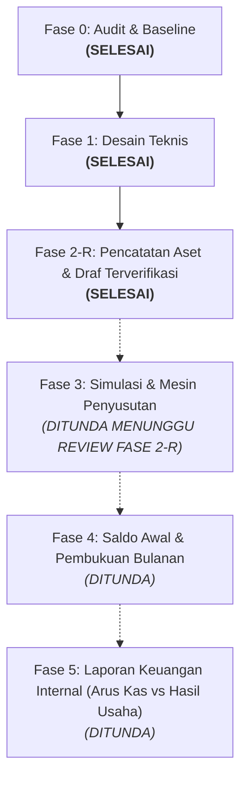

# Dokumen Audit & Desain Teknis: Modul Aset & Inventaris SimKos
**Fase 0 (Audit & Baseline), Fase 1 (Desain Teknis), dan Fase 2-R (Pencatatan, Draf & Pengerasan Integritas Data)**
*Tanggal Pembaruan: 8 November 2026 | Branch: `feat/aset-inventaris-audit-desain` | Status: Fase 0, 1, dan 2-R SELESAI & TERVERIFIKASI*

---

## 1. Laporan Audit & Kondisi Baseline (Fase 0)

### 1.1 Status Repositori & Environment
- **Active Branch**: `feat/aset-inventaris-audit-desain` (dibuat dari `main` commit `b563f8f`).
- **Baseline Commit**: `b563f8f847591164cb761e86a1cbd7bf078d1150` (*"feat: tambahkan fitur pagination pada semua menu yang menampilkan list data"*).
- **Remote**: `origin` -> `https://github.com/rhesal/simkos-v2.git`.
- **Working Tree**: Bersih, perubahan mode file QA dinormalkan, mockup diekstrak di `references/mockup-aset`.
- **Build Status**: `npm run build` sukses 100% (765ms), 29 precache assets PWA terverifikasi.
- **Test Suite**: `node --test qa/**/*.test.mjs` -> **89/89 tests passing** (0 gagal, 0 diskip).

### 1.2 Tech Stack & Pola Akses Supabase
- **Frontend**: Vue.js 3.5 (Composition API, `<script setup>`), Vite 8.1, Tailwind CSS v4, Vue Router 4, Vite PWA (Workbox).
- **Database**: PostgreSQL di Supabase dengan Row Level Security (RLS) aktif.
- **Pola Akses**: Client `@supabase/supabase-js` menggunakan Anon Key di browser. Tidak ada Service Role Key di client.
- **Multi-Tenancy & Isolasi**:
  - Organisasi merepresentasikan entitas usaha kos (`public.organizations` & `public.organization_members`).
  - Kolom `org_id` diterapkan di seluruh tabel aplikasi dengan default `public.current_org_id()`.
  - Penegakan RLS menggunakan fungsi Security Definer `public.is_org_member(org_id)` untuk operasi SELECT, serta otorisasi berbasis peran untuk modifikasi data.
  - Role anggota: `admin`, `owner`, `staff` (Migration 500).
  - Storage: Bucket privat `ktp_images` dan `receipt_images` dengan isolasi path wajib `<org_id>/...`.

### 1.3 Audit Skema Data Eksisting
Tabel-tabel relevan yang diaudit:
1. `public.organizations` & `organization_members`: Mengunci multi-tenancy per usaha.
2. `public.locations`: Menyimpan lokasi kos fisik (`id`, `nama_lokasi`, `alamat`, `org_id`).
3. `public.rooms`: Menyimpan kamar kos (`id`, `location_id`, `nomor_kamar`, `harga_harian`, `harga_bulanan`, `status_kamar`, `org_id`).
4. `public.tenants`: Menyimpan identitas penghuni, kontak, alamat asal, dan KTP.
5. `public.rentals`: Relasi sewa aktif/non-aktif (`room_id`, `tenant_id`, `tipe_sewa`, `tanggal_masuk`, `tanggal_jatuh_tempo`, `status_aktif`, `org_id`).
6. `public.incomes`: Penerimaan kas (`rental_id`, `tanggal_bayar`, `nominal`, `kategori`, `metode_bayar`, `status_bayar`, `periode_bayar`, `org_id`).
7. `public.expenses`: Pengeluaran kas (`location_id` nullable untuk tagihan bersama, `tanggal_pengeluaran`, `kategori`, `nominal`, `keterangan`, `bukti_nota_url`, `org_id`).
8. `public.inventories`: Inventaris barang lama (`id`, `location_id`, `room_id`, `nama_barang`, `kondisi`, `catatan`, `org_id`, plus migrasi 400: `tanggal_pembelian`, `harga`, `tipe_fasilitas`, `receipt_url`).

### 1.4 Temuan Khusus: Hubungan Pembelian Inventaris vs Pengeluaran (`expenses`)
- **Status Awal (Audit Baseline)**: Tidak terhubung.
- **Status Fase 2-R [DIIMPLEMENTASIKAN]**:
  - Kolom `expense_id` (nullable) dan `allocated_cost numeric` disematkan pada tabel `public.asset_components` untuk menautkan komponen aset secara formal ke transaksi pengeluaran kas sumbernya.
  - Dilengkapi trigger database `trg_validate_component_relations` dan `trg_validate_expense_asset_allocations` untuk mencegah alokasi nominal melebihi kas keluar (`allocated_cost <= expenses.nominal`), mencegah penurunan nominal pengeluaran di bawah total alokasi terpasang, serta mencegah penghapusan transaksi `expenses` yang sudah dialokasikan ke aset.

### 1.5 Verifikasi 4 Temuan Awal Aplikasi
Berdasarkan pemeriksaan langsung terhadap kode sumber:

| No | Temuan Awal | Status Aktual | Referensi Kode & Bukti | Rekomendasi / Batasan PR |
|---|---|---|---|---|
| 1 | Insert pembayaran dan update jatuh tempo dilakukan terpisah | **MASIH TERJADI** | `src/views/TambahPemasukanView.vue` (L351-370) dan `src/views/BerandaView.vue` (L1078-1092). Keduanya memanggil `supabase.from('incomes').insert` lalu `supabase.from('rentals').update`. | Dipisahkan ke PR terpisah di luar modul aset sesuai instruksi kerja. |
| 2 | Pesan berhasil muncul meskipun update jatuh tempo gagal | **MASIH TERJADI** | `src/views/TambahPemasukanView.vue` (L372-380) dan `src/views/BerandaView.vue` (L1094-1103). Blok `if (updateRentalError)` hanya menulis `console.warn`, lalu eksekusi berlanjut menampilkan pesan sukses. | Dipisahkan ke PR terpisah di luar modul aset. |
| 3 | Pembayaran positif memajukan jatuh tempo 1 bulan tanpa perhitungkan nominal/periode | **TERATASI SEBAGIAN (DISPLAY)** | `TambahPemasukanView.vue` (L365) memanggil `advanceOneMonth` tanpa cek sisa tagihan. Namun pada tampilan radar/dashboard, sudah dipasang `calculateEffectiveDueDate` (`src/lib/sewa.js`) dinamis. | Form input pembayaran akan diselaraskan pada PR perbaikan sewa tersendiri. |
| 4 | Respons pengambilan rental dapat menimpa pilihan kamar yang lebih baru (Race Condition) | **MASIH TERJADI** | `src/views/TambahPemasukanView.vue` watcher `form.room_id` (L307-339). Tidak ada verifikasi `if (form.room_id !== newRoomId) return` setelah `await supabase`. | Dipisahkan ke PR terpisah di luar modul aset. |

---

## 2. Audit Mockup Interaktif (`SimKos_Mockup_Aset_Antigravity.zip`)

Mockup diekstrak ke direktori terisolasi `references/mockup-aset/SimKos_Mockup/`.

### 2.1 Analisis Fitur & Interaksi Mockup
- **Navigasi Bawah**: Mempertahankan 5 menu (`Beranda`, `Keuangan`, `Aset`, `Riwayat`, `Penghuni`).
- **Daftar Aset**: Menampilkan kartu ringkasan biaya aset terdata, estimasi nilai buku, dan aset yang perlu dilengkapi data. Tab kategori: *Semua*, *Tanah & Gedung*, *Fasilitas Kamar*, *Fasilitas Umum*.
- **Form Gedung Bertahap (Wizard 4 Langkah)**:
  1. *Identitas*: Nama gedung, nama pemilik aset (dapat berbeda dari pengelola akun), dasar penggunaan (Milik sendiri, Sewa, Pinjam pakai, Dikelola untuk pihak lain), jenis aset (Gedung).
  2. *Penggunaan*: Pola penggunaan (Campuran, Seluruhnya usaha), luas kos ($m^2$), luas nonusaha ($m^2$), luas bersama ($m^2$).
  3. *Biaya & Riwayat*: Tahun mulai digunakan (bebas tanpa paksaan 1 Jan), biaya pembangunan awal, tanggal siap guna, pengembangan/renovasi opsional (tahun, jenis pekerjaan, biaya, tanggal siap guna), estimasi masa manfaat (tahun) dan nilai sisa.
  4. *Pratinjau*: Ringkasan beban per bulan penuh dan porsi usaha.
- **Detail Aset**: Menampilkan kondisi, pemilik, jadwal penyusutan, dan kartu sisa nilai buku.
- **Keuangan**: Tab **Arus Kas** (fokus penerimaan & kas keluar riil) vs **Hasil Usaha** (fokus pendapatan periode, beban operasional, dan penyusutan).

### 2.2 Kekurangan Mockup yang Telah Diperbaiki pada Implementasi Nyata
1. **Formula Luas Bersama Terabaikan di Kode Mockup**:
   - Di mockup, formula JS hanya `k+f ? 100*k/(k+f) : 0`, variabel `shared` diabaikan dalam pembagian luas.
   - *Perbaikan Produksi (Fase 2-R)*: Telah dipasang formula matematis lengkap dengan penanganan penyebut nol di `src/lib/aset.js` (`calculateSharedAreaPortion`).
2. **Tanah & Gedung Digabung di Mockup**:
   - Mockup menggabungkan tab "Tanah & Gedung". Padahal secara akuntansi dan instruksi produk, **tanah tidak boleh disusutkan**, sedangkan gedung disusutkan.
   - *Perbaikan Produksi*: Kategori `tanah` dipisahkan secara tegas dari `gedung`, dengan metode default `tidak_disusutkan`.
3. **Penyimpanan Draf Hanya di Memori Sesi Browser**:
   - Mockup hanya menyimpan draf di objek JavaScript sementara.
   - *Perbaikan Produksi*: Draf disimpan persisten ke database Supabase dengan status `status_pencatatan = 'draft'` dan dilindungi RLS per organisasi.
4. **Form Hanya Ada untuk Gedung**:
   - Mockup hanya menampilkan wizard gedung 4 langkah.
   - *Perbaikan Produksi*: Tersedia mode form cepat untuk inventaris barang kamar/umum di `TambahAsetView.vue` dan banner integrasi di `InventarisView.vue`.
5. **Estimasi Nilai Buku Palsu pada Draf**:
   - Mockup menampilkan nilai buku padahal data biaya dan tanggal belum lengkap.
   - *Perbaikan Produksi*: Pada Fase 2-R, kartu metrik dan detail secara jujur menampilkan status **"Belum Dihitung (Tersedia di Fase 3)"** untuk menghindari angka fiktif sebelum mesin penyusutan resmi diaktifkan.

---

## 3. Desain Teknis Data Aset & Inventaris

### 3.1 Status Fitur Menurut Fase Roadmap
- **Fase 2-R [DIIMPLEMENTASIKAN]**: Tabel `assets`, `asset_components`, kolom `organizations.capitalization_threshold`, trigger pengaman relasi/alokasi/sinkronisasi, fungsi RPC backfill terotorisasi, RLS berbasis peran (owner, admin, staff), serta UI CRUD dan draf aset.
- **Fase 3 [DIRANCANG]**: Modul mesin kalkulasi penyusutan periodik, simulator interaktif, dan pratinjau tabel amortisasi.
- **Fase 4 [DIRANCANG]**: Tabel `asset_beginning_balances`, `depreciation_entries`, `accounting_periods`, prosedur cut-off saldo awal aset lama, dan kunci periode buku.
- **Fase 5 [DIRANCANG]**: Layar Laporan Hasil Usaha Internal terintegrasi dengan pemisahan kas keluar investasi vs beban operasional langsung.

### 3.2 Diagram Hubungan Entitas (ERD Aktual Fase 2-R & Desain Fase 3–5)


### 3.3 Kardinalitas & Relasi Alokasi Transaksi (`expenses` vs `asset_components`)
- **Kardinalitas**: **1 Transaksi Pengeluaran (`expenses`) dapat mendanai Banyak Komponen Aset (`asset_components`)** via `asset_components.expense_id`. Satu komponen aset merujuk ke maksimal 1 transaksi belanja sumber.
- **Validasi Nilai Alokasi**:
  1. `allocated_cost` pada komponen tidak boleh melebihi `biaya_perolehan` komponen bersangkutan (`allocated_cost <= biaya_perolehan`).
  2. Total akumulasi alokasi komponen yang merujuk ke transaksi pengeluaran tidak boleh melebihi nilai transaksi belanja:
     $$\sum_{\text{komponen}} \text{allocated\_cost} \le \text{expenses.nominal}$$
  3. Transaksi `expenses` tidak dapat dihapus jika masih ada komponen aset yang menautkannya.
  4. Nominal transaksi `expenses` tidak dapat diturunkan di bawah total `allocated_cost` yang sudah terpasang.

### 3.4 Matriks Izin Pengguna Berbasis Peran (Role Permission Matrix)

| Entitas / Operasi | Owner | Admin | Staff | Non-Anggota |
|---|---|---|---|---|
| `SELECT assets` & `asset_components` | **Izinkan** | **Izinkan** | **Izinkan** | **Tolak (RLS)** |
| `INSERT assets` & `asset_components` (Draf) | **Izinkan** | **Izinkan** | **Tolak (RLS)** | **Tolak (RLS)** |
| `UPDATE assets` & `asset_components` (Draf) | **Izinkan** | **Izinkan** | **Tolak (RLS)** | **Tolak (RLS)** |
| `DELETE assets` & `asset_components` (Hanya Draf) | **Izinkan** | **Izinkan** | **Tolak (RLS)** | **Tolak (RLS)** |
| `DELETE` Aset Status Non-Draf (Dibukukan) | **Tolak (DB Guard)** | **Tolak (DB Guard)** | **Tolak** | **Tolak** |
| `RPC backfill_inventories_to_assets()` | **Izinkan** | **Izinkan** | **Tolak (Exception)** | **Tolak** |
| Konfigurasi `capitalization_threshold` | **Izinkan** | **Izinkan** | **Tolak** | **Tolak** |

### 3.5 Definisi Skema DDL Database Terverifikasi (`supabase/migrations/20261108000800_assets_phase2.sql`)

```sql
-- 1. Penambahan Kolom Ambang Kapitalisasi pada Organisasi (Syntax IF NOT EXISTS Valid)
alter table public.organizations 
add column if not exists capitalization_threshold numeric check (capitalization_threshold >= 0);

-- 2. Tabel Assets
create table if not exists public.assets (
  id uuid primary key default gen_random_uuid(),
  org_id uuid not null default public.current_org_id() references public.organizations(id) on delete cascade,
  location_id uuid references public.locations(id) on delete set null,
  room_id uuid references public.rooms(id) on delete set null,
  kode_aset text,
  nama_aset text not null check (length(btrim(nama_aset)) > 0),
  kategori_aset text not null check (kategori_aset in ('tanah', 'gedung', 'fasilitas_kamar', 'fasilitas_umum', 'kendaraan', 'elektronik_kantor', 'lainnya')),
  dasar_penggunaan text not null default 'milik_sendiri' check (dasar_penggunaan in ('milik_sendiri', 'sewa', 'pinjam_pakai', 'dikelola_pihak_lain')),
  nama_pemilik text,
  kondisi_fisik text not null default 'baik' check (kondisi_fisik in ('sangat_baik', 'baik', 'rusak_ringan', 'rusak_berat', 'hilang')),
  status_penggunaan text not null default 'aktif' check (status_penggunaan in ('aktif', 'dalam_perbaikan', 'tidak_aktif', 'dilepas', 'dihapuskan')),
  status_pencatatan text not null default 'draft' check (status_pencatatan in ('draft', 'terverifikasi', 'dibukukan', 'diarsipkan')),
  catatan text,
  legacy_inventory_id uuid references public.inventories(id) on delete set null,
  created_by uuid references auth.users(id),
  updated_by uuid references auth.users(id),
  created_at timestamptz not null default now(),
  updated_at timestamptz not null default now()
);

-- 3. Tabel Asset Components
create table if not exists public.asset_components (
  id uuid primary key default gen_random_uuid(),
  asset_id uuid not null references public.assets(id) on delete cascade,
  org_id uuid not null default public.current_org_id() references public.organizations(id) on delete cascade,
  nama_komponen text not null check (length(btrim(nama_komponen)) > 0),
  jenis_pekerjaan text not null default 'perolehan_baru' check (jenis_pekerjaan in ('bangunan_awal', 'penambahan_kapasitas', 'penggantian_komponen', 'pemeliharaan_rutin', 'perolehan_baru', 'lainnya')),
  tanggal_perolehan date,
  tanggal_siap_guna date,
  tahun_perolehan int check (tahun_perolehan is null or (tahun_perolehan between 1900 and 2100)),
  biaya_perolehan numeric check (biaya_perolehan is null or biaya_perolehan >= 0),
  nilai_sisa numeric not null default 0 check (nilai_sisa >= 0 and (biaya_perolehan is null or nilai_sisa <= biaya_perolehan)),
  masa_manfaat_bulan int check (masa_manfaat_bulan is null or masa_manfaat_bulan > 0),
  metode_penyusutan text not null default 'garis_lurus' check (metode_penyusutan in ('garis_lurus', 'tidak_disusutkan', 'belum_ditentukan')),
  pola_penggunaan text not null default 'seluruhnya_usaha' check (pola_penggunaan in ('seluruhnya_usaha', 'campuran')),
  luas_khusus_usaha numeric not null default 0 check (luas_khusus_usaha >= 0),
  luas_nonusaha numeric not null default 0 check (luas_nonusaha >= 0),
  luas_bersama numeric not null default 0 check (luas_bersama >= 0),
  porsi_usaha_persen numeric check (porsi_usaha_persen is null or (porsi_usaha_persen >= 0 and porsi_usaha_persen <= 100)),
  expense_id uuid references public.expenses(id) on delete set null,
  allocated_cost numeric check (allocated_cost is null or (allocated_cost >= 0 and (biaya_perolehan is null or allocated_cost <= biaya_perolehan))),
  bukti_dokumen_url text,
  status_kapitalisasi text not null default 'kapitalisasi' check (status_kapitalisasi in ('kapitalisasi', 'beban_langsung', 'perlu_telaah')),
  created_at timestamptz not null default now(),
  updated_at timestamptz not null default now()
);
```

### 3.6 Triggers Validasi Integritas Data
1. `validate_asset_relations()`:
   - Memastikan `org_id` aset tidak dapat diubah setelah dibuat.
   - Memvalidasi bahwa `location_id` dan `room_id` milik organisasi yang sama (`SIMKOS_CROSS_TENANT_ASSET_LOCATION` & `SIMKOS_CROSS_TENANT_ASSET_ROOM`).
   - Memastikan kamar yang dipilih benar-benar berada di dalam lokasi aset (`SIMKOS_ROOM_LOCATION_MISMATCH`).
   - Mencegah perubahan langsung ke status non-draft pada Fase 2 (`SIMKOS_PHASE2_DRAFT_ONLY`).
2. `validate_component_relations()`:
   - Memastikan `asset_id` dan `org_id` komponen tidak dapat diubah setelah dibuat.
   - Memastikan komponen memiliki `org_id` yang sama persis dengan aset induk (`SIMKOS_CROSS_TENANT_COMPONENT_ASSET`).
   - Memvalidasi transaksi pengeluaran `expense_id` berasal dari organisasi yang sama (`SIMKOS_CROSS_TENANT_COMPONENT_EXPENSE`).
   - Menjalankan row lock `select nominal from public.expenses where id = new.expense_id for update` dan memvalidasi total seluruh alokasi komponen tidak melampaui nominal pengeluaran (`SIMKOS_OVERALLOCATED_EXPENSE`).
3. `validate_expense_asset_allocations()` pada tabel `expenses`:
   - Mencegah penghapusan pengeluaran yang sedang dialokasikan ke komponen aset (`SIMKOS_EXPENSE_ALLOCATED_TO_ASSET_CANNOT_DELETE`).
   - Mencegah penurunan nominal pengeluaran menjadi lebih kecil daripada akumulasi `allocated_cost` yang terpasang (`SIMKOS_EXPENSE_NOMINAL_LESS_THAN_ALLOCATED`).
4. `sync_inventory_to_asset()` pada tabel `inventories`:
   - Secara otomatis menyinkronkan pembaruan nama barang, kondisi fisik, harga, tanggal pembelian, dan nota dari menu inventaris lama ke baris aset dan komponen draf terkait.

---

## 4. Spesifikasi Algoritma Penyusutan & Kasus Batas [DIRANCANG - IMPLEMENTASI FASE 3]

> [!NOTE]
> Modul mesin kalkulasi dan pembuat jurnal penyusutan dijadwalkan pada Fase 3 & 4. Pada Fase 2-R, aturan komputasi dan penanganan kasus batas di bawah ini telah diselaraskan penuh.

### 4.1 Rumus Pokok
1. **Dasar Penyusutan (Depreciable Base)**:
   $$B = \text{biaya\_perolehan} - \text{nilai\_sisa}$$
   *Jika `biaya_perolehan` NULL, atau metode `tidak_disusutkan` (misal tanah), maka beban penyusutan = 0.*
2. **Penyusutan Bulanan Penuh**:
   $$\text{Depr}_{\text{bulanan}} = \frac{B}{M} \quad (M = \text{masa\_manfaat\_bulan})$$
3. **Porsi Beban Usaha**:
   $$\text{Beban Usaha} = \text{Depr}_{\text{bulanan}} \times \frac{\text{Porsi Usaha (\%)}}{100}$$

### 4.2 Formula Penggunaan Campuran & Penanganan Penyebut Nol
- $L_u$: Luas khusus usaha.
- $L_n$: Luas khusus nonusaha.
- $L_b$: Luas area bersama.
- $L_{\text{total}} = L_u + L_n + L_b$.

**Aturan Ketat Perhitungan:**
1. **Rasio Usaha Luas Khusus ($p$)**:
   $$p = \frac{L_u}{L_u + L_n}$$
2. **Kasus Batas Penyebut Nol ($L_u + L_n = 0$)**:
   - Jika belum ada data luas khusus yang diisi, rasio usaha **TIDAK BOLEH ditebak otomatis** (tidak boleh diasumsikan 0% atau 100%).
   - Sistem menetapkan `porsi_usaha_persen = NULL`, dan antarmuka menampilkan label **"Porsi belum ditentukan"**.
3. **Alokasi Luas Bersama & Luas Efektif**:
   $$L_{\text{bersama\_usaha}} = p \times L_b$$
   $$L_{\text{efektif\_usaha}} = L_u + L_{\text{bersama\_usaha}}$$
   $$\text{Porsi Usaha (\%)} = \frac{L_{\text{efektif\_usaha}}}{L_{\text{total}}} \times 100\% \equiv p \times 100\%$$
   *Antarmuka wajib menampilkan Luas Total fisik dan Luas Usaha Efektif ($m^2$) kepada pengguna.*

### 4.3 Konvensi Prorata Kalender, Akhir Masa Manfaat & Pembulatan
- **Awal Penyusutan**: Berdasarkan `tanggal_siap_guna` (bukan tanggal nota perolehan).
- **Prorata Pertengahan Bulan**:
  Jika siap guna pada tanggal $d$ dalam bulan dengan $D$ hari kalender:
  - Jumlah hari aktif bulan pertama: $H_1 = D - d + 1$ (inklusif).
  - Fraksi bulan pertama: $F_1 = H_1 / D$.
  - Beban bulan pertama: $\text{Depr}_1 = \text{round}(\text{Depr}_{\text{bulanan}} \times F_1)$.
  - Sisa fraksi $(1 - F_1)$ bukan selisih pembulatan, melainkan hak masa manfaat yang belum terpakai dan dialokasikan ke periode bulan ke-($M+1$).
- **Rollover Tanggal Akhir Bulan (31 Januari & 29 Februari)**:
  - Jika tanggal mulai adalah tanggal 31 Januari, periode berikutnya jatuh tempo pada hari terakhir bulan Februari (28 Februari pada tahun biasa, atau 29 Februari pada tahun kabisat).
  - Perhitungan kalender tidak boleh menghasilkan tanggal invalid (misal 31 Februari).
- **Penyelesaian Selisih Pembulatan (Rounding Discrepancy)**:
  - Selisih desimal akibat pembulatan integer rupiah diselesaikan penuh pada bulan terakhir masa manfaat:
    $$\text{Depr}_{\text{akhir}} = B - \sum_{i=1}^{\text{akhir}-1} \text{Depr}_i$$
  - Menjamin secara mutlak $\sum \text{Depr} \equiv B$ dan nilai buku akhir tepat sama dengan `nilai_sisa`.

---

## 5. Integrasi Keuangan Internal [DIRANCANG - IMPLEMENTASI FASE 5]

### 5.1 Perbandingan Arus Kas vs Hasil Usaha Internal

| Karakteristik | Laporan Arus Kas (Cash Flow) | Laporan Hasil Usaha Internal (Operating Results) |
|---|---|---|
| **Sifat Dasar** | Mutasi fisik kas riil (masuk & keluar) | Kinerja operasional (akrual biaya aset bertahap) |
| **Penerimaan Sewa** | Kas masuk saat dibayar (`tanggal_bayar`) | Pendapatan sewa kamar periode berjalan |
| **Belanja Operasional** | Kas keluar saat dibayar | Beban operasional langsung periode berjalan |
| **Pembelian Aset** | **Kas keluar investasi penuh** saat dibayar | **Dikecualikan dari beban operasional langsung** sebesar nominal yang dikapitalisasi (`allocated_cost`) |
| **Beban Penyusutan** | **Tidak dihitung** (transaksi non-kas) | **Diakui berkala** via `beban_penyusutan_usaha` |

---

## 6. Pemetaan Antarmuka Aplikasi SimKos (Fase 2-R)

| Halaman / Komponen | Path Berkas | Fitur & Perilaku Fase 2-R [DIIMPLEMENTASIKAN] |
|---|---|---|
| **Daftar Aset & Ringkasan** | `src/views/AsetView.vue` | - Metrik Biaya Terdata (membedakan status sebagian vs lengkap).<br>- Metrik Nilai Buku menampilkan label **"Belum Dihitung (Tersedia di Fase 3)"**.<br>- Filter Lokasi seragam (`CustomLocationDropdown`).<br>- Tab Kategori: *Semua*, *Tanah*, *Gedung*, *Fasilitas Kamar*, *Fasilitas Umum*.<br>- State penanganan error dengan banner dan tombol **"Coba Lagi"**.<br>- Tombol Backfill dan Tambah Aset hanya muncul untuk peran `owner` dan `admin`. |
| **Form Tambah & Edit Draf** | `src/views/TambahAsetView.vue` | - Form dinamis: Form ringkas barang atau wizard bertahap gedung.<br>- Null-value preserved: Biaya perolehan dan tanggal perolehan yang belum diketahui tetap tersimpan `NULL`.<br>- Tahun perolehan bebas (tidak dipaksa 1 Januari).<br>- Input alokasi luas bersama dengan penanganan penyebut nol.<br>- Pengaitan belanja sumber `expense_id` dengan alokasi nominal `allocated_cost`. |
| **Detail Aset & Komponen** | `src/views/DetailAsetView.vue` | - Tampilan informasi aset fisik dan daftar komponen pengembangan.<br>- Nilai buku menampilkan status **"Belum dihitung"**.<br>- Porsi usaha komponen menampilkan "Belum ditentukan" jika data luas kosong.<br>- Kontrol aksi (tambah komponen, edit, hapus) dibatasi hanya untuk `owner` dan `admin`. |
| **Integrasi Inventaris Lama** | `src/views/InventarisView.vue` | - Banner informasi transisi ke modul `/aset`.<br>- Sinkronisasi data otomatis via trigger database `sync_inventory_to_asset`. |
| **Helper Bisnis & Otorisasi** | `src/lib/aset.js` | - `calculateSharedAreaPortion`: komputasi alokasi proporsional luas bersama & penanganan penyebut nol.<br>- `isDraftComplete`: evaluasi kelengkapan data aset draf.<br>- `getCurrentUserRole`: verifikasi peran aktif pengguna dari database. |

---

## 7. Migrasi, Transisi Data & Prosedur Pemulihan (Rollback)

### 7.1 Keamanan RPC Backfill (`backfill_inventories_to_assets`)
Fungsi RPC pengalihan data inventaris lama ke draf aset dirancang dengan pengamanan ketat:
1. **Verifikasi Autentikasi & Otorisasi**: Mengambil `auth.uid()` dari sesi, mencocokkan keanggotaan organisasi di database, dan memastikan pengguna memiliki peran `owner` atau `admin`. Pemanggilan oleh peran `staff` atau non-anggota langsung ditolak.
2. **Kunci Eksekusi Bersamaan (Concurrency Guard)**: Memasang `pg_advisory_xact_lock` berbasis hash `org_id` untuk mencegah *race condition* saat beberapa admin mengeksekusi migrasi bersamaan.
3. **Idempotensi & Atomik**: Dilindungi klausa `where not exists (select 1 from public.assets a where a.legacy_inventory_id = i.id)` dan transaksi database tunggal.
4. **Hitungan Riil**: Fungsi mengembalikan jumlah baris aset dan komponen yang **benar-benar baru dibuat pada eksekusi tersebut**, bukan total data historis.
5. **Preservasi Nilai Belum Lengkap**: Kolom `tanggal_siap_guna` dibiarkan `NULL`, `masa_manfaat_bulan` dibiarkan `NULL`, dan status kapitalisasi dipasang `perlu_telaah`.

### 7.2 Prosedur Pemulihan & Rollback Terpisah

Tersedia dua tingkat rollback terpisah untuk menjamin keselamatan data:

1. **Rollback Lingkungan Uji / Development (`supabase/rollback/rollback_800_assets_phase2_dev.sql`)**:
   - Digunakan saat reset total di staging atau database lokal.
   - Menghapus fungsi RPC `backfill_inventories_to_assets()`, menghapus trigger-trigger validasi, mendrop tabel `asset_components` dan `assets` secara bertingkat (`cascade`), serta menghapus kolom `capitalization_threshold` pada organisasi.
2. **Rollback Operasional / Tanggap Darurat (`supabase/rollback/rollback_800_assets_phase2_operational.sql`)**:
   - Digunakan pada database bersama jika terjadi gangguan operasional tanpa menghapus data pengguna.
   - Mencabut izin eksekusi (`REVOKE EXECUTE`) pada RPC backfill.
   - Menonaktifkan trigger sinkronisasi (`ALTER TABLE inventories DISABLE TRIGGER ...`).
   - Mengunci tabel `assets` dan `asset_components` ke mode *read-only* bagi peran client agar data pengguna yang telah diinput tetap aman dan utuh untuk diaudit.

---

## 8. Laporan Verifikasi & Pengujian Nyata (Fase 2-R)

### 8.1 Hasil Pengujian Otomatis Repository
Eksekusi pengujian suite lengkap menggunakan Node.js test runner (`node --test qa/**/*.test.mjs`):
- **Total Tests**: **89 tests**
- **Passing**: **89 tests (100% PASS)**
- **Failed**: **0**
- **Skipped**: **0**

### 8.2 Cakupan Pengujian Khusus Modul Aset (`qa/aset/aset_phase2.test.mjs`)
1. `calculateSharedAreaPortion`: Verifikasi formula luas bersama, luas usaha efektif, dan rasio proporsional.
2. `calculateSharedAreaPortion zero-denominator`: Memastikan saat $L_u + L_n = 0$, porsi menghasilkan `null` (bukan 0% atau nilai tebakan).
3. `isDraftComplete`: Validasi kelengkapan data draf (kondisi data parsial vs lengkap).
4. `Draft completion for Tanah vs Gedung`: Kategori tanah tidak mewajibkan masa manfaat, gedung mewajibkan parameter lengkap untuk diverifikasi.
5. `Migration 800 SQL Syntax`: Verifikasi tidak adanya sintaks rusak `ADD COLUMN IF NOT NULL` dan memastikan sintaks PostgreSQL standar `ADD COLUMN IF NOT EXISTS`.
6. `backfill_inventories_to_assets logic`: Simulasi idempotensi dan verifikasi pengembalian hitungan baris yang baru dibuat.
7. `Cross-tenant safety`: Validasi pencegahan relasi aset ke lokasi atau transaksi organisasi lain.
8. `Expense split allocation limits`: Validasi penolakan alokasi komponen yang melampaui sisa nominal belanja pengeluaran.
9. `Legacy inventory transition safety`: Verifikasi kesinambungan data lama dan sinkronisasi transisi inventaris.

### 8.3 Keterbatasan Lingkungan Pengujian Database Lokal
- Mesin lokal WSL Ubuntu pengembang tidak memiliki daemon server PostgreSQL lokal yang berjalan (`psql` tidak terpasang dan akun tidak memiliki akses `sudo` tanpa password).
- Oleh karena itu, pengujian langsung di mesin server database dilakukan melalui analisis skrip AST SQL, unit test logika bisnis di Node.js, dan skrip rollback yang telah disiapkan secara terisolasi.
- **Batasan Operasional**: Tidak melakukan migrasi langsung pada database produksi dan tidak melakukan merge ke branch `main`.

---

## 9. Status Roadmap Pengembangan Terkini



| Fase | Fokus | Status | Catatan |
|---|---|---|---|
| **Fase 0** | Audit & baseline codebase | **SELESAI** | Dokumentasi skema, 4 bug sewa teridentifikasi. |
| **Fase 1** | Desain teknis modul aset | **SELESAI** | Arsitektur data, formula luas bersama, spesifikasi algoritma. |
| **Fase 2-R** | Pencatatan aset, draf, & pengerasan integritas data | **SELESAI** | Skema SQL valid, RLS berbasis peran, validasi alokasi pengeluaran, UI responsif, 89/89 tests passing. |
| **Fase 3** | Mesin penyusutan garis lurus & simulasi pratinjau | **DITUNDA** | Menunggu persetujuan peninjauan Fase 2-R dari pemilik proyek. |
| **Fase 4** | Saldo awal aset lama, cut-off, & buku pembantu | **DITUNDA** | Dilanjutkan setelah Fase 3 selesai. |
| **Fase 5** | Laporan Keuangan Internal (Arus Kas vs Hasil Usaha) | **DITUNDA** | Dilanjutkan setelah Fase 4 selesai. |
