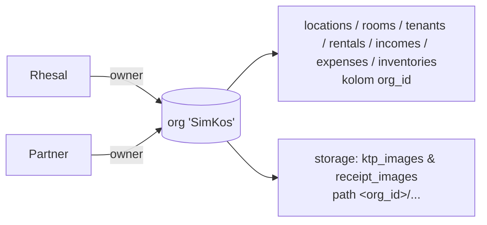

# Pengamanan Data SimKos v2: multi-pemilik, RLS, KTP & nota

Dokumen ini menjelaskan perubahan keamanan di PR #1 dan **langkah manual** untuk
project Supabase live ("SimKos App"). Perubahan kode saja **belum** mengamankan
data: migration harus diterapkan di Supabase, berurutan.

## 1. Kondisi live sebelum PR ini (dibaca read-only, 10 Okt 2026)

- Bucket `ktp_images` dan `receipt_images` **sudah private**. URL publik KTP
  tidak bisa dibuka (HTTP 400). Bucket belum punya batas ukuran/tipe file.
- **Masalah utama:** semua policy hanya mengecek "user sudah login":
  - 7 tabel: `"Hanya user login yang bisa akses <tabel>"` = `auth.role() = 'authenticated'`.
  - storage: `"Izinkan lihat KTP"` / `"Izinkan upload KTP"` = semua objek `ktp_images`.
  - Ditambah **signup publik terbuka**, siapa pun bisa mendaftar lalu membaca
    seluruh data penghuni dan semua foto KTP. **Signup publik sudah dimatikan**
    (`disable_signup = true`, 10 Okt 2026).
- RLS tabel `inventories` **mati**, dan role `anon` punya grant SELECT/INSERT di
  semua tabel, jadi `inventories` bisa ditulis tanpa login (isinya masih kosong).
- 2 akun di `auth.users`, yaitu Rhesal dan partner (co-owner), memakai data yang sama.
  27 foto KTP ada di **root** bucket (`ktp_<n>.jpg`): 26 diunggah satu akun,
  1 oleh akun lainnya. `receipt_images` kosong.
- Tidak ada kolom pemilik di tabel mana pun. Semua FK induk nullable.
- Baseline skema live: `docs/reference/live_schema_public.sql` (tanpa data, bukan migration).

## 2. Desain: organisasi (multi-pemilik)

Satu **organisasi** = satu usaha kos. Semua anggota organisasi melihat dan
mengelola **semua** data organisasinya.



| Komponen | Isi |
|---|---|
| `organizations` | `id, name, created_at`. Anggota bisa membaca, admin atau owner bisa ganti nama. Buat/hapus org hanya lewat SQL/dashboard. |
| `organization_members` | `org_id, user_id → auth.users (on delete cascade), role ('admin','owner','staff', default 'staff'; sejak migration 500)`, PK `(org_id,user_id)`, **`unique(user_id)`**, jadi satu user hanya bisa di satu org. |
| `is_org_member(org)`, `is_org_owner(org)`, `is_org_admin(org)` (migration 500) | `SECURITY DEFINER STABLE`, `search_path = ''`. Dipakai semua policy. Policy `organization_members` hanya memakai helper ini (tidak query tabelnya langsung), jadi tidak terjadi rekursi RLS. |
| `current_org_id()` | Org milik user yang login. ERROR (42501) bila tidak login, bukan anggota, atau >1 org. Dipakai sebagai **default `org_id`**, jadi frontend tidak perlu mengirim `org_id` saat insert. |
| 7 tabel aplikasi | Kolom `org_id uuid not null references organizations`, index, default `current_org_id()`. Satu policy `<tabel>_org_access` untuk `authenticated`. **USING** `is_org_member(org_id)`. **WITH CHECK** `is_org_member(org_id)` plus setiap induk yang diisi (FK tidak NULL) harus satu org (`rooms→locations`, `rentals→rooms,tenants`, `incomes→rentals`, `expenses→locations`, `inventories→locations,rooms`). FK NULL tetap boleh, karena di live memang nullable. |
| `anon` | Semua grant di 9 tabel dicabut. RLS `inventories` diaktifkan. |
| Anggota | Semua anggota bisa melihat daftar anggota org-nya. Sejak migration 500: tambah/ubah/hapus anggota hanya oleh **admin org itu**, **tidak untuk barisnya sendiri** dan **tidak untuk admin lain**; peran yang bisa diberikan lewat API hanya owner/staff. Owner dan staff tidak bisa mengelola anggota. Admin terakhir dijaga trigger. Rincian: `docs/org-roles.md`. Belum ada UI undangan; kelola lewat SQL (bagian 6). |
| Storage | Hanya path `<org_id>/<prefix>_<uuid>.<ext>` dengan `is_org_member(<folder pertama>)`. Tidak ada akses ke objek di root. Guard **RESTRICTIVE** `simkos_private_images_guard` (to public) menahan policy permisif lain. Bucket private, maks 5 MB, hanya JPEG/PNG/WEBP. |
| Trigger path | `tenants.foto_ktp_url`, `expenses.bukti_nota_url`, dan `inventories.receipt_url` (bila kolomnya ada) yang baru atau berubah **wajib** diawali `<org_id baris itu>/` dan tidak boleh berisi `..`. Nilai yang tidak berubah dibiarkan. Ini mencegah orang menautkan file milik org lain ke baris sendiri. |

Policy "file lama di root terbaca bila namanya cocok dengan `tenants.foto_ktp_url`"
**sengaja tidak dipakai**. Policy seperti itu memungkinkan anggota org lain
"mengklaim" file dengan menulis namanya di baris miliknya. Sebagai gantinya,
file lama **dipindah** ke folder org dengan `supabase/scripts/move_root_files_to_org.mjs`.

### Frontend
- `src/lib/storage.js`: `getCurrentOrgId()` mengambil `org_id` sekali setelah login
  (`organization_members`), lalu menyimpannya di cache per user. Cache dibuang saat
  `SIGNED_OUT`/ganti user dan saat tombol logout. Path upload menjadi `<org_id>/...`.
  Bila upload ditolak (403/RLS), cache dibuang dan user diminta **"Muat ulang aplikasi"**.
- `vite.config.js`: PWA `autoUpdate` + `workbox.skipWaiting/clientsClaim/cleanupOutdatedCaches`,
  supaya bundle lama (yang masih upload ke root) cepat diganti.
- Tetap dari commit sebelumnya: modal KTP via `download()` + blob URL (`KtpViewerModal.vue`),
  TTL signed URL nota 1 jam, upload KTP `cacheControl '0'`, validasi JPG/PNG/WEBP ≤ 5 MB,
  nama file UUID.

## 3. File

| File | Fungsi |
|---|---|
| `supabase/migrations/20261010000200_organizations_and_backfill.sql` | Tabel org + helper + `org_id` + **backfill**: membuat org 'SimKos' dan memasukkan **semua** user `auth.users` sebagai owner. **Gagal bila jumlah user ≠ 2**, kecuali di-override dengan `set simkos.backfill_expected_users = '<n>';`. Semua baris lama diisi `org_id`, lalu dibuat `NOT NULL` dan diberi default. Policy tabel lama belum disentuh, jadi app lama tetap jalan. |
| `supabase/migrations/20261010000210_org_rls_policies.sql` | Menghapus policy lama di 7 tabel, mengaktifkan RLS di semua (termasuk inventories), mencabut anon, lalu memasang policy org. |
| `supabase/scripts/move_root_files_to_org.mjs` | Memindah file yang direferensikan ke `<org_id>/<nama sama>`. Idempotent dan bisa resume, dengan log JSON. Urutannya move, lalu update baris. Bila update gagal, file dipindah balik. File yang sumbernya ada di folder **organisasi lain** ditandai `conflict` dan tidak dipindah. Semua file di luar folder org yang tidak direferensikan (root, `<uid>/`, folder lain) hanya dilaporkan di `unreferenced_outside_org_files`. |
| `supabase/migrations/20261010000300_private_storage_buckets.sql` | Langkah 0: tolak policy storage permisif generik. Langkah 0b: **tolak bila masih ada baris yang menunjuk file di luar folder org**, artinya move script belum tuntas. Lalu bucket 5 MB + JPEG/PNG/WEBP, policy org, guard RESTRICTIVE, dan trigger path. |
| `supabase/rollback/rollback_300_storage.sql` | Mengembalikan 2 policy storage live **persis**. Bucket **tetap private**. |
| `supabase/rollback/rollback_210_org_rls.sql` | Mengembalikan 7 policy tabel live **persis**. Sengaja tidak mengembalikan RLS-off di inventories dan grant anon. |
| `supabase/rollback/rollback_200_organizations.sql` | Opsional. Menghapus `org_id` dan tabel org, sehingga skema kembali sama dengan baseline. |
| `docs/reference/live_schema_public.sql` | Baseline skema live (menggantikan skema hasil tebakan). |
| `qa/rls/org/` | Tes RLS lokal berbasis baseline live (`run_local_org.sh`). |
| `qa/move-script/move_script.test.mjs` | Tes move script dengan stub Storage (`node --test qa/move-script/`). |

## 4. Urutan penerapan di project live (MANUAL)

> Jangan pakai `supabase db push` untuk semua sekaligus. Migration 300 harus
> dijalankan **setelah** move script. Kalau tetap dijalankan terlalu cepat, migration
> itu menolak dengan aman, tapi urutan di bawah ini lebih jelas. Jalankan setiap
> file **utuh dalam satu kali Run** di SQL Editor, karena SQL Editor menjalankan
> satu file sebagai satu transaksi. Kalau lewat psql: `psql -1 -f <file>`.

**Langkah 0. Backup**
```bash
supabase link --project-ref opuiruumaagtudqnrlhv
supabase db dump -f backup_schema.sql
supabase db dump --data-only -f backup_data.sql
```
Policy sebelum perubahan sudah tercatat di file rollback (`supabase/rollback/`).

**Langkah 1. Cek user** (SQL Editor):
```sql
select id, email, created_at from auth.users order by created_at;  -- harus 2: Rhesal & partner
```

**Langkah 2. Migration 200**, lalu **210** (SQL Editor, satu file per Run).
Cek hasilnya:
```sql
select o.name, m.user_id, m.role from organization_members m join organizations o on o.id = m.org_id; -- 2 owner
select count(*) filter (where org_id is null) from tenants;   -- 0
select tablename, policyname from pg_policies where schemaname = 'public' order by 1; -- *_org_access + policy org
```
Login dengan **kedua** akun. Keduanya harus melihat semua lokasi, kamar, penghuni,
dan keuangan. Foto KTP masih bisa dibuka karena policy storage lama belum diganti.

**Langkah 3. Deploy frontend.** Merge PR ini ke `main` (deploy Vercel). Setelah itu,
buka aplikasi dan muat ulang sekali (PWA diganti otomatis). Upload KTP baru akan
masuk ke `<org_id>/...`. Ini masih diizinkan policy lama `"Izinkan upload KTP"`.
Catatan: upload **nota** (`receipt_images`) sudah gagal di live sejak awal, karena
tidak ada policy untuk bucket itu. Upload nota baru bisa jalan setelah Langkah 5.

**Langkah 4. Pindahkan file lama** (di komputer sendiri, di root repo, setelah `npm install`):
```bash
export SUPABASE_URL=https://opuiruumaagtudqnrlhv.supabase.co
export SUPABASE_SERVICE_ROLE_KEY='<Dashboard → Settings → API → service_role>'   # JANGAN di-commit
node supabase/scripts/move_root_files_to_org.mjs --dry-run   # rencana: 27 file KTP
node supabase/scripts/move_root_files_to_org.mjs             # jalankan
unset SUPABASE_SERVICE_ROLE_KEY
```
Skrip harus selesai dengan exit 0 tanpa item `failed`, `conflict`, atau `missing`.
Kalau terputus, jalankan ulang perintah yang sama.

> **Kalau ada item `failed_needs_attention`:** update baris gagal **dan** file gagal
> dipindah balik, jadi baris itu sementara menunjuk ke file yang sudah tidak ada di
> path lamanya (foto KTP tidak tampil). **Segera jalankan ulang skripnya**. Run
> berikutnya mendeteksi file sudah ada di folder org dan menuntaskan update baris.
> Jangan lanjut ke migration 300 sebelum item ini hilang dari ringkasan.

File yang tidak direferensikan baris mana pun (di root, `<uid>/`, atau folder lain di
luar folder org) **tidak dipindah** dan tidak bisa dibuka lewat app setelah migration
300. Daftarnya ada di `unreferenced_outside_org_files` di log. Bawa daftar ini ke
Rhesal untuk diputuskan (hapus atau simpan). Log ada di
`supabase/scripts/move_root_files_to_org.log.json` (di-.gitignore). Cek hasilnya:
```sql
select count(*) from tenants where foto_ktp_url is not null and foto_ktp_url not like org_id || '/%';  -- 0
```

**Langkah 5. Migration 300** (SQL Editor). Migration ini menolak berjalan bila ada
policy storage permisif generik, atau bila masih ada baris yang menunjuk file di luar
folder org (Langkah 4 belum tuntas). Kalau tidak ada masalah, ia memasang policy org,
guard, dan trigger path.

**Langkah 6. Verifikasi**
- Login sebagai Rhesal dan partner: keduanya bisa membuka **semua** foto KTP, termasuk
  yang diunggah akun lain. Upload KTP baru dan upload nota juga harus berhasil.
- SQL:
  ```sql
  select id, public, file_size_limit, allowed_mime_types from storage.buckets where id in ('ktp_images','receipt_images');
  select policyname, permissive, cmd from pg_policies where schemaname = 'storage' and tablename = 'objects';
  select count(*) from storage.objects where bucket_id = 'ktp_images' and position('/' in name) = 0; -- file root sisa (tak direferensikan)
  ```

### Rollback
Urutannya terbalik: `rollback_300_storage.sql`, lalu `rollback_210_org_rls.sql`, lalu
(opsional) `rollback_200_organizations.sql`. Bucket **tidak pernah** dibuat public.

> **Syarat `rollback_300_storage.sql`: signup harus tetap MATI.** Rollback ini
> mengembalikan 2 policy storage live yang lama, yang mengizinkan **setiap user yang
> login** membaca `ktp_images`. Itu hanya aman selama tidak ada akun baru yang bisa
> mendaftar (Auth → Sign In / Providers → "Allow new users to sign up" nonaktif).
> Cek pengaturan itu sebelum menjalankan rollback, dan jangan aktifkan signup selama
> rollback 300 masih berlaku.
File yang sudah dipindah tidak dipindah balik, tapi tetap terbaca lewat policy lama.

## 5. Policy storage generik (dicek otomatis di migration 300)
Policy PERMISSIVE digabung dengan OR. Migration 300 berhenti dengan ERROR bila ada
policy di `storage.objects` yang kosong atau `true`, atau yang tidak membatasi bucket
maupun pemilik. Pengecekan ini berbasis teks. Perlindungan utamanya adalah guard
**RESTRICTIVE** (digabung dengan AND), yang menahan juga ekspresi seperti
`bucket_id = 'x' or true`. Lihat semua policy:
```sql
select policyname, permissive, roles, cmd, qual, with_check from pg_policies
where schemaname = 'storage' and tablename = 'objects' order by policyname;
```

## 6. Kelola anggota (sementara, tanpa UI)
Lewat SQL Editor (service role), atau oleh **admin** lewat API (sejak migration 500; resep org baru & ganti admin di `docs/org-roles.md`):
```sql
-- tambah staff (user harus sudah diundang lewat Dashboard → Authentication → Invite)
insert into organization_members (org_id, user_id, role)
select o.id, u.id, 'staff' from organizations o, auth.users u
where o.name = 'SimKos' and u.email = 'staf@contoh.com';
-- keluarkan anggota
delete from organization_members where user_id = (select id from auth.users where email = 'staf@contoh.com');
```
Saat ini role `staff` punya akses data yang **sama** dengan owner. Bedanya, staff tidak
bisa mengelola anggota. Pembatasan per role (misalnya staff tidak boleh menghapus
keuangan) belum ada.

## 7. Di luar scope PR ini (bug yang ditemukan)
- **Inventaris:** kode memakai kolom `tanggal_pembelian`, `harga`, `tipe_fasilitas`, dan
  `receipt_url` yang **tidak ada** di tabel `inventories` live, jadi fitur inventaris
  kemungkinan sudah rusak di production. Setelah kolom `receipt_url` ditambahkan,
  pasang triggernya:
  `create trigger inventories_receipt_path_org before insert or update on public.inventories for each row execute function public.enforce_org_storage_path('receipt_url');`
- **Auth `site_url` = `http://localhost:3000`:** link email (reset password, undangan)
  mengarah ke localhost. Ganti ke domain production di Dashboard → Authentication →
  URL Configuration.

## Urutan hapus/ganti foto KTP dan laporan file yatim

Foto KTP mengikuti aturan yang sama dengan nota pengeluaran (`docs/tagihan-bersama.md`): **BARIS dulu, FILE belakangan.**

- **Ganti KTP:** upload file baru ke `<org_id>/...` → update `tenants.foto_ktp_url` dengan compare-and-set terhadap nilai yang terakhir dilihat (`.is('foto_ktp_url', null)` bila kosong, `.eq(...)` bila ada) → kalau 0 baris, file baru dihapus lagi dan user mendapat pesan "sudah diubah pengguna lain" / "tidak ditemukan" → kalau berhasil, file lama dihapus.
- **Kosongkan KTP:** kolom dikosongkan dulu (compare-and-set yang sama), baru file dihapus.
- Gagal menghapus file **tidak** membatalkan aksi; user mendapat pesan sukses dengan tambahan "Sisa file akan dibersihkan saat perawatan berkala." dan path dicatat di console sebagai file yatim.

**Laporan file yatim** (read-only, tidak pernah menghapus):

```bash
export SUPABASE_URL=https://<ref>.supabase.co
export SUPABASE_SERVICE_ROLE_KEY=...   # jangan di-commit
node supabase/scripts/report_orphan_files.mjs --out supabase/scripts/laporan.orphans.json
```

Skrip memeriksa `ktp_images/<org_id>/` dan `receipt_images/<org_id>/` untuk semua org, lalu melaporkan file yang tidak dirujuk `tenants.foto_ktp_url`, `expenses.bukti_nota_url`, atau `inventories.receipt_url` (dilewati bila kolom belum ada). File yang lebih muda dari 24 jam dilewati (`--min-age-hours`). Hasilnya ditinjau Rhesal sebelum ada file yang dihapus manual.
